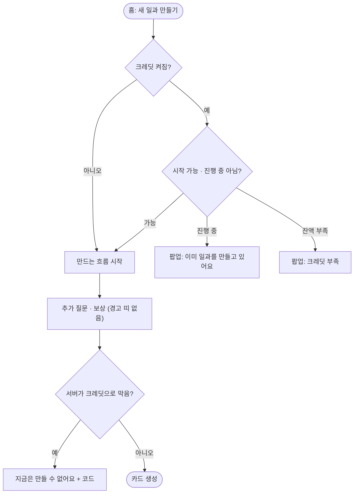

# 잔액 0에서 끝까지 만든다고 안내하고, 진행 중인 작업을 홈에서 못 막고, 초기화 시각에 시간대가 없다

## 개요
크레딧 안내가 실제 동작과 다르던 세 곳을 고쳤다. 커밋은 `4cd2e1c`(develop 푸시 완료, main에는 아직 반영되지 않음)이다. 고치는 도중에 사용자가 **"잔액을 들이미는 경고 문구는 이상하고 불편하다"**고 결정해서, ①은 문구를 고치는 대신 **경고 띠를 없애는 것**으로 바뀌었다.

## 기능 흐름

## 변경 사항

### ① 흐름 경고 띠 제거 (사용자 결정)
- `question_screen.dart`, `reward_setup_screen.dart`: `CreditLowNotice` 래퍼를 뺐다.
- `widgets/credit_low_notice.dart`: 삭제했다(사용자 승인). `CreditSummary.isLow`와 `lowThreshold`도 쓰는 곳이 없어져 지웠다.
- `ai_credit_summary_view.dart`: 설정 카드의 "적음" 줄도 뺐다(사용자 결정).
- `routine_loading_screen.dart`: 크레딧 때문에 막힌 실패(`isCreditBlockingCode`)는 제목을 `질문을 준비하지 못했어요` 대신 `지금은 만들 수 없어요`로 보여 준다. 예전 제목은 AI 실패처럼 읽혔다.

### ② 홈에서 진행 중 작업 막기
- `credit_start_gate.dart`: `summary.enabled && (!canStartRoutine || isGeneratingRoutine)`. 서버의 `canStartRoutine`에는 진행 중인지가 없어서, 진행 중인 ROUTINE_CREATE도 따로 본다.
- `guardian_home_screen.dart`: 진행 중이면 `이미 일과를 만들고 있어요` / `다 만든 뒤에 새 일과를 만들 수 있어요`를 보여 준다.

### ③ 초기화 시각 시간대
- 서버 `CreditSummaryResponse`: `OffsetDateTime nextResetAtOffset`를 더했다(예: `2026-09-28T00:00:00+09:00`). `CreditQueryService`가 주기를 잰 `Clock`의 시간대로 만든다. 꺼진 상태(`disabled()`)에서는 null이다.
- 기존 `nextResetAt`은 **옛 앱 호환을 위해 그대로 둔다.** 지우면 이미 설치된 앱의 설정 화면이 날짜를 못 읽는다.
- 앱 `credit_summary.dart`: `nextResetAtOffset`가 있으면 `.toLocal()`해서 쓰고, 없으면(옛 서버) 기존 값을 쓴다.

## 검증
| 항목 | 방법 | 결과 |
|---|---|---|
| 앱 전체 테스트 | `flutter test` | 1185 통과, `flutter analyze` 0건 |
| 서버 전체 테스트 | `./gradlew test` | 908 통과 (`CreditQueryServiceTest`에 오프셋 값과 disabled null 검증 추가) |
| ③ 시간대 | TZ를 서울과 뉴욕으로 바꿔 `credit_summary_test` | 둘 다 통과. 뉴욕에서는 9월 27일(일) 오전 11시로 적힌다 |
| ① 띠 없음 | Android 에뮬레이터, 잔액 3 | 보상 화면에 띠가 없다 (아래 왼쪽) |
| ① 제목 | 흐름 도중 관리자에서 잔액을 0으로 바꿈 | `지금은 만들 수 없어요` (아래 오른쪽) |
| ② | 위젯 테스트(`credit_gate_test`) | 통과. **실기기로는 밟지 않았다** (진행 중 상태를 만들려면 AI 생성을 한 번 더 호출해야 한다) |
| ③ 운영 | — | **서버 배포 전이라 확인하지 못했다** |

## 주의사항
- 오른쪽 캡처 아래에 `AI_CREDIT_INSUFFICIENT` 원문 코드가 보인다. 제보 추적용 코드라 남겨 두었고, 모양은 디자인 요청 #420·#422를 따른다.
- `nextResetAt`(시간대 없음)은 옛 앱이 사라질 때까지 지우지 않는다.
- #420 D(흐름 경고 띠) 시안 요청은 이번 결정으로 대상에서 빠진다. #420에 따로 댓글로 남긴다.

## 남은 일
- [ ] 배포(main 반영) 뒤 운영 `/api/credits/me`에 `nextResetAtOffset`가 오는지 확인
- [ ] 뉴욕 시간대 기기에서 설정 초기화 시각이 현지 시각으로 보이는지 실기기 확인
