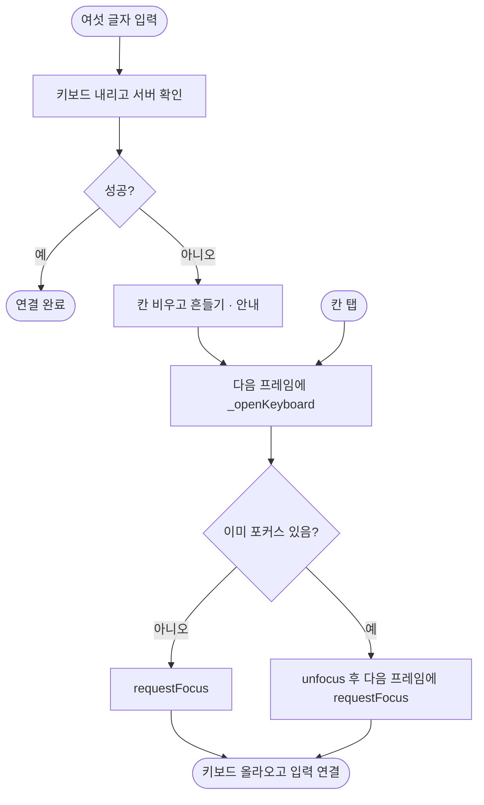

# 연결 암호를 한 번 틀리면 키보드가 다시 올라오지 않아 입력할 수 없다

## 개요
서버를 다녀와 실패하면(틀림, 인터넷 끊김) 키보드가 내려간 채 다시 올라오지 않았다. 칸을 눌러도 입력할 수 없어서 뒤로 나갔다 들어와야 했다. Android와 iOS 모두 고쳤다. 커밋은 `c883e82`(develop 푸시, main 미반영)이다.

## 기능 흐름

## 원인
보낼 때 키보드를 내렸다가 실패하면 **포커스는 돌아와 있었다.** 이미 포커스가 있으니 칸을 눌러 `requestFocus`를 불러도 아무 일이 없었다.

첫 시도로 `TextInput.show`를 불렀더니 키보드는 떴지만 **친 글자가 칸에 들어가지 않았다.** 입력 연결이 끊긴 상태였다. 그래서 포커스를 한 번 풀고 다음 프레임에 다시 잡는다. 실패 직후 자동으로 여는 것도 **다음 프레임**에서 한다. 같은 프레임에서 열면 Android가 키보드를 올리지 않았다.

## 변경 사항
- `link_enter_screen.dart`: `_openKeyboard()`를 추가하고, 칸 `onTap`과 `_fail` 뒤 postFrame에서 부른다.

## 검증
| 경우 | Android 에뮬레이터 | iOS 시뮬레이터 |
|---|---|---|
| 틀린 뒤 곧바로 타이핑 | 입력됨 | 입력됨 |
| 틀린 뒤 칸을 누르고 타이핑 | 입력됨 (`mInputShown=true`) | 입력됨 (Maestro) |
| 앱에서 걸러지는 실패(형식) | 키보드 유지 (변화 없음) | — |

위젯 테스트 `link_enter_screen_test`(#428 그룹)를 더했다. 전체 1185 통과, analyze 0건.

Android: 실패 뒤 키보드가 올라오고 `XY`가 입력된다.

iOS: `암호가 맞지 않아요` 뒤 칸을 누르면 `ABC`가 입력된다.

## 주의사항
- `_openKeyboard`의 unfocus와 postFrame은 **둘 다 필요하다.** 하나만 빼면 "키보드는 뜨는데 글자가 안 들어가는" 상태로 돌아간다. 위젯 테스트는 플랫폼 키보드를 흉내 내지 못하니, 이 부분을 고치면 실기기로 다시 밟아야 한다.

## 남은 일
- [ ] 배포(main 반영)
