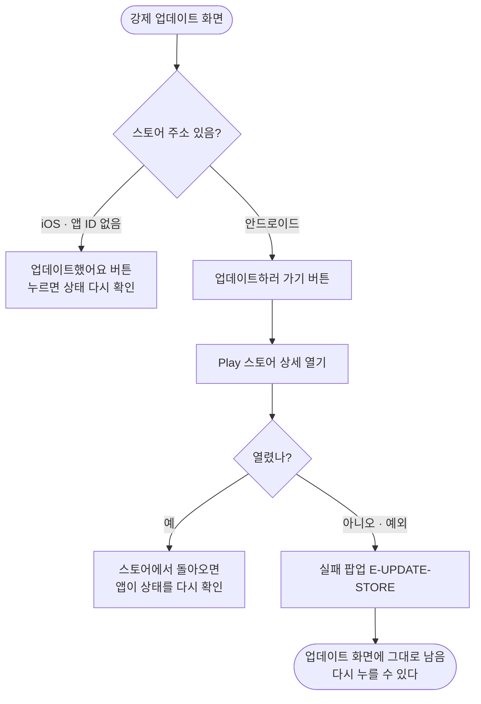

# ⚙️[기능추가][서버][운영] 점검 모드와 강제 업데이트를 관리자에서 켠다 — 스토어 버튼

## 개요

이전에는 강제 업데이트 화면에 "스토어에서 이룸을 업데이트해주세요"라는 문구만 있어 사용자가 스토어를 직접 찾아가야 했다. 이번에 **`업데이트하러 가기`** 버튼을 넣어 스토어의 이룸 상세 화면으로 바로 보내도록 했다. 안드로이드에만 적용했다. iOS는 App Store 앱 ID가 아직 없어서 버튼을 숨기고 예전 동작을 그대로 둔다. v1.43.0(PR #413)으로 배포했다.

## 기능 흐름

## 변경 사항

### 설정
- `client/lib/core/config/app_config.dart`: `androidPackageId`(`kr.twinfang.elum`), `iosAppStoreId`(빈 값), `storeUrl(platform)`를 추가했다. 보낼 곳을 모르면 `null`을 돌려준다.

### 스토어 열기
- `client/lib/core/app_status/store_launcher.dart` (새 파일): `launchUrl`(외부 앱)로 스토어를 연다. 실패하면 로그를 남기고 `false`를 돌려준다. `storeLauncherProvider`로 분리해 테스트에서 가짜로 바꿔 끼울 수 있다.

### 화면
- `client/lib/core/app_status/app_status_gate.dart`: 강제 업데이트 화면의 버튼 문구와 동작을 플랫폼에 따라 나눈다. 실패하면 공용 `showFailure`로 알린다. 팝업을 띄울 수 있도록 `_FullNotice`가 안쪽 context를 넘기게 바꿨다.

### 테스트
- `client/test/app_status_store_button_test.dart` (새 파일): 6개. 플랫폼별 주소, 버튼을 누르면 맞는 주소로 여는지, 실패할 때와 예외가 날 때 에러 코드가 나오는지, iOS에서 버튼을 숨기는지를 확인한다.

## 주요 구현 내용

- **버튼은 하나만 둔다.** 스토어에서 돌아와 앱이 다시 앞에 뜨면 기존 로직(`didChangeAppLifecycleState`)이 상태를 다시 확인한다. 그래서 `업데이트했어요` 버튼은 따로 두지 않았다.
- **iOS에서 검색 주소로 보내지 않는다.** 같은 이름의 다른 앱으로 보낼 위험이 있기 때문이다. ID를 모르면 버튼을 숨긴다.
- **스토어 ID는 `.env`에 두지 않는다.** 환경마다 달라지는 값이 아니라 앱 자체의 식별자다. Secret을 빠뜨려 빈 값으로 배포돼도 아무 증상이 없는 길을 만들 이유가 없다.
- 이 화면은 Figma 시안이 없다. 점검 화면과 같이 쓰는 기존 버튼 모양을 유지했다.

## 검증

| 항목 | 결과 |
|---|---|
| `flutter analyze` | 0건 |
| `flutter test` | **1168개 통과** |
| 새 테스트 6개 | 구현 전에 먼저 작성해 실패하는 것을 확인 |
| 안드로이드 주소 출처 | `client/android/app/build.gradle.kts`의 `applicationId` |
| iOS 앱 ID | 레포·이슈 어디에도 없다. App Store 공개 검색(`itunes.apple.com/lookup?bundleId=kr.twinfang.elum`) 결과도 **0건**이다 (아직 공개 전) |
| 실기기에서 강제 업데이트 화면 | **확인하지 못했다.** 운영의 최소 버전을 올려야 볼 수 있는 화면이라, 사용 중인 모든 사용자가 막힐 위험이 있어 하지 않았다 |

## 남은 일 (이슈를 열어 둔다)

- [ ] App Store에 공개되면 App Store Connect의 `앱 정보 > Apple ID` 숫자를 `AppConfig.iosAppStoreId`에 넣는다. 그러면 iOS 버튼이 켜진다. 이때 `app_status_store_button_test.dart`에서 "ID가 비어 있다"를 확인하는 테스트도 함께 바꾼다.
- [ ] 권장 업데이트 화면(닫을 수 있는 안내)은 시안이 없어 이번 범위에 넣지 않았다.

## 주의사항

- 최소 버전(`MIN_APP_VERSION_*`)을 올릴 때는 **심사 중인 빌드가 막히지 않는지** 반드시 확인한다. 막히면 리뷰어가 업데이트 화면만 보게 된다.
