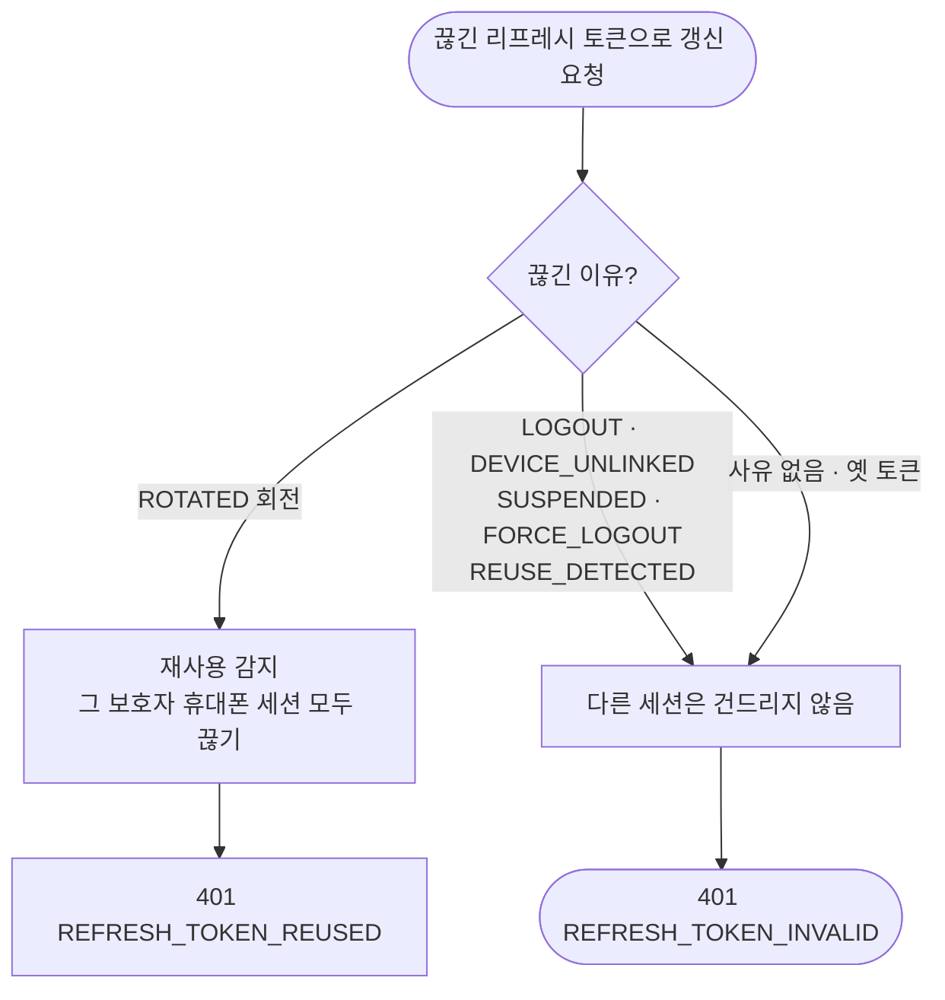

# ⚙️[기능추가][서버][계정] 이룸이 한 명에 보호자 여럿 — D1 로그아웃 후 재사용 감지 오탐

## 개요

E2E에서 D1 결함을 찾았다. 한 휴대폰에서 로그아웃한 뒤 **그 휴대폰에서 늦게 도착한 리프레시 요청 하나가 다른 휴대폰까지 로그아웃시켰다.** 이미 끊긴 토큰이 다시 오면 서버가 이유를 가리지 않고 재사용(탈취)으로 판단해, 그 보호자의 휴대폰 세션을 전부 끊었기 때문이다. 이제 리프레시 토큰에 **끊긴 이유**를 남기고, 전체 세션을 끊는 재사용 감지는 **회전 때문에 끊긴 토큰에만** 적용한다. v1.43.0(PR #413)으로 배포했고, 운영에서 시나리오를 그대로 재현해 확인했다.

## 기능 흐름

## 변경 사항

### DB
- `server/src/main/resources/db/migration/V27__add_refresh_token_revoke_reason.sql`: `refresh_token`에 끊긴 이유 컬럼을 **추가만** 한다(NULL 허용). 옛 서버 이미지로 되돌려도 동작한다 — `MigrationRollbackContractTest`에 등록했다.

### 도메인
- `auth/infrastructure/entity/RevokeReason.java` (새 파일): `ROTATED`·`LOGOUT`·`REUSE_DETECTED`·`DEVICE_UNLINKED`·`SUSPENDED`·`FORCE_LOGOUT`
- `auth/infrastructure/entity/RefreshToken.java`: 사유를 저장한다. **이미 끊긴 토큰의 처음 사유는 덮어쓰지 않는다.**
- `auth/infrastructure/repository/RefreshTokenRepository.java`: 일괄로 끊는 쿼리에 사유를 넘긴다.

### 판정·호출부
- `auth/application/service/RefreshTokenService.java`: 재사용 판정을 `ROTATED` 사유일 때로 좁혔다.
- 토큰을 끊는 곳 아홉 군데에 사유를 넣었다: `AuthService`(로그아웃), `RefreshTokenRevoker`, `AdminMemberService`(정지·강제 로그아웃), `DeviceLinkService`(연결 해제), `GuardianshipService`(나가기).

## 주요 구현 내용

- **사유가 없는 옛 토큰은 세션을 지키는 쪽으로 처리한다.** 배포 전에 끊긴 토큰은 회전 때문인지 로그아웃 때문인지 알 수 없다. 오탐으로 모든 휴대폰을 로그아웃시키는 것보다, 그 요청만 401로 거절하는 편이 피해가 작다.
- **처음 사유를 덮지 않는다.** 회전된 토큰이 나중에 "전체 끊기"에 다시 포함돼도 사유는 `ROTATED`로 남는다. 그래서 탈취된 회전 체인의 앞쪽 복사본은 계속 탈취 신호로 잡힌다.

## 검증

| 항목 | 결과 |
|---|---|
| `./gradlew test` | **902개 통과** |
| 되돌림 확인 | 판정을 옛 조건(끊긴 토큰이면 전부 재사용)으로 되돌리면 **새 테스트 8건이 실패**하는 것을 확인 |
| 서버 배포 | `elum-server-cicd` 성공 (v1.43.0) |

**운영 실측** (`api.elum.chuseok22.com`, QA 계정, `X-Device-Id`를 달리해 휴대폰 두 대처럼 요청)

| # | 동작 | 기대 | 결과 |
|---|---|---|---|
| 1 | 휴대폰 A 로그인 | 200 | 200 |
| 2 | 휴대폰 B 로그인 | 200 | 200 |
| 3 | A 로그아웃 | 204 | 204 |
| 4 | **A의 옛 토큰으로 갱신 (D1 재현)** | 401, 다른 세션 유지 | **401 `REFRESH_TOKEN_INVALID`** |
| 5 | **B 갱신** | **200 (수정 전에는 여기서 끊겼다)** | **200** |
| 6 | B의 회전된 옛 토큰 재사용 | 401 재사용 감지 | 401 `REFRESH_TOKEN_REUSED` |
| 7 | B 최신 토큰으로 갱신 | 401 (6에서 전체가 끊겼어야 함) | 401 `REFRESH_TOKEN_INVALID` |

4·5가 D1 수정을, 6·7이 탈취 감지가 약해지지 않았음을 보여 준다.

## 주의사항

- **새로 토큰을 끊는 코드를 추가할 때는 반드시 사유를 넣는다.** 사유 없이 끊으면 옛 토큰처럼 처리되어, 회전 토큰이었더라도 재사용 감지가 걸리지 않는다.
- `ROTATED` 외의 사유를 재사용 감지에 넣으면 D1이 되살아난다. `RefreshTokenServiceTest`의 새 테스트 8건이 이를 막는다.
