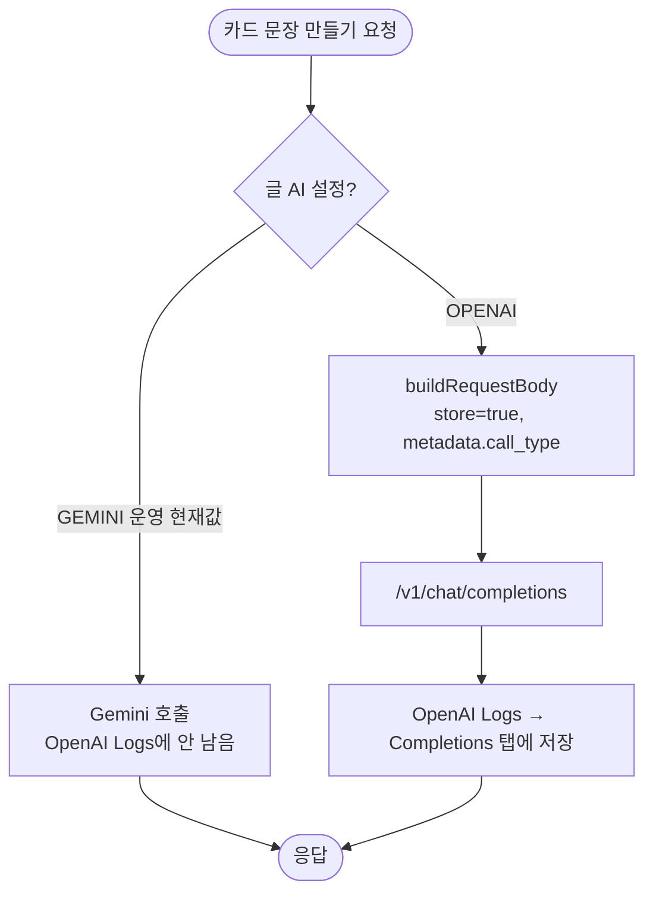

# OpenAI 글 생성 호출을 대시보드 Logs에 남긴다

## 개요

OpenAI 대시보드(platform.openai.com/logs)에 서버 호출 기록이 하나도 보이지 않았다. 원인은 두 가지였다.

1. 서버는 **Chat Completions**(`/v1/chat/completions`)로 부르는데, 이 API는 요청에 `store: true`를 보낸 호출만 저장한다. 문서 예제가 쓰는 Responses API는 기본으로 저장되지만 **Responses 탭**에만 뜬다. 우리 호출이 나올 자리는 **Completions 탭**이다.
2. **운영의 글 AI는 `GEMINI`**(`TEXT_PROVIDER_SELECTED=GEMINI`)라 카드 문장은 처음부터 OpenAI를 거치지 않았다. OpenAI로 가는 건 그림 생성(`IMAGE_PROVIDER_SELECTED=OPENAI`)뿐이다.

글 AI는 Gemini로 유지하기로 했다(사용자 결정). 그래서 이번 변경은 **글 AI를 OpenAI로 바꾸거나 관리자 화면에서 OpenAI로 시험할 때** 기록이 남도록 해 두는 안전장치다. 배포해도 지금 운영 화면에서 달라지는 건 없다.

## 기능 흐름

## 변경 사항

### 서버
- `server/src/main/java/com/chuseok22/elumserver/ai/infrastructure/client/OpenAiTextClient.java`: `call()` 안에서 조립하던 요청 본문을 `buildRequestBody(...)`로 떼어냈다. 여기에 `store: true`와 `metadata: {call_type: OPENAI_TEXT_CREATE | OPENAI_TEXT_QUESTION}`를 더했다. 기존 필드(model, messages, response_format)는 그대로 두었고, temperature를 보내지 않는 것도 유지했다.

### 테스트
- `server/src/test/java/.../OpenAiTextClientRequestBodyTest.java`(신규, 3개):
  - `store=true`를 보낸다
  - 호출 종류별 `metadata.call_type`
  - 기존 필드는 그대로이고 temperature는 보내지 않는다

## 주요 구현 내용

- **본문 조립을 떼어낸 이유**: `store`가 빠져도 호출은 정상으로 성공한다. 로그만 조용히 사라지기 때문에 테스트 말고는 알아챌 방법이 없다. 순수 함수로 떼어 네트워크 없이 본문을 검증할 수 있게 했다.
- **`metadata.call_type`**: Logs 화면에서 일과 만들기와 추가 질문을 나눠 보기 위해 넣었다. 값은 서버 AI 호출 기록(`AiCallType`)과 같은 이름을 써서 두 기록을 맞대 볼 수 있다.
- **비용**: 저장 자체에는 추가 요금이 없다. 토큰 과금은 그대로다.
- **개인정보**: `store`를 켜면 보호자 원문이 OpenAI 쪽에 대시보드용으로 보관된다. 이 조직은 무료 토큰 때문에 이미 데이터 공유에 동의한 상태이고, 처리방침 9항 "보유 기간은 전달받는 업체의 정책에 따름"에 포괄된다. 사용자 승인을 받았다.

## 검증

| 항목 | 결과 |
|---|---|
| 새 테스트 3개 | 구현 전에는 컴파일 실패(메서드 없음), 구현 후 통과 |
| 서버 전체 `./gradlew test` | **890개 통과**, 실패·에러 0 |
| 실제 저장 여부 | 운영 DB의 OpenAI 키(AES-GCM 암호문)를 마스터 키로 복호화해 `gpt-4.1-mini`에 `store: true` + `metadata.call_type=MANUAL_TEST_411`로 1회 호출(28토큰) → `GET /v1/chat/completions/chatcmpl-ERffqktPnClok8eayKe9dmUUrTbfH`로 **저장과 metadata를 확인함** |
| 운영 설정 확인 | `TEXT_PROVIDER_SELECTED=GEMINI`, `IMAGE_PROVIDER_SELECTED=OPENAI`, `OPENAI_TEXT_MODEL=gpt-4.1-mini` |

서버 경로(관리자 시험 → OpenAI)는 글 AI가 Gemini라 실측하지 않았다. 대신 같은 본문 형태로 직접 호출해 저장되는 것을 확인했다.

## 주의사항

- **Responses 탭에는 앞으로도 뜨지 않는다.** 우리 서버 호출은 Completions 탭에서 본다.
- **그림 생성**(`/v1/images/generations`)은 범위 밖이다. 이 API가 Logs 화면에 남는지는 확인하지 않았다.
- `buildRequestBody`에서 `store`를 지우면 테스트가 잡는다. 로그 보관을 끄려면 테스트도 함께 고쳐야 한다(의도된 결정이어야 한다는 뜻이다).
- 배포 PR: #412
