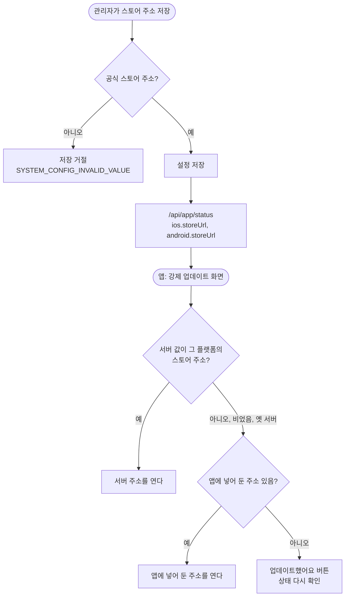

# ⚙️[기능추가][서버][운영] 강제 업데이트 스토어 주소를 관리자에서 바꾼다

## 개요

강제 업데이트 화면의 `업데이트하러 가기` 버튼이 여는 스토어 주소를 **관리자 설정에서 바꿀 수 있게** 했다. 이 화면은 **옛 버전 앱에서 뜨는 화면**이다. 그래서 앱에 박아 둔 주소는 앱을 다시 내지 않으면 고칠 수 없었다. 실제로 App Store에 있는 1.24.1은 iOS 앱 ID가 비어 있어서, 나중에 막히면 스토어 버튼 대신 `업데이트했어요`만 뜬다. 이제 서버가 주소를 내려주고, 앱은 **서버 값 → 앱에 넣어 둔 값** 순서로 쓴다. v1.44.0(PR #417)으로 배포했다.

## 기능 흐름

## 변경 사항

### 서버: 설정 키와 검증
- `server/.../systemconfig/core/ConfigKey.java`: 앱 제어 그룹에 `IOS_STORE_URL`, `ANDROID_STORE_URL`을 추가했다. 기본값은 빈 값이고, 비어 있으면 앱에 넣어 둔 주소를 쓴다. 기존 설정처럼 서버가 뜰 때 자동으로 등록되고 관리자 화면에 자동으로 나온다.
- `server/.../systemconfig/core/StoreUrlPolicy.java` (새 파일): 플랫폼별로 허용하는 주소 규칙이다.
  - iOS: `https` 또는 `itms-apps`이면서 호스트가 `apps.apple.com`
  - Android: `https`이면서 `play.google.com`, 또는 `market://details`
- `server/.../systemconfig/application/service/SystemConfigService.java`: 저장할 때 위 규칙을 통과하지 못하면 `SYSTEM_CONFIG_INVALID_VALUE`로 거절한다.

### 서버: 응답
- `AppStatusResponse.java`: `VersionRequirement`에 `storeUrl`을 추가했다.
- `AppStatusController.java`: 플랫폼별 설정값을 응답에 싣는다.
- `AppStatusControllerDocs.java`: API 문서에 `storeUrl`과 앱이 이 값을 쓰는 방식을 적었다.

### 앱
- `client/lib/core/app_status/app_status.dart`: 응답의 플랫폼 칸에서 `storeUrl`을 읽는다. 문자열이 아니거나 없으면 빈 값으로 둔다.
- `client/lib/core/config/app_config.dart`: `storeUrl(platform, serverUrl:)`에서 서버 값이 그 플랫폼의 공식 스토어 주소면 그 값을, 아니면 앱에 넣어 둔 주소를 돌려준다. 거르는 규칙은 서버와 같다.
- `client/lib/core/app_status/app_status_gate.dart`: 강제 업데이트 화면이 서버 값을 넘겨 주소를 받는다.

### 테스트
- `SystemConfigServiceTest`: 4개를 추가했다. 플랫폼별 허용 주소를 받는지, 흉내 낸 호스트·`http`·스킴 없음·`javascript:`·다른 플랫폼 주소를 거절하는지, 기본값이 비어 있는지를 본다.
- `AppStatusControllerTest` (새 파일): 2개. 플랫폼별 `storeUrl`이 실리는지, 설정이 비면 빈 값이 가는지를 본다.
- `app_status_store_button_test.dart`: 5개를 추가했다. 서버 값 우선, 빈 값과 옛 서버일 때 앱 기본값으로 돌아가기, 잘못된 값 무시, 응답 파싱, 버튼이 서버 주소를 여는지를 본다.

## 주요 구현 내용

- **서버와 앱이 같은 규칙으로 두 번 거른다.** 저장할 때 서버가 막지만, 앱도 받은 값을 다시 본다. 설정 검증을 거치지 않고 DB에 값이 들어가는 경우처럼 서버 쪽이 뚫려도, 막힌 사용자를 엉뚱한 사이트로 보내지 않는다.
- **호스트는 정확히 비교한다.** `endsWith`로 보면 `apps.apple.com.evil.com`이 통과한다.
- **비우는 방법은 기본값으로 되돌리기다.** 이 레포의 설정 저장은 빈 값을 거절한다(비밀값 제외). 서버 주소를 지우려면 관리자 화면에서 기본값으로 되돌리면 된다. 그러면 빈 값이 되어 앱에 넣어 둔 주소를 쓴다.
- **스토어 주소는 `.env`나 Secret에 두지 않는다.** 앱에 넣어 둔 값(#279의 `iosAppStoreId`, `androidPackageId`)은 서버를 못 볼 때 쓰는 안전망으로 그대로 둔다.

## 검증

| 항목 | 결과 |
|---|---|
| 서버 `./gradlew test` | **908개 통과** |
| 앱 `flutter test` | **1173개 통과** (5개 추가) |
| `flutter analyze` | 0건 |
| 테스트 먼저 작성 | 서버 테스트와 앱 테스트를 구현 전에 작성해 컴파일 실패를 확인했다 |
| 테스트가 실제로 잡는가 | 서버 저장 검증을 일부러 빼고 돌리면 `19 tests completed, 1 failed`가 났다. 원래대로 되돌리고 다시 통과를 확인했다 |
| 운영 실측 | 배포 후 `GET https://api.elum.chuseok22.com/api/app/status` 응답에 `ios.storeUrl`, `android.storeUrl`이 빈 값으로 실리는 것을 확인했다 |
| 관리자 화면 | **눈으로 확인하지 못했다.** 설정 목록은 enum에서 자동으로 만들어지는 구조라 나올 것으로 보지만, 로그인해서 화면을 보지는 않았다 |
| 실제 기기에서 서버 주소로 스토어 열기 | **확인하지 못했다.** 위젯 테스트에서 버튼이 서버 주소를 넘기는 것까지만 확인했다 |

## 주의사항

- **앱 쪽은 이 코드가 들어간 버전부터 동작한다.** 1.24.1처럼 이미 깔린 앱은 `storeUrl`을 읽지 않는다. 그 사용자에게는 서버에서 주소를 넣어도 달라지는 것이 없다.
- **안드로이드는 Play에 공개되기 전에 최소 버전을 올리지 않는다.** 지금 앱에 넣어 둔 Play 주소는 공개 전이라 열어도 이룸 화면이 나오지 않는다.
- 허용 주소 규칙을 바꿀 때는 **서버 `StoreUrlPolicy`와 앱 `AppConfig._allowedStoreUrl` 두 곳을 함께** 고친다. 한쪽만 바꾸면 서버가 받은 주소를 앱이 버리거나 그 반대가 된다.
- 최소 버전(`MIN_APP_VERSION_*`)을 올릴 때는 심사 중인 빌드가 막히지 않는지 먼저 확인한다 (#279 주의사항 그대로).
