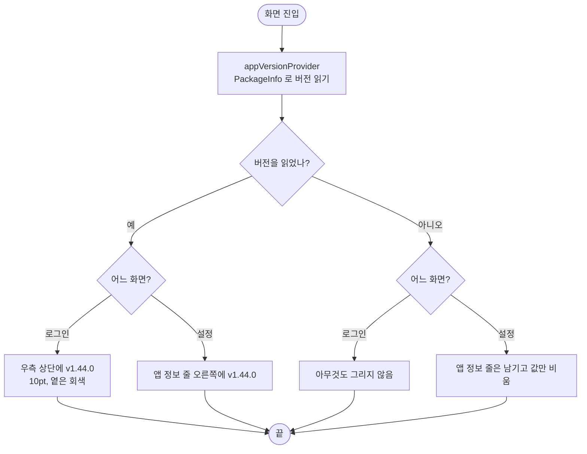

# ⚙️[기능추가][클라][설정] 앱 버전을 설정 앱 정보 줄과 로그인 화면에 표시

## 개요

앱 버전을 두 곳에서 볼 수 있게 했다.
- **설정 화면**: 맨 아래 가운데에 떨어져 있던 `버전 1.44.0` 글자를 없애고, 목록 안에 `앱 정보` 줄을 넣어 오른쪽에 `v1.44.0`을 보여준다.
- **로그인 화면**: 우측 상단 구석에 거의 안 보일 만큼 작고 옅게 `v1.44.0`을 둔다. 로그인하지 못한 사용자는 설정에 갈 수 없어서, 제보할 때 빌드를 확인할 곳이 여기뿐이다.

시안이 없는 **개발 쪽 임시안**이다. 디자인 시안은 #419로 디자이너에게 요청했다 (대안 4안 + 3안 비교 보드 첨부).

왼쪽부터 로그인(iOS), 로그인(Android), 설정. 로그인 화면 버전은 우측 상단에 있다.

## 기능 흐름

버전 읽기는 네트워크를 타지 않는다. 설정 화면(#289)에서 쓰던 `appVersionProvider`를 그대로 재사용했다.

## 변경 사항

### 설정 화면
- `client/lib/features/guardian/presentation/guardian_settings_screen.dart`
  - `_VersionLine`(맨 아래 가운데 글자)을 없애고 `_AppInfoTile`을 추가했다. 자리는 `약관 및 개인정보처리방침`과 `로그아웃` 사이다.
  - 버전 줄을 맨 아래에 붙이려고 쓰던 `LayoutBuilder` + `IntrinsicHeight` + `Spacer`를 걷어내고 `SingleChildScrollView` 하나로 줄였다.
- `client/lib/core/widgets/settings_tile.dart`
  - `valueText` 옵션을 추가했다. 값이 있으면 화살표 대신 그 글자를 옅은 색으로 그린다.
  - 값만 보여주고 누를 수 없는 줄(`valueText` 있음 + `onTap` 없음)은 `AppPressable`로 감싸지 않고 `MergeSemantics`로 묶는다. 읽기 프로그램이 "앱 정보, v1.44.0"을 한 덩어리로 읽는다.

### 로그인 화면
- `client/lib/features/auth/presentation/login_screen.dart`
  - `_VersionCorner`를 추가했다. `LoginScene`의 `overlay`를 `Stack`으로 바꿔 버튼 묶음과 **따로** 얹는다. 버튼 배치는 바뀌지 않는다.
  - 위치는 `MediaQuery.paddingOf(context).top + 4`, 오른쪽 16이다. 노치·다이내믹 아일랜드 아래이고, 제공자 버튼의 좌우 여백과 맞췄다.
- `client/lib/core/theme/app_typography.dart`
  - `appVersionTag` 토큰(10/w400 Pretendard)을 추가했다. caption(12)보다 작은 글자는 이것뿐이다.

### 테스트
- `client/test/login_screen_test.dart`: 우측 상단에 버전이 보이는지(오른쪽 끝 40 안, 위 100 안), 버전을 못 읽으면 아무것도 안 그리고 버튼은 그대로인지
- `client/test/guardian_settings_test.dart`: 앱 정보 줄에 버전이 있고 화살표가 없는지, 옛 맨 아래 글자가 사라졌는지, 버전을 못 읽어도 줄은 남는지. "문의하기 뺐다" 테스트의 줄 순서에 `앱 정보`를 넣었다
- `client/test/settings_conformance_test.dart`, `client/test/figma/settings_1022-4467.png`: 줄이 하나 늘어 설정 대조 렌더를 다시 찍고, 알려진 차이 주석을 달았다

## 주요 구현 내용

**로그인 화면 자리를 우측 상단으로 고른 이유**
- iOS·Android 두 배치 모두 문구(`오늘의 하루,`)가 y=104 아래에서 시작해 상단이 비어 있다.
- 아래쪽은 병아리 그림·버튼·`최근 로그인` 알약이 차 있어 작은 글자가 묻힌다. 버튼 아래 85 여백은 초록 그라데이션 위라 대비도 약하다 (#419 D안 확대 조각에서 확인했다).
- 버튼 묶음 여백을 건드리면 누르는 자리가 흔들린다 (#346에서 피했던 문제).

**설정에서 버전을 "목록의 한 줄"로 옮긴 이유**
- 목록 밖 맨 아래 글자는 "앱 정보"로 찾기 어렵다. 사용자 요청이었다.
- 들어갈 화면이 없는 줄이라 화살표와 눌림 반응을 뺐다. 화살표가 있으면 누를 곳처럼 읽히고, 눌러도 아무 일이 없는데 줄어드는 반응이 오면 고장 난 것처럼 보인다.

**버전을 못 읽을 때**
- 로그인은 아무것도 그리지 않는다. 사용자가 할 수 있는 일이 없다.
- 설정은 줄을 남기고 값만 비운다. 줄이 사라지면 아래 줄이 올라와 자리가 흔들린다.

## 검증

- `flutter test` 1177개 통과, `flutter analyze` 0건
- 새 테스트 4개 추가
- 처음 전체 실행에서 두 곳이 깨져 고쳤다
  - `design_token_test`의 "화면에서 fontSize를 직접 지정하지 않는다": `copyWith(fontSize: 10)`을 `appVersionTag` 토큰으로 바꿨다
  - 설정 대조 골든: 줄이 늘어난 것이 의도라 다시 찍었다

## 주의사항

- **게시된 지원 페이지의 안내를 고쳐야 한다.** 문의할 때 적어 달라는 항목으로 "앱 버전: 설정 화면 맨 아래"라고 안내하고 있다 (#289). 이제 `설정 > 앱 정보`다. 페이지를 어디서 관리하는지 확인하지 못해 이번에 고치지 않았다.
- **시안이 나오면 교체한다 (#419).** 그때 함께 바꿀 곳이 있다.
  - `settings_conformance_test.dart`의 알려진 차이 주석과 골든
  - `guardian_settings_test.dart`의 줄 순서
  - `appVersionTag` 토큰 값
- `앱 정보` 줄은 시안 `1022:4467`에 없는 줄이다. 시안 대조에서 "시안에 없다"고 나와도 지우지 않는다.
- 로그인 버전 글자는 `textPlaceholder`에 투명도 0.6을 얹었다. 배경 그림에 따라 거의 안 보이는 것이 의도다. 잘 보이게 바꾸고 싶으면 투명도를 조정하지 말고 시안을 기다린다.
- `dart format`을 파일 전체에 돌리면 이 레포는 건드리지 않은 줄까지 바뀐다 (레포 전체가 포맷된 상태가 아니다). 이번 커밋은 바꾼 부분만 남기도록 다시 적용했다.
