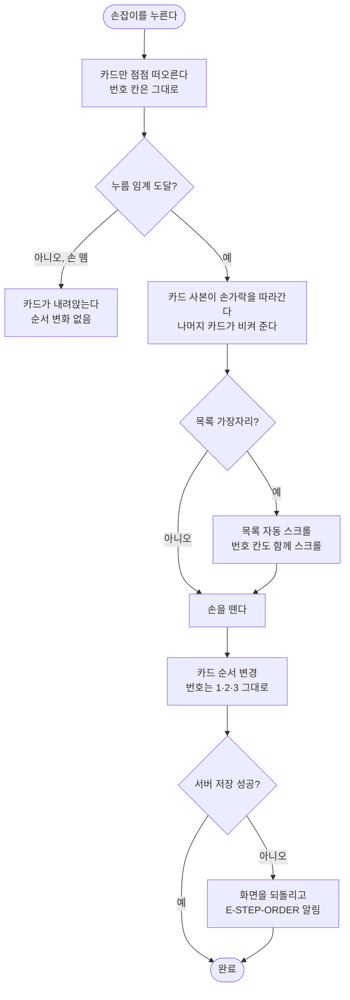

# 일과 시트 순서 변경 시 번호는 고정하고 카드만 움직이며, 하단 버튼을 떠 있게 한다

## 개요

일과 시트(시안 `956:4084` 오늘 일과, `980:4777` 지난 일과)에서 두 가지를 시안에 맞췄다.

1. 순서를 바꿀 때 **왼쪽 번호(1·2·3·4)는 제자리에 두고, 오른쪽 카드만** 떠서 자리를 바꾼다. 전에는 번호와 카드가 한 줄로 묶여 있어서, 오래 누르면 번호까지 들리고 끄는 동안 번호가 카드를 따라 미끄러졌다.
2. `편집하기`·`일과 다시하기` 버튼을 **시트 바닥 위에 떠 있게** 했다. 단계가 많으면 목록이 버튼 뒤로 스크롤된다. 버튼 위 흐림(그라데이션)은 시안에 없어 넣지 않았다(사용자 결정: "디자인대로만 가자").

보상이 없을 때 표시(`980:5174`)는 이미 시안과 같은 것을 확인했고, 이번 변경 뒤에도 렌더가 바뀌지 않았다.

커밋: `ff5652f` (develop, push 전)

## 기능 흐름

## 변경 사항

### 시트 구조

- `client/lib/features/guardian/presentation/widgets/routine_detail_sheet.dart`
  - `ReorderableListView` 한 개(번호+카드 한 줄) → `CustomScrollView` 안에 `SliverCrossAxisGroup`으로 **번호 칸(폭 44)과 카드 칸을 나란히** 두었다. 순서 바꾸기(`SliverReorderableList`)는 카드 칸에만 걸린다.
  - `_StepRow`를 `_StepBadge`(움직이지 않는 번호)와 `_StepCard`(들어올림·손잡이·완료 표시)로 나눴다. 끄는 동안 번호를 숨기던 `Opacity` 처리는 없앴다. 번호가 제자리에 있으니 숨길 이유가 없다.
  - `_StepItemKey`(전역 키)를 추가해 카드를 감쌌다.
  - 보상 줄은 순서 바꾸기 대상이 아니라서 스크롤 맨 아래 별도 칸에 두었다. 보이는 모습은 같다.
  - 버튼은 `Stack` + `Positioned`(아래 56, 높이 66)로 띄웠다. 스크롤 아래 여백을 `56 + 66 + 여백`으로 잡아, 끝까지 내리면 보상 줄이 버튼에 가리지 않는다.

### 테스트

- `client/test/routine_detail_sheet_test.dart`
  - **끄는 동안 번호는 제자리에 그대로 있고 카드만 떠오른다 (#434):** 누르고 있을 때 번호 뱃지에 그림자가 없는지, 끄는 도중 1·2·3이 모두 보이고 좌표가 그대로인지 확인한다.
  - **편집하기 버튼은 목록 위에 떠 있다 (#434):** 목록 영역이 버튼 아래까지 이어지는지 확인한다.
  - 기존 끌기 테스트에 "맨 위 카드가 실제로 자리를 옮겼다"는 단언을 추가했다. 칸을 나눈 뒤에도 순서 바꾸기가 진짜로 동작하는지 지킨다.
- `client/test/figma/past_sheet_980-4777.png`: 목록이 버튼 뒤로 이어지는 부분만 바뀌어 다시 찍었다.

### 문서

- `docs/superpowers/specs/2026-09-27-routine-sheet-fixed-badges-design.md`: 설계와 결정 사항

## 주요 구현 내용

**번호 칸과 카드 칸을 한 스크롤 안에 둔 이유.** 두 칸을 각각의 목록으로 따로 두면 같이 스크롤되지 않는다. 카드 칸 목록을 스크롤이 없는 목록으로 만들어 바깥 스크롤에 넣는 방법도 있지만, 그러면 끌면서 가장자리에 닿았을 때의 **자동 스크롤이 동작하지 않는다**(순서 바꾸기는 자기 목록만 스크롤하려 한다). `SliverCrossAxisGroup`은 두 칸을 한 스크롤 안에 옆으로 나란히 놓아 이 문제가 없다. 단계는 최대 10개라 6개 이상이면 스크롤이 생긴다.

**높이가 맞아야 번호와 카드가 어긋나지 않는다.** 두 칸은 같이 스크롤될 뿐 서로의 높이를 모른다. 뱃지와 카드 모두 `68 + 아래 8`로 같은 높이를 쓰기 때문에 줄이 맞는다.

## 검증

| 항목 | 결과 |
|---|---|
| 앱 테스트 | **1186 통과** |
| `flutter analyze` | 0건 |
| 새 테스트가 실제로 잡는가 | 구현 전 코드에서 둘 다 실패함: 번호 뱃지 그림자 `Expected: false, Actual: true` / 목록 아래 끝 `330.08 < 버튼 아래 끝 392.56` |
| 시안 대조 `956:4084` | 렌더 변화 없음 (한 픽셀도 다르지 않음) |
| 시안 대조 `980:5174` (보상 없음) | 렌더 변화 없음 |
| 시안 대조 `980:4777` (지난 일과) | 목록이 버튼 뒤로 이어지는 아래쪽만 바뀜 (아래 그림) |
| 에뮬레이터 (Android, arm64) | 가짜 데이터로 시트만 띄워 끌기·스크롤·자동 스크롤 확인 (아래 그림) |

**4단계: 누름 → 끄는 중 → 놓은 뒤.** 번호 1·2·3·4는 끝까지 제자리이고 카드만 움직인다. 서버로 보낸 순서는 `c2,c3,c1,c4`.

**8단계: 처음 → 스크롤 → 끝.** 6·7번이 버튼 뒤로 지나가고, 끝까지 내리면 보상 줄이 버튼 위에 온전히 보인다.

**8단계: 끌며 자동 스크롤.** 5번 카드를 맨 위로 끌자 목록이 따라 올라갔고, 번호 칸은 1·2·3… 그대로다. 서버로 보낸 순서는 `c5,c1,c2,c3,c4,c6,c7,c8`.

**지난 일과 시트: 전 / 후 / 시안(긴 목록 전체를 그린 프레임).**

### 확인하지 못한 것

- **실제 로그인 계정과 운영 데이터로는 밟지 않았다.** 에뮬레이터 앱이 로그아웃 상태였고, 일과를 새로 만들면 AI 비용이 들어서 서버 없이 시트만 띄우는 임시 진입점(커밋 안 함)으로 확인했다. 시트는 받은 일과를 그릴 뿐이라 결과는 같을 것으로 보지만, 홈에서 시트를 여는 경로 자체는 밟지 않았다.
- **iOS는 확인하지 않았다.**

## 주의사항

- **`SliverReorderableList`로 바꿀 때는 전역 키로 감싸야 한다.** `ReorderableListView`는 안에서 해 주지만 `SliverReorderableList`는 해 주지 않는다. 없으면 끌기가 시작될 때 카드 상태가 버려지고, 손을 떼는 순간 이미 사라진 들어올림 애니메이션을 되돌리려다 `AnimationController.reverse() called after dispose()` 오류가 난다. 이번에 기존 끌기 테스트 3개가 이 오류로 실패해서 `_StepItemKey`로 감쌌다.
- **뱃지와 카드의 높이를 따로 바꾸지 않는다.** 두 칸은 높이를 서로 모른다. 한쪽만 바꾸면 아래로 갈수록 번호와 카드가 어긋난다.
- **끄는 카드는 시트 위 전체 화면 레이어에 그려진다.** 맨 위로 끌면 카드가 시트 제목 위를 지나간다. 전부터 그랬던 동작이고(#274), 이번에 바꾸지 않았다.
- **떠 있는 버튼 위에 흐림을 넣지 않았다.** 시안에 없어서다. 목록 글자가 버튼 바로 위에서 잘려 보이는 것이 거슬리면 디자이너와 정할 일이다.
