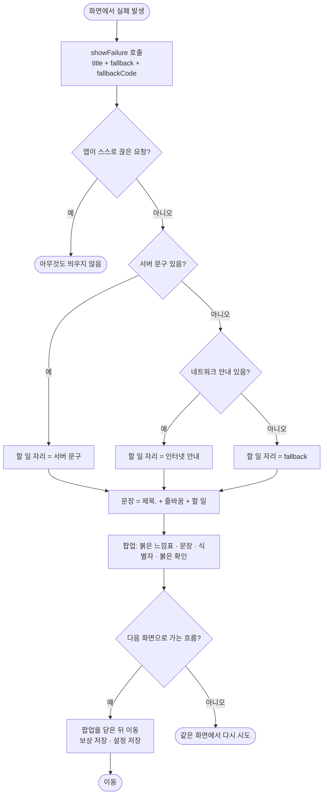

# 노란 경고 팝업과 실패 스낵바를 시안 팝업으로 통일

## 개요

시안 최상위(`238:1846`)의 `팝업` 컴포넌트 세트(`931:4878`)에는 변형이 info, 로그인실패, 삭제, 로그아웃/회원탈퇴, 방침 다섯 개뿐이고 **노란 경고 변형이 없다.** 그런데 앱은 실패를 노란 경고 팝업과 화면 아래 스낵바로 따로 보여주고 있었다. 이번 작업으로 모든 실패를 시안 `로그인실패`(1045:5079) 팝업 하나로 통일했다. 모양은 붉은 느낌표, 두 줄 문장 하나, 붉은 `확인`이다. 노란 경고 아이콘·버튼 톤·색 토큰은 앱에서 없앴다. #242의 결정("이룸이도 보는 화면이라 빨강을 쓰지 않는다")과 #188·#353의 결정("로그아웃은 한 단계 낮춘다")을 **사용자 결정으로 뒤집었다** (2026-09-27).

커밋: `fb787fc` (develop 반영)

## 기능 흐름

## 변경 사항

### 공통 팝업
- `client/lib/core/widgets/show_failure.dart`: `showFailure`를 `로그인실패` 변형으로 바꿨다. 제목과 할 일을 `failureSentence`로 두 줄 문장으로 잇고, 식별자는 `code`로 따로 넘긴다. 제목이 이미 있으면 네트워크 안내가 할 일 자리를 대신한다(할 일이 두 개가 되지 않게). `showFailureSnack`은 없앴다.
- `client/lib/core/widgets/elum_dialog.dart`: `ElumDialogIcon.warning`, `ElumDialogTone.warn`을 없앴다. 식별자를 문장 아래 작은 회색 글자로 적는 `code`를 추가했다. 두 줄 제목은 `dialogSentence`(줄 간격 1.2)로 그린다.
- `client/lib/core/network/app_failure.dart`: `describe`에서 식별자를 뺀 문장만 돌려주는 `bodyOr`를 분리했다.
- `client/lib/core/theme/app_typography.dart`: `dialogSentence`(18/w500, 줄 1.2) 토큰을 추가했다. 시안 `로그인실패`의 두 줄 문장 값이다.
- `client/lib/core/theme/app_colors.dart`, `client/lib/core/assets/app_assets.dart`, `client/assets/icon/dialog/warn_round.svg`: 노란 `warn`·`warnText` 색과 `dialogWarn` 아이콘을 없앴다.

### 실패 스낵바 → 팝업 (10곳)
- `card_review_screen.dart`: 일과 저장 실패(E-CONFIRM), 카드 문장 저장 실패(E-STEP), 소리 재생 실패(E-TTS)
- `reward_setup_screen.dart`: 보상 저장 실패(E-REWARD). **팝업을 닫은 뒤** 이전 화면으로 돌아간다
- `routine_detail_sheet.dart`: 카드 순서 저장 실패(E-STEP-ORDER)
- `today_routine_section.dart`: 일과 순서 저장(E-ORDER), 삭제(E-DEL), 다시 만들기(E-DUP) 실패
- `guardian_settings_screen.dart`: 탈퇴 실패(E-DEL)
- `pin_screen.dart`: 설정 저장 실패(E-PROFILE). **팝업을 닫은 뒤** 홈으로 간다. 문구에서 "서버"를 뺐다
- `child_routine_detail_screen.dart`: 이룸이 화면의 소리 재생 실패(E-TTS)

### 노란 경고 → 느낌표 + 붉은 버튼
- `guardian_settings_screen.dart`: 로그아웃 확인이 시안 `로그아웃/회원탈퇴`(1045:5194) 그대로 붉은 `확인`이다
- `guardian_home_screen.dart`: 크레딧 소진·생성 중 막힘 팝업을 `로그인실패` 모양(두 줄 문장 + 붉은 확인)으로 바꿨다
- `routine_flow_scaffold.dart`: 만들던 것을 잃는 나가기가 느낌표 + 붉은 `나가기`다. 임시저장에 남는 나가기는 그대로 아이콘 없이 민트다
- `login_screen.dart`: 로그인 실패 문구를 시안대로 "잠시 후 다시 시도해주세요"로 맞췄다

### 문서
- `client/CLAUDE.md`, `client/docs/motion.md`, `docs/08-design-principles.md`: "이룸이 화면에 빨강 금지"를 **입력 오류(암호·코드 틀림)** 로 한정하고, 실패 팝업은 예외로 시안 그대로 붉다고 적었다. 실패를 스낵바로 띄우지 않는다는 규칙도 추가했다.

### 테스트
- `client/test/show_failure_test.dart` (신규): 아이콘·문장·붉은 확인, 식별자 표시, 스낵바 없음, 오프라인 안내, 취소된 요청 무시, 닫기, 문장 잇기 규칙
- `client/test/settings_conformance_test.dart`: 실패 팝업 시안 대조 골든(`figma/popup_loginfail_1045-5079.png`) 추가, 로그아웃 골든 갱신
- `exit_confirm_test`, `exit_dialog_golden_test`, `credit_gate_test`, `guardian_settings_test`, `pin_screen_test`, `app_status_store_button_test`: 새 모양·문구·닫기 순서에 맞췄다
- `client/test/show_failure_snack_test.dart`: 대상이 사라져 삭제했다

## 주요 구현 내용

**실패를 말하는 통로는 `showFailure` 하나다.** 화면마다 팝업을 그리지 않고 제목(무엇이 안 됐는지)과 할 일(무엇을 하면 되는지)만 넘긴다. 시안 문장처럼 `제목.` + 줄바꿈 + `할 일`로 잇는다.

**식별자는 문장 밖에 둔다.** 예전에는 `잠시 후 다시 해주세요 (E-AUTH)`처럼 괄호로 붙였다. 시안은 문장 하나뿐이라 괄호가 섞이면 두 줄이 세 줄로 꺾인다. 그래서 문장 아래 작은 글자로 따로 적는다. 제보 단서라 빼지는 않는다(레포 예외처리 규칙).

**화면을 옮기는 흐름은 팝업을 기다린다.** 스낵바는 화면이 바뀌어도 떠 있었지만, 팝업은 띄운 채 이동하면 다음 화면 위에 남는다. 보상 저장과 설정 저장은 `await showFailure` 뒤에 이동한다.

### 시안 대조

왼쪽이 시안 export(1045:5079), 오른쪽이 앱 렌더다. 아이콘은 시안 SVG와 같은 파일이다. 아이콘에서 문장까지 간격(23px)과 문장 두 줄의 줄 간격이 같다. 차이는 **식별자 줄(`E-AUTH`) 하나**이고, 그만큼 버튼이 아래로 내려간다.

### 검증

| 항목 | 결과 |
|---|---|
| `flutter test` | **1191개 통과** |
| `flutter analyze` | 0건 |
| 실패 팝업 시안 대조 | 위 이미지 — 식별자 줄 외 일치 |
| 에뮬레이터 실측 | **못 했다** (아래) |

**에뮬레이터 실측을 끝내지 못했다.** 오프라인 로그인 실패는 네이버·카카오가 브라우저 탭으로 열리고, 탭을 닫으면 사용자 취소로 처리돼 팝업이 뜨지 않는다(의도된 동작). 로그인 뒤 화면으로 가려고 QA 세션을 넣었다. 그런데 **다른 세션이 같은 에뮬레이터에 앱을 설치하고 조작하고 있어서** 그 작업을 망가뜨리지 않도록 중단했다. 이때 만든 시험 계정은 바로 삭제했다(204). 실기기 확인은 위 댓글로 건 TestFlight 테스트 빌드로 이어간다.

## 주의사항

- **새 실패를 만들 때 스낵바를 쓰지 않는다.** `ScaffoldMessenger.showSnackBar`는 성공 알림에만 쓴다. 실패는 `showFailure`다.
- **`showFailure` 뒤에 화면을 옮기면 `await` 한다.** 기다리지 않으면 팝업이 다음 화면 위에 남는다.
- **이룸이 화면의 입력 오류는 여전히 흔들림만이다.** 이번에 바뀐 것은 실패 *팝업*뿐이다. 암호·코드 틀림에 빨간 테두리나 경고 아이콘을 쓰지 않는 규칙은 그대로다.
- **두 줄 제목은 `\n`으로 판단해 줄 간격 1.2를 쓴다.** 한 줄 제목(`로그아웃 하실건가요?`)은 시안대로 1.0이다. 제목에 `\n`을 넣으면 팝업 높이가 달라지므로 골든이 흔들린다.
- **로그아웃과 탈퇴는 이제 같은 색이다.** 둘의 구분은 탈퇴의 설명 문장("다시 로그인해도 되돌릴 수 없어요")뿐이다. 그 문장을 지우면 둘이 똑같아 보인다.
- 남은 확인: TestFlight 빌드에서 실제 실패 팝업(예: 비행기 모드로 일과 순서 바꾸기 → E-ORDER)을 한 번 밟는다.
