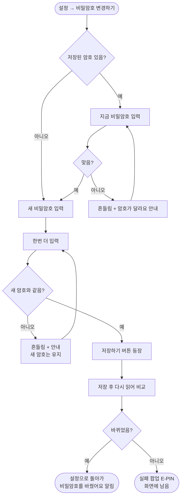

# 비밀암호 변경하기

## 개요

보호자 비밀암호(보호자 화면으로 넘어갈 때 묻는 4자리)는 온보딩에서 한 번 정하면 바꿀 방법이 없었다. 설정 시안(`1022:4467`)에 `비밀암호 변경하기` 줄이 추가되어, 설정의 시안 자리에 줄을 넣었다. 흐름은 **지금 암호 확인 → 새 암호 → 한번 더 → 저장**이다. 안쪽 화면은 시안이 없어서 온보딩 비밀번호 화면(`238:1909` · `238:2767`)의 점·키패드·간격을 그대로 썼다. 시안 요청은 #438로 올렸다.

커밋: `a9c1608` (develop 반영)

## 기능 흐름

## 변경 사항

### 화면
- `client/lib/features/guardian/presentation/pin_change_screen.dart` (신규): 세 단계를 한 화면의 상태로 다룬다(`verify` → `enter` → `confirm`). 온보딩 `PinDots` · `PinInputField` · `AppShake` · `ElumHeader`를 재사용한다.
- `client/lib/features/guardian/presentation/guardian_settings_screen.dart`: `비밀암호 변경하기` 줄을 임시저장과 약관 사이에 추가했다.
- `client/lib/core/router/app_router.dart`: `Routes.guardianPinChange` (`/guardian/settings/pin`) 추가.

### 테스트
- `client/test/pin_change_screen_test.dart` (신규 7건): 지금 암호부터 묻기, 틀린 지금 암호(팝업 없음), 끝까지 저장, 한번 더 불일치 시 새 암호 유지, 확정 전 나가면 그대로, 암호 없던 휴대폰, 저장 실패 팝업
- `client/test/pin_change_screen_golden_test.dart` (신규): 네 상태 골든. 시안이 없어 회귀용이다
- `client/test/guardian_settings_test.dart`: 줄 순서에 새 줄 추가, 누르면 변경 화면으로 가는지
- `client/test/settings_conformance_test.dart` · `figma/settings_1022-4467.png`: 설정 골든 갱신

## 주요 구현 내용

**지금 암호를 먼저 묻는다.** 보호자 화면이 열린 휴대폰을 이룸이가 들고 있을 때 확인 없이 바꿀 수 있으면, 보호자 화면을 지키는 암호가 의미를 잃는다(사용자 결정).

**저장했는지 다시 읽어 확인한다.** `SharedPrefsStorage.setPin`은 저장 실패를 삼키고 로그만 남긴다. 그대로 믿고 "바꿨어요"라고 하면 다음 전환 때 새 암호가 먹지 않는다. 그래서 저장 뒤 `getPin`으로 다시 읽어 다르면 공통 실패 팝업(E-PIN)을 띄운다.

**입력 오류는 흔들림만 쓴다.** 틀린 암호와 한번 더 불일치에는 빨간 표시·경고 아이콘 없이 점을 한 번 흔들고 설명 자리에 `암호가 달라요. 다시 넣어주세요`를 띄운다. 온보딩·모드 전환 화면과 같은 규칙이다.

### 화면

시안(왼쪽)과 앱 설정(오른쪽). `비밀암호 변경하기` 줄이 시안 자리에 있다. 크레딧 카드(#407), `앱 정보` 줄(#418), 문의하기 없음(#312)은 원래 알고 있던 차이다.

변경 화면 네 상태(렌더): 지금 암호 / 틀림 / 새 암호 / 한번 더 맞음.

### 검증

| 항목 | 결과 |
|---|---|
| `flutter test` | **1205개 통과** |
| `flutter analyze` | 0건 |
| 설정 시안 대조 | 줄 위치 일치 (위 이미지) |
| 에뮬레이터 실측 | **못 했다** — 같은 에뮬레이터를 다른 세션이 쓰고 있어 건드리지 않았다. TestFlight 테스트 빌드로 확인한다 |

## 주의사항

- **시안이 오면(#438) 문구·배치를 바꾼다.** 지금 제목은 1단계 `지금 비밀암호를`, 2단계 `새 비밀암호를`으로 한 단어만 다르다. 헷갈릴 수 있다는 점을 디자인 요청에 적었다.
- **암호는 휴대폰에만 있다.** 서버에 보내지 않으므로 앱을 지우면 사라지고, 다른 휴대폰에는 따라가지 않는다. 이번 작업은 그 구조를 바꾸지 않았다.
- **평문 저장은 그대로다** (`local_storage.dart`의 기존 경고). 암호를 바꿀 수 있게 됐다고 저장 방식이 안전해진 것은 아니다.
- 암호를 정한 적 없는 휴대폰은 확인 없이 새 암호부터 받는다. 모드 전환 화면도 이때 그냥 통과시키므로 같은 기준이다.
