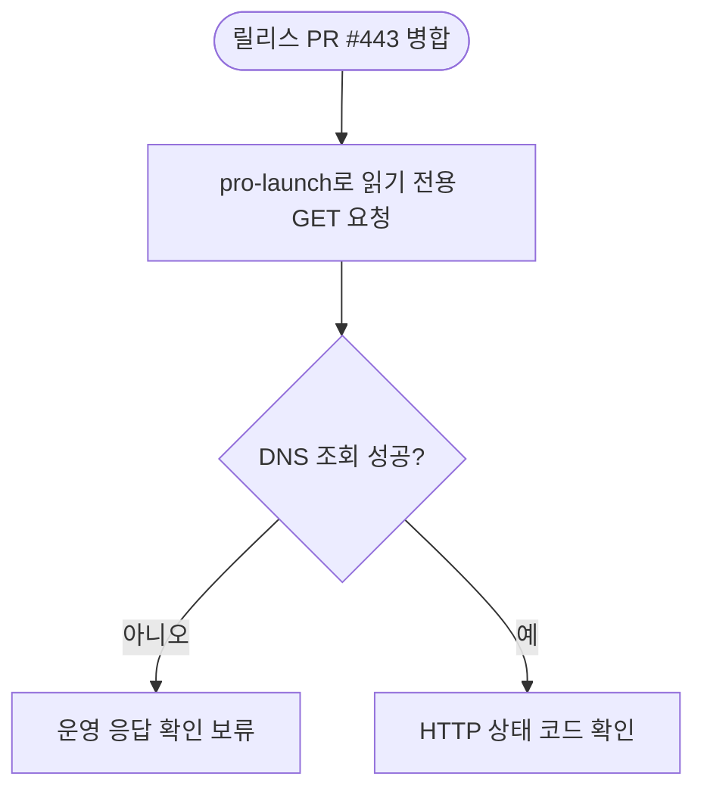

# 이룸 운영 API 응답 확인

## 개요

릴리스 PR #443은 병합됐고 `main`에 v2.0.0 릴리스 커밋이 있습니다. `pro-launch`에서 운영 구형 가입·로그인 경로를 변경 없는 GET 요청으로 확인하려 했지만, 실행 환경의 DNS 조회가 실패해 HTTP 응답 코드를 받지 못했습니다.

## 점검 결과

- `GET /api/auth/signup`: DNS 이름 확인 실패, 서버 응답 코드 없음
- `GET /api/auth/login`: DNS 이름 확인 실패, 서버 응답 코드 없음
- API가 차단됐다고 판정할 수 있는 응답은 얻지 못했습니다.
- 인증 헤더나 요청 본문은 보내지 않았습니다.

## 흐름

## 후속

운영 도메인에 연결되는 환경에서 같은 두 경로의 응답을 확인한 뒤 이슈 #441을 완료 처리해야 합니다. 그 전까지 이슈는 `작업중` 상태로 둡니다.
