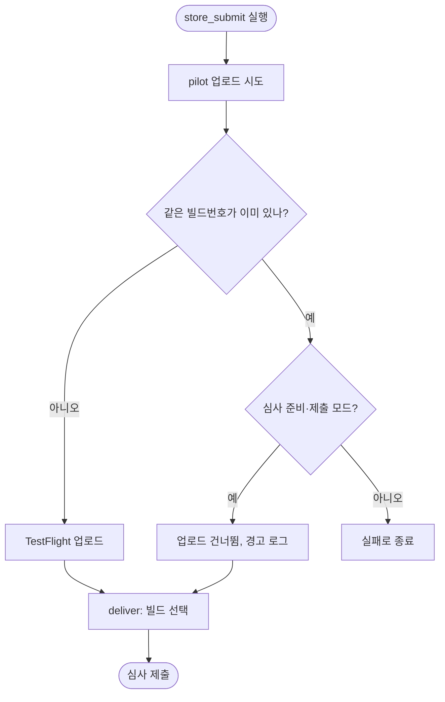

# iOS 심사 제출 실패 원인과 수정, 네이버 로그인 iOS 설정, 전체 E2E 검증 (v2.1.1 → v2.1.2)

## 개요

v2.1.1을 배포한 뒤 `store_submit`(App Store 심사 제출)이 실패했다. 원인을 찾아 Fastfile을 고쳤고(#449), v2.1.2로 배포해 **심사 제출까지 통과**했다. 같은 검증 중에 iOS 네이버 로그인이 "서비스 설정 오류"로 막히는 것을 찾아 네이버 개발자센터에 iOS 환경을 추가했고, Android·iOS 모두 로그인부터 홈까지 확인했다.

## 시간순 기록

| 순서 | 무슨 일 | 결과 |
|---|---|---|
| 1 | v2.1.1 스토어 배포 (push) — Play 내부, TestFlight | 성공. 빌드번호 213 |
| 2 | 이슈 #446·#444에 `@projectops app build main` | Android 테스트 APK, iOS 테스트 TestFlight 성공. 테스트 빌드번호는 `이슈번호+2자리 횟수`라 **44402** |
| 3 | `store_submit` 수동 실행 (run 36566714255) | **실패** — `bundle version must be higher than the previously uploaded version: 44402` (`ENTITY_ERROR.ATTRIBUTE.INVALID.DUPLICATE`). 심사에 들어간 것 없음 |
| 4 | 원인 분석 | 아래 "원인" |
| 5 | Fastfile 수정 (#449, 커밋 `da32afd`) → develop에 `main` 병합 후 push → 배포 PR #450 | v2.1.2, version_code 214 |
| 6 | v2.1.2 push 배포 (run 36569598368) | 성공 — 214 업로드 |
| 7 | `store_submit` 1차 (run 36569629507) | 수정대로 **업로드를 건너뜀**. 그러나 `deliver`가 `Build number: 214 does not exist`로 실패 — Apple이 방금 올라간 빌드를 아직 처리 중 |
| 8 | 약 8분 뒤 `store_submit` 2차 (run 36572779311) | **성공** — `Successfully selected build`, `Successfully submitted the app for review!` |

## 원인 (코드 회귀가 아니다)

- Fastfile의 "항상 업로드" 구조는 7월 21일 이후 바뀌지 않았다. **같은 버전을 두 번 올릴 수 없다**는 제약이 처음부터 있었다.
- 9/24·9/25에 됐던 이유는 push 직후 수십 초 안에 dispatch를 쏴서 워크플로 concurrency가 **push 실행을 업로드 전에 취소**했기 때문이다(그때 dispatch가 유일한 업로드). 이번엔 push 실행이 이미 끝난 뒤였다.
- 테스트 빌드 번호(이슈번호 기반, 44402)가 스토어 번호(version_code 213)보다 커서, **같은 버전에 테스트 빌드가 먼저 올라가면** 스토어 빌드도 막힌다. 새 버전(릴리스)이 되면 번호 체계가 다시 시작해 부딪히지 않는다.
- `version_code`는 릴리스 PR이 머지될 때만 오른다. 업로드나 수동 실행으로는 오르지 않는다.

## 수정

`client/ios/fastlane/Fastfile` — `pilot` 호출을 `begin/rescue`로 감쌌다. 오류 문구가 중복 빌드(`INVALID.DUPLICATE` · `already been used` · `must be higher than the previously uploaded`)이고 **심사 준비·제출 모드일 때만** 업로드를 건너뛰고 `deliver`로 넘어간다. `store_only`와 다른 업로드 오류는 그대로 실패시킨다. 실제 오류 문구에는 매칭되고 일반 오류(network timeout)에는 걸리지 않는 것을 확인했다. 실행 로그에 `같은 빌드(214)가 이미 TestFlight 에 있어 업로드를 건너뛰고 ASC 단계로 넘어갑니다`가 남았다.

## 네이버 로그인 — iOS 설정 문제

- iOS 시뮬레이터(v2.1.2)에서 네이버 로그인을 누르면 네이버가 **"이룸 서비스 설정에 오류가 있어 네이버 아이디로 로그인할 수 없습니다"**를 띄웠다. 앱 코드가 아니라 네이버 개발자센터 앱 "이룸"의 **서비스 환경에 iOS가 없었기 때문**이다(Android만 등록).
- 콘솔 API 설정에 **iOS 환경을 추가**했다: 다운로드 URL `https://apps.apple.com/kr/app/id6792970508`, URL Scheme `elum`. 저장 후 새로고침해서 값이 남아 있는 것을 확인했다. 개발 상태는 "서비스 적용"이라 검수 잠금으로 막히지 않았다. 기존 Android 설정과 제공정보는 건드리지 않았다.

**수정 전 (iOS)**

**콘솔에 iOS 환경 입력**

**수정 후 (iOS) — "이룸 로그인 중" 정상 진입**

**로그인 후 앱 홈 (iOS)** — 팝업이 떠 있는 첫 진입 화면

## E2E 검증 결과

| 대상 | 방법 | 결과 |
|---|---|---|
| Android 네이버 로그인 | `main` v2.1.1 소스로 만든 **릴리스 APK**, 에뮬레이터(emulator-5554), 앱·Chrome 데이터를 지운 새 상태 | 아이디/비밀번호 로그인 → 앱 홈 통과. 크래시·`ClassCastException`·네이버 SDK 예외 로그 0건 |
| iOS 네이버 로그인 | iOS 시뮬레이터 **디버그** 빌드(v2.1.2), Maestro | 콘솔 수정 후 통과. 아이디/비밀번호 로그인 → 앱 홈 |
| App Store 심사 제출 | `store_submit` 워크플로 로그 | 통과 (위 8번) |

## 확인하지 못한 것

- **App Store Connect 화면**: 심사 상태가 "심사 대기"로 바뀌었는지 직접 보지 못했다. 워크플로 로그만 확인했다(API 키가 없고 Apple 계정 자동 로그인은 잠긴 적이 있어 하지 않았다). 공개 조회로 본 App Store 표시 버전은 1.45.0이다.
- **스토어·TestFlight에서 받은 빌드**로 실기기 로그인은 밟지 못했다. 위 검증은 같은 소스의 릴리스 빌드(Android)와 시뮬레이터 디버그 빌드(iOS)다.
- **카카오·Apple 로그인**은 밟지 못했다.
- iOS 시뮬레이터에는 네이버 앱이 없어 웹 로그인 경로만 확인했다.

## 이번에 잘못한 것 (재발 방지)

- 심사 제출을 시도하기 전에 **push 배포가 이미 끝났는지** 확인하지 않고 dispatch했다.
- 빌드번호를 잘못 설명했다(44402를 스토어 빌드라고 함) → 44402는 테스트 빌드, 스토어 빌드는 213으로 정정했다.
- iOS 시뮬레이터를 **좌표 클릭(`cliclick`)**으로 조작해 사용자의 실제 마우스를 움직였고, 다른 앱이 앞에 있을 때 엉뚱한 곳을 눌렀을 수 있다. 이 레포의 표준인 **Maestro**(`client/e2e`)를 확인하지 않은 탓이다. 이후 Maestro로 다시 검증했다.
- 검증 중 에뮬레이터 앱 데이터와 Chrome 데이터를 지웠다. QA용 일과("아침에 학교 갈 준비를 해요")가 테스트 계정에 남아 있다(서버가 확정된 일과를 지우지 못한다).

## 남은 일 (후속)

- [ ] 업로드를 건너뛴 뒤 `deliver`가 빌드를 못 찾는 문제: 방금 올라간 빌드는 Apple 처리가 끝나야 선택된다. 건너뛰는 경로에서 **처리 완료를 기다리는 단계**를 넣을지 정한다(지금은 몇 분 뒤 재실행으로 해결).
- [ ] projectops 템플릿에도 같은 구멍(이미 올라간 빌드 재사용 불가)이 있다. 이슈를 올릴지 정한다.
- [ ] 스토어에서 받은 빌드로 실기기 네이버 로그인(Android·iOS) 한 번 확인.
