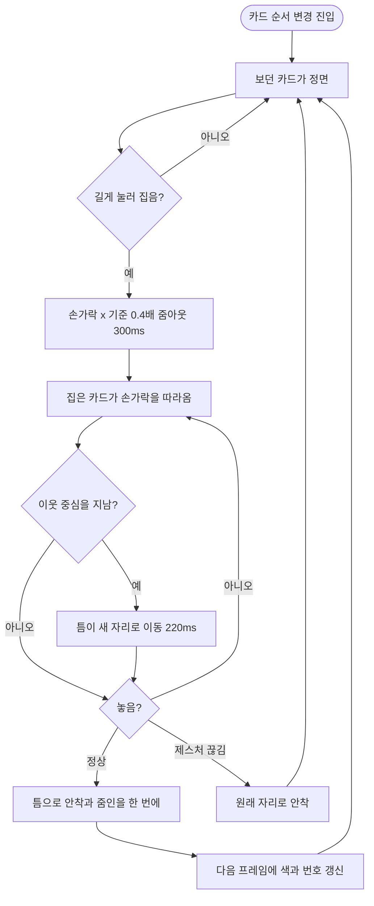

# 카드 순서 변경을 줌아웃하고 손가락을 따라다니게 바꾼다

## 개요

카드확인의 `카드 순서 변경` 모드를 다시 만들었다. 카드를 길게 눌러 집으면 화면 전체가 줌아웃하고, 집은 카드가 손가락을 좌우·상하로 따라다니며, 이웃 카드 사이에 갖다 대면 그 자리가 벌어진다. 놓으면 벌어진 자리로 안착하면서 원래 크기로 돌아온다. 커밋 `2bbd8024`, develop 에 푸시했다.

왼쪽부터 1) 첫 카드를 집은 직후(줌아웃) 2) 오른쪽으로 끌자 두 번째 카드가 앞으로 물러나고 틈이 열림 3) 손가락을 되돌리자 틈도 따라옴 4) 놓은 뒤 — 원래 크기, 번호 2·파랑으로 바뀜(안드로이드 에뮬레이터).

## 정정: 이슈 본문과 달라진 점

| 이슈 본문 | 실제 구현 | 이유 |
|---|---|---|
| 진입할 때 줌아웃 | **집을 때** 줌아웃, 놓을 때 줌인. 평소(진입 직후) 화면은 기존 크기 | 사용자가 고른 B안(놓을 때마다 원래 크기로 줌인)과 맞춘 것 |
| 약 0.6배 | **0.4배** | 0.6이면 옆 카드가 한 장 남짓만 보여 순서를 읽기 어려웠다 |

## 원인

| 증상 | 원인 |
|---|---|
| 3번을 보다 진입하면 1번으로 순간이동 | 목록이 스크롤 0 으로 새로 만들어졌고, 나올 때도 `_currentIndex = 0` 으로 리셋했다 |
| 살짝 움직였는데 3번 쪽으로 감 | 카드가 화면의 87% 라 조금만 옮겨도 가장자리 자동 스크롤이 켜졌다 |
| 버벅임 | 스냅 물리 + 400ms 놓기 스크롤 + 색 변경이 겹쳤다 |
| 들어갈 자리를 모름 | 가로 `ReorderableListView` 는 이웃이 절반을 넘어야 비켜서 미리 볼 수 없다 |

## 기능 흐름

## 변경 사항

### 순서 변경 목록
- `client/lib/features/guardian/presentation/widgets/card_review_reorder_list.dart` (신규): 직접 만든 드래그 목록. `reorderInsertionIndex`(들어갈 사이 계산, 순수 함수), 줌아웃·안착 컨트롤러, 가장자리 자동 스크롤, 스크린리더용 앞·뒤 이동 동작.
- `client/lib/features/guardian/presentation/widgets/card_review_parts.dart`: 옛 `CardReviewReorderList` 와 스냅 물리를 뺐다(-241줄).

### 화면
- `client/lib/features/guardian/presentation/card_review_screen.dart`: 진입 때 보던 카드(`_indexAtEnter`)를 넘기고, 나올 때 `완료` 는 정면 카드, `✕` 는 들어오기 전 카드로 페이지 뷰를 세운다(컨트롤러를 새로 만든다).

### 문서·테스트
- `client/docs/motion.md`: 순서 변경 움직임 표를 더했다.
- `client/test/card_review_redesign_test.dart`: 새 동작 테스트 13건, 옛 가정(놓으면 400ms 스크롤·확대 Transform)의 두 건을 새 동작으로 바꿨다.

## 주요 구현 내용

- **들어갈 자리는 눈에 보이는 배치(틈 포함)의 이웃 중심으로 잰다.** 벌어지기 전 배치로 재면 손가락 아래 카드가 바뀌어 틈이 깜빡인다.
- **안착과 줌인을 한 컨트롤러로 묶었다.** 나누면 화면이 두 번 출렁인다(사용자가 B안을 고른 이유).
- **색·번호는 안착한 다음 프레임에 바꾼다.** 같은 프레임에 바꾸면 새로 그려진 카드가 처음부터 새 색으로 서서 섞이는 움직임이 없다.
- 자동 스크롤은 최고 360px/s, 줌아웃이 끝난 뒤에만 켠다.

## 실기기에서 찾은 결함

위젯 테스트 51건이 통과한 뒤에도 안드로이드 에뮬레이터에서 문제가 하나 나왔다. 처음에는 줌아웃을 손가락 x 기준으로 하고 스크롤이 모자라면 빈 여백을 덧대 그 자리를 지켰다. **왼쪽 끝 카드를 집으면 화면 왼쪽 118dp 가 비고 카드는 오른쪽에 몰려 순서를 읽을 수 없었다.** 빈 여백을 없애고 스크롤 범위 안에서만 기준점을 맞추도록 고쳤다. 가운데 카드는 그대로 손가락 아래에서 줌아웃하고, 양 끝 카드는 근사치다.

## 엣지 케이스

| # | 상황 | 동작 | 확인 |
|---|---|---|---|
| E1 | 3번 카드에서 진입 | 3번이 정면으로 남는다 | 위젯 테스트 |
| E2 | 옮기고 `완료` | 옮긴 카드에서 기본 화면이 이어진다 | 위젯 테스트 |
| E3 | `✕` | 들어오기 전 순서·보던 카드로 돌아간다 | 위젯 테스트 |
| E4 | 제스처가 끊김 | 옮기지 않고 원래 자리로 안착, 예외 없음 | 위젯 테스트 |
| E5 | 카드가 한 장 | 길게 눌러도 집히지 않고 화면이 그대로 | 위젯 테스트 |
| E6 | 가장자리에 손가락을 붙임 | 1초에 380 을 넘지 않게 스크롤 | 위젯 테스트 |
| E7 | 두 번째 손가락 | 집은 동안은 무시, 스크롤도 잠김 | 코드로만 확인, 실기기 못 함 |
| E8 | 스크린리더 | `앞으로 옮기기` · `뒤로 옮기기` 동작 | 위젯 테스트로 동작 확인, 실제 TalkBack 은 못 함 |
| E9 | 양 끝 카드를 집음 | 빈 여백 없이 범위 안에서 줌아웃 | 에뮬레이터 |
| E10 | 짧게 눌러 스크롤 | 집히지 않고 한 장씩 정면에 붙음 | 위젯 테스트 |

## 검증

- 앱 전체 테스트 1541 통과, 카드확인 테스트 51 통과.
- `flutter analyze`: 손대지 않은 `character_badge_test.dart` 미사용 import 경고 7건만 남았다.
- 안드로이드 에뮬레이터(Pixel급 1080×2400)에서 집기·줌아웃·틈 열기·되돌리기·안착·색 변경을 밟았다. 로그인을 못 밟아 테스트용 임시 화면을 띄웠고 파일은 지웠다.
- 사용자가 테스트 빌드(TestFlight)로 확인했고 "잘된다"고 했다.
- **일부러 되돌려 실패시키는 검증은 하지 않았다.** 그래서 새 테스트가 옛 결함을 실제로 잡는지는 확인하지 못했다.
- iOS 시뮬레이터는 길게 눌러 끄는 조작을 좌표 없이 할 수 없어 밟지 못했고, iOS 는 사용자의 TestFlight 확인이 근거다.

## 주의사항

- **시안 `1197:5798` 에 없는 동작이다.** 줌 비율 0.4·집은 카드 4% 확대·그림자는 디자이너(예람) 확인이 필요하다.
- 양 끝 카드를 집었을 때 손가락 아래 카드가 원래 자리에서 조금 벗어난다(스크롤 범위 때문). 문제가 되면 줄 앞뒤에 여백을 두는 방식을 다시 검토한다. 그때는 위 결함이 재현되니 화면이 비는 정도를 함께 본다.
- 워크트리 브랜치 이름이 글자 중간에서 잘려 깨진 원격 브랜치가 한 번 올라갔다. 바로 지웠고 깨끗한 이름으로 다시 올렸다. 긴 제목의 이슈는 브랜치를 짧게 지어야 한다.
- 배포(`main` 릴리스)는 하지 않았다.
