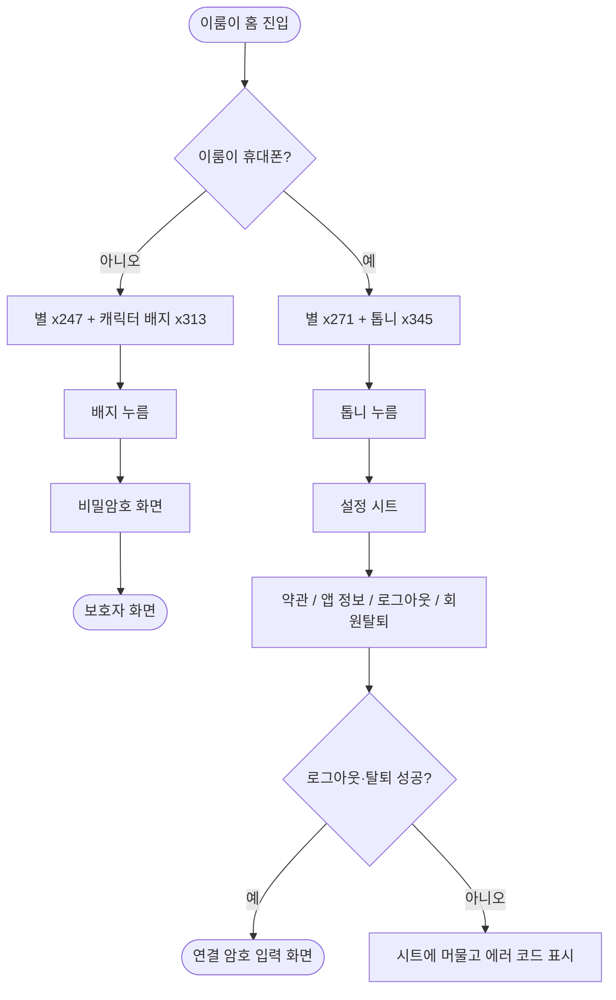

# 보호자 휴대폰과 이룸이 휴대폰의 홈 상단 줄을 시안대로 나눈다

## 개요

#445가 이룸이 화면 전체를 새 시안 섹션 `1197:6774`로 맞췄는데, 이 섹션은 **이룸이 휴대폰** 시안이었다. Figma에는 휴대폰 종류별로 홈 상단 줄이 따로 그려져 있고(보호자 휴대폰 `425:4392`, 이룸이 휴대폰 `1197:6774`), 앱은 두 휴대폰 모두 후자를 기준으로 만들어져 있었다. 보호자 휴대폰은 캐릭터 배지로 되돌리고, 이룸이 휴대폰은 톱니를 시안 자리로 옮기고 설정 시트에 약관·앱 정보를 더했다.

## 기능 흐름

## 변경 사항

### 홈 상단 줄
- `client/lib/features/child/presentation/child_home_screen.dart`: `_TopBar`를 휴대폰 종류(`isElumiDevice`)로 나눴다.
  - 보호자 휴대폰: 별(x247) + 공용 `CharacterBadge`(x313, 56×56). 누르면 비밀암호를 거쳐 보호자 화면으로 간다. 줄 윗변이 배지 y70에 서도록 안전영역 아래 여백을 11로 둔다.
  - 이룸이 휴대폰: 별(x271) + 톱니(x345). 임시로 별 왼쪽에 있던 톱니를 시안 자리로 옮겼고, 누르면 설정 시트가 열린다.

### 이룸이 설정 시트
- `client/lib/features/link/presentation/elumi_settings_sheet.dart`: `약관 및 개인정보처리방침`, `앱 정보` 줄을 더해 네 줄(약관, 앱 정보, 로그아웃, 회원탈퇴)로 했다. 약관 줄은 시트 위에 목록 화면을 올린다.
- `client/lib/core/widgets/app_info_tile.dart`: 보호자 설정에만 있던 `앱 정보` 줄을 공용 위젯으로 꺼냈다.
- `client/lib/features/guardian/presentation/guardian_settings_screen.dart`: 비공개였던 `_AppInfoTile`을 공용 위젯으로 교체했다. 동작은 같다.

### 테스트
- `client/test/child_elumi_settings_test.dart`: 이룸이 휴대폰 톱니가 별 오른쪽(x357)에 서는지, 보호자 휴대폰이 시안 좌표대로 배지를 쓰는지(별 x247, 배지 x313·56×56, 별과 배지 y 차 4), 시트가 네 줄인지, 약관 줄이 목록 화면을 여는지 확인한다.
- `client/test/child_mode_test.dart`: 보호자 휴대폰의 오른쪽 위가 배지이고 그 배지로 비밀암호에 가는 것으로 바꿨다.
- `client/test/figma_conformance_test.dart`: `1197-*` 시안 골든 3종은 이룸이 휴대폰 상태로 돌리게 했다. 톱니 위치는 골든 변경 없이 맞았다.
- `client/test/goldens/child_home_list.png`, `child_home_empty.png`: 보호자 휴대폰 기본 화면이 바뀌어 다시 만들었다.

## 주요 구현 내용

- 오른쪽 끝 요소가 달라서 줄 높이가 달라진다. 이룸이 휴대폰은 별(48)이, 보호자 휴대폰은 배지(56)가 줄 높이를 정한다. 그래서 안전영역 아래 여백을 15와 11로 따로 둬야 별이 두 시안에서 모두 y74에 선다.
- 이룸이 설정 항목은 보호자 설정의 부분집합이다. AI 크레딧, 이룸이 휴대폰 연결, 임시저장, 비밀암호 변경은 보호자만의 일이라 넣지 않았다.

## 검증

- 앱 테스트 2055건 통과, `flutter analyze` 0건.
- 설정 시트를 위젯 렌더링으로 열어 톱니 위치, 네 줄 순서, 약관 화면 이동을 눈으로 확인했다.
- 병합 뒤 develop에 push했고 deploy PR #486으로 main 릴리스를 올렸다.

## 주의사항

- **시뮬레이터 실기기 확인은 못 했다.** `iPhone 16 Pro Max` 디버그 실행이 두 번 모두 `DevFS … Service disconnected`로 끊겼다. 위젯 렌더링으로 대신했고, 앱 정보 줄의 버전 값은 이 방식에서는 비어 있어 확인하지 못했다.
- **시안에 없는 항목이다.** 이룸이 설정의 약관·앱 정보 줄은 사용자와 합의한 안이며 디자이너 확인이 필요하다.
- 보호자 휴대폰은 **홈 상단 줄만** `425:4392`로 맞췄다. 두 시안의 나머지 화면 차이는 아직 대조하지 않았다.
- 다음에 이룸이 화면 시안을 반영할 때는 섹션이 보호자 휴대폰용인지 이룸이 휴대폰용인지 먼저 구분한다.
