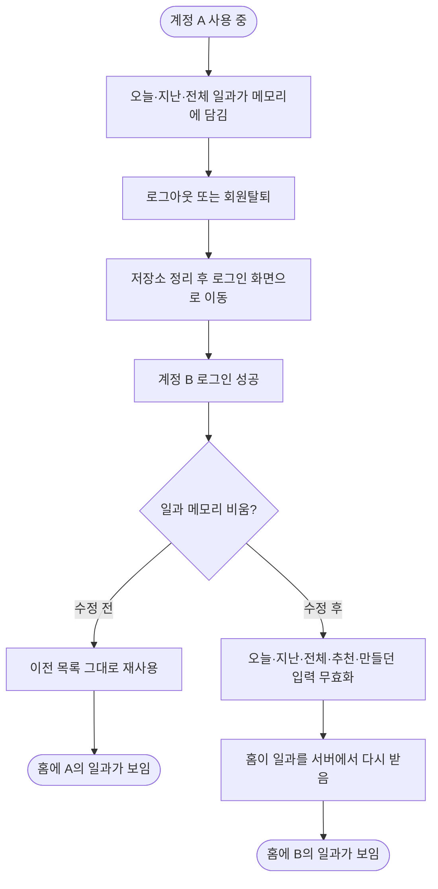

# 계정을 바꿔 로그인하면 이전 계정의 일과가 남아 보인다

## 개요

로그아웃·탈퇴 뒤 앱을 끄지 않고 다른 소셜 계정으로 로그인하면 홈이 이전 계정의 일과 목록을 그대로 그리던 문제를 고쳤다. 서버가 계정을 섞은 것이 아니라 앱이 메모리에 들고 있던 목록을 다시 받지 않은 것이 원인이었다. 로그인 성공 한 곳에서 이전 계정에 묶인 일과 관련 메모리를 함께 비우도록 했고, 로컬 iOS 시뮬레이터 E2E로 효과를 켬/끔 대조해 확인했다. 수정은 v2.7.0으로 배포됐다.

## 기능 흐름



## 변경 사항

### 앱 (클라이언트)
- `client/lib/features/auth/application/account_reset.dart` (신규): `forgetPreviousAccountRoutines()`. 오늘·지난·전체 일과(`refreshRoutines`), 추천 일과, 만들던 일과 입력(`routineFlowProvider`)을 한꺼번에 무효화한다.
- `client/lib/features/auth/presentation/login_screen.dart`: 로그인 성공 분기(`consentRequired`·`onboarding`·`home`)에서 기존 `memberProvider`·`profileSessionProvider` 무효화 옆에 위 함수를 호출한다.

### 테스트
- `client/test/login_account_switch_test.dart` (신규): 계정 A로 네 목록을 받은 뒤 B로 로그인하면 네 목록이 모두 B 기준으로 다시 받아지는지 확인한다. 고치기 전에는 `[오늘A, 지난A, 전체A, 추천A]`가 남아 실패했고 고친 뒤 통과한다.

## 주요 구현 내용

- **원인**: `todayRoutinesProvider`·`pastRoutinesProvider`·`myRoutinesProvider`는 계정과 무관한 `FutureProvider`라 한 번 받으면 앱이 꺼질 때까지 값을 들고 있다. 로그아웃·탈퇴는 저장소만 비우고(#362: 화면이 떠 있는 동안 비우면 회원 정보를 다시 받아 지운 선택을 되살린다), 로그인은 회원 정보·이룸이 선택·온보딩만 비웠다.
- **운영 로그 근거**: 카카오 첫 세션의 `/api/routines/today`·`/past`(22:38:13) 이후 탈퇴 2번, 카카오 재가입, 네이버 가입을 거치는 동안 22:44:23까지 다시 불리지 않았다. 네이버 신규 회원은 크레딧도 새 계정 값(50 중 0 사용)이라 서버 쪽 혼선은 아니었다.
- **비우는 위치**: 로그아웃·탈퇴·세션 만료가 모두 로그인 화면을 거치므로 로그인 성공 한 곳에 두면 세 경로가 한 번에 덮인다. 로그아웃·탈퇴 직전에는 비우지 않는다.
- **비우지 않는 것**: 이룸이 화면의 체크 대기열(`childRoutineProvider`). 아직 서버에 못 보낸 체크가 있을 수 있고, 보호자 로그아웃·탈퇴의 저장소 정리가 대기열 키를 이미 지운다.

## 검증

### 앱 테스트
- 전체 2054개 통과, `flutter analyze` 0건(수정 전 CI는 기존 `character_badge_test` 경고 7건 때문에 붉었고 #484로 정리했다).

### 로컬 E2E (iOS 시뮬레이터 iPhone 16 Pro, 디버그 빌드 `develop` 최신)
Maestro로 글자를 찾아 눌렀다(마우스 미사용). 흐름은 홈 → 설정 → 로그아웃 → 확인 → 네이버로 로그인 → 홈. 같은 앱에서 수정 한 줄만 껐다 켜서 비교했다. 운영 서버에서 읽기만 했고 데이터는 쓰지 않았다.

| | 네이버 재로그인 뒤 홈의 일과 호출 |
|---|---|
| 수정 켬 (23:46) | `/api/routines/today`·`/past`를 로그인 2초 뒤 다시 받음 |
| 수정 끔 (23:52) | 로그인 뒤 한 번도 안 받음 (이전 목록 재사용) |

서버 로그로 교차 확인했다.

```
23:46:27  POST /api/auth/oauth/naver
23:46:29  GET  /api/routines/today, /past      ← 수정 켬: 다시 받음
23:52:56  POST /api/auth/oauth/naver           ← 수정 끔: 이후 today/past 없음
```


### 배포
- 릴리스 PR #483 머지(v2.7.0). 서버·Android Firebase·Play 내부 테스트·iOS TestFlight 릴리스 빌드와 테스트 빌드(iOS TestFlight·Android APK) 모두 성공.

## 주의사항

- **계정이 하나뿐인 시뮬레이터**라 카카오→탈퇴→네이버 시나리오 자체는 밟지 못했다. 이 버그의 핵심인 "로그인 직후 일과를 새로 받는가"를 비교했고, 탈퇴 경로도 같은 로그인 지점을 지난다. 탈퇴는 운영 계정이 지워져서 밟지 않았다. 실제 두 계정으로 한 최종 확인은 테스트 빌드에서 남아 있다.
- 새 계정 단위의 메모리 상태(provider)가 생기면 `account_reset.dart`에 더해야 한다. 한 곳만 빠져도 이전 계정의 것이 남는다.
- 로컬 iOS 디버그 빌드는 `ios/Flutter/Secrets.xcconfig`에 `ELUM_ADMOB_APP_ID`가 없으면 시작 직후 AdMob 초기화 예외로 죽는다. 로컬에서만 Google 공개 테스트 ID를 넣었고 커밋하지 않았다.
- 화면의 "Test mode" 표시는 디버그·테스트 빌드의 AdMob 테스트 광고 표시다. 스토어 빌드는 실제 광고 단위를 쓴다.
- 탈퇴한 계정은 365일 보관되고 같은 소셜 계정으로 로그인하면 빈 상태로 되살아난다(설계, #372). 사용자에게는 "탈퇴가 안 됐다"로 보일 수 있다.
