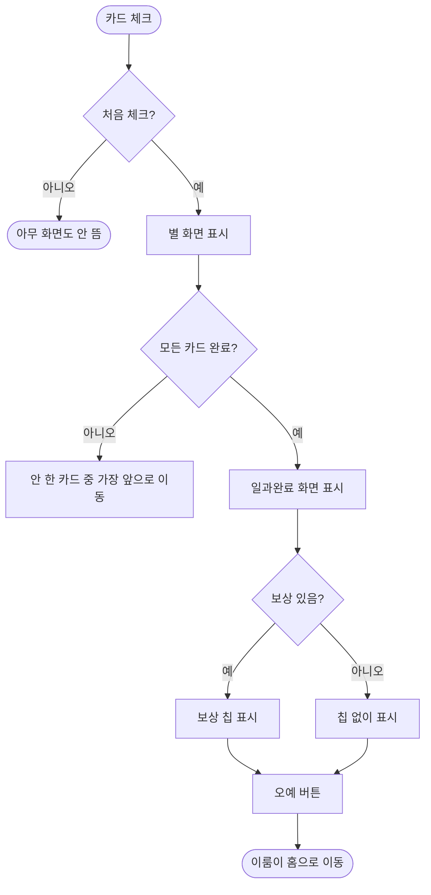

# 이룸이가 일과를 다 끝내면 일과완료 화면을 보여준다

## 개요

이룸이가 일과의 마지막 카드를 체크하면 별 화면(`축하해요!`)을 닫은 뒤 **일과완료 화면**(Figma `1274:9831`)이 이어서 뜬다. 화면에는 루미와 별 다섯 개, `일과를 끝냈어요!`, 보호자가 정한 보상 칩, `오예!` 버튼이 있고 버튼을 누르면 이룸이 홈으로 돌아간다. 보상이 없으면 칩을 그리지 않는다.

## 기능 흐름

## 변경 사항

### 화면·흐름
- `client/lib/features/child/presentation/routine_done_screen.dart`: 일과완료 화면을 새로 만들었다. 배경 그라디언트(`#0C0D1A` 7% → `#39514D`), 루미와 별 다섯 개, 제목, 보상 칩(333×80, 모서리 20, 반투명 `#EEE9E6` 30%), `오예!` 버튼. 제목과 버튼 자리는 시안 좌표에 고정해 칩이 빠져도 움직이지 않는다.
- `client/lib/features/child/presentation/child_routine_detail_screen.dart`: 별 화면을 닫은 뒤 모든 카드가 체크됐으면 일과완료 화면을 이어서 띄운다(`_isRoutineDone`). 아니면 기존대로 다음 카드로 넘어간다.
- `client/lib/core/router/app_router.dart`: `Routes.childRoutineDone`(`/child/routine-done`) 등록. 보상은 `extra`로 받는다.

### 에셋·토큰
- `client/assets/images/routine_done_*`: 캐릭터(PNG), 별 다섯 개(PNG), 윙크 눈(SVG). 후광과 투명도가 구워진 PNG를 쓴다 — SVG 필터는 렌더러가 버리기 때문이다.
- `client/lib/core/assets/app_assets.dart`: 위 에셋 상수.
- `client/lib/core/theme/app_colors.dart`: 배경 아래 끝색 `routineDoneBackdropBottom`(`#39514D`).

### 테스트
- `client/test/child_card_advance_test.dart`: 흐름 4건 추가(별 다음 완료 화면 / 보상 없음 / 오예 누르면 홈 / 끝낸 일과 재체크 시 안 뜸). 기존 "남은 카드가 없으면 머문다" 테스트는 새 흐름에 맞춰 대체했다.
- `client/test/figma_conformance_test.dart`, `client/test/figma/routine_done_1274-9831.png`: 시안 대조 골든에 일과완료를 올렸다.

## 주요 구현 내용

- **별 화면과 완료 화면의 순서**: 별은 카드마다 주는 연출이라 마지막 카드도 지금처럼 먼저 보여준다. 기존 명세(별은 카드마다, 보상은 일과가 끝났을 때 한 번)와 어긋나지 않는다.
- **재체크 시 안 뜸**: 완료 화면은 별 화면이 뜰 때에만 이어서 뜬다. 체크를 풀었다 다시 체크하면 별 화면이 안 뜨는 기존 규칙 그대로 완료 화면도 안 뜬다.
- **시안 대조**: 시안 export 와 렌더를 픽셀로 맞댔다. 다른 픽셀 **0.98%**(`tool/figma_diff.py`)이고 남은 덩어리는 글자(제목·칩·버튼 문구) 래스터 차이다. 배경 위·중·아래 색, 버튼·칩 색은 값이 같다. 내려받은 캐릭터 그림이 시안 그룹 상자보다 안쪽이라 (+4, +3), 기울어진 별 넷은 1~2px 보정했다.
- **검증**: 앱 테스트 2066 통과, analyze 0건. 핵심 줄(`if (_isRoutineDone)`)을 끄면 새 테스트 4건이 실패하는 것을 확인했다.

## 주의사항

- **결정이 남은 것**: 카드마다 뜨는 별 화면에 보상 칩이 지금도 남아 있다(시안 `보상_루미` 등에도 남아 있음). 완료 화면에 보상이 생겼으니 별 화면의 칩을 뺄지 디자이너(예람) 확인이 필요해 그대로 뒀다.
- 이룸이 휴대폰 시안(`1197:6774`)에는 일과완료 프레임이 없다. 두 휴대폰이 같은 화면을 쓴다고 보고 만들었다.
- 버튼 폭은 361로 그려진다(시안 360). 보상 화면과 같은 공용 버튼 규격이라 따로 손대지 않았다.
- 실기기에서 밟아 보지는 않았다. 위젯 테스트와 시안 대조까지 확인했다.
