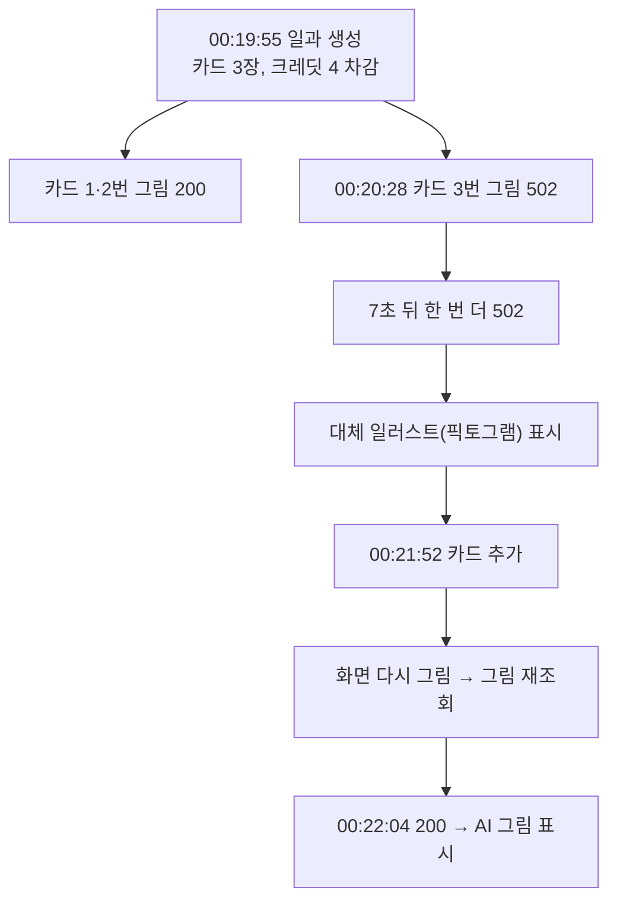

# 서버가 재배포되는 중에 카드 그림 조회가 실패하면 기본 그림에 갇힌다

## 개요

디자이너가 "카드를 추가했더니 그림이 갑자기 다른 그림으로 바뀐다"고 제보했다. 원인은 AI 사용 여부가 바뀐 것이 아니라 **카드 그림 조회가 502 로 실패해 기본 그림(픽토그램)이 보이다가, 화면이 다시 그려지며 재조회에 성공한 것**이다. 일시 오류면 스스로 몇 번 다시 받도록 고쳤다.

## 로그로 확인한 순서 (디자이너 휴대폰, 2026-10-02 한국 시각)

- 이 계정의 그림 방식은 `CARTOON`(`/api/member/me`)이다. 서버는 카드마다 AI 그림을 만들었고(`imageCount 3`, `charged 4`) 응답 이미지에는 AI 출처 표시(C2PA)가 들어 있다. 즉 **처음부터 AI 그림이 맞고**, 첫 화면의 픽토그램은 조회 실패 때의 대체 그림이었다. 그림 방식은 `CARTOON`(만화) · `REALISTIC`(실사) · `PHOTO_ONLY`(직접 사진, AI 그림 없음)이며 회원 설정을 따른다.
- 502 본문은 리버스 프록시의 HTML 오류 페이지였다. 같은 날 00:11, 00:17(한국 시각)에 서버 배포가 돌았고 컨테이너가 바뀌는 시각과 맞는다. 다만 서버 로그는 새 컨테이너 것만 남아(현재 로그는 v2.10.0 기동분뿐) **00:20 서버 쪽 기록은 확인하지 못했다.**
- 이후 v2.10.0 배포(00:27)에서 서버 기동은 40초(00:30:32)였다.

## 변경 사항

- `client/lib/features/guardian/data/card_image_repository.dart`
  - `isTransientFailure`: 408, 429, 502, 503, 504, 시간 초과, 연결 끊김만 일시 오류로 본다. 404, 401, 403 은 아니다.
  - `nextRetryDelay`: 일시 오류로 실패한 그림에 대해 3초, 10초, 30초, 60초, 90초 중 다음 간격을 준다. 다섯 번이 상한이고 성공하면 기록을 지운다.
  - `cardImageProvider`: 실패하면 지금처럼 붙들지 않고, 일시 오류면 `Timer` 로 `invalidateSelf` 한다. **화면이 보고 있는 동안만** 돈다. 아무도 안 보면 버려지고 타이머도 멈춘다.
- `client/test/card_image_retry_test.dart`: 5건 추가.
- `client/test/photo/card_image_disk_cache_test.dart`: E18 테스트 이름을 실제 동작에 맞췄다.

## 주요 구현 내용

- **처음에는 재시도 동안 provider 를 붙들었다.** 그랬더니 기존 규칙(실패 뒤 다시 접근하면 바로 새로 받는다, E17)이 깨져 테스트가 잡았다. 붙들지 않고 보고 있을 때만 재시도하도록 바꿔 규칙을 지켰다.
- 간격 합이 약 3분 남짓이라 재배포 구간을 넘기지만 횟수 상한이 있어 끝없이 두드리지 않는다. 재시도 동안 카드는 기본 그림을 그대로 보여 주고 받아지면 그 자리에서 바뀐다.
- **검증**: 새 테스트 5건(502 두 번 뒤 성공 / 계속 실패하면 상한까지만 / 404 / 401 / 일시 오류 분류). 재시도 호출을 끄면 앞의 두 건이 실패하는 것을 확인했다. 앱 테스트 2075 통과, analyze 0건.

## 주의사항

- 서버가 40초 안팎으로 되살아나므로 첫 세 번(3초, 10초, 30초 → 누적 43초)에서 대부분 복구된다.
- 오프라인(연결 끊김)도 일시 오류라 같은 간격으로 다시 시도한다. 상한이 있어 배터리나 트래픽 부담은 작다.
- 실기기로 서버를 재배포하는 중에 밟아 보지는 않았다. 위젯·프로바이더 수준에서만 확인했다.
