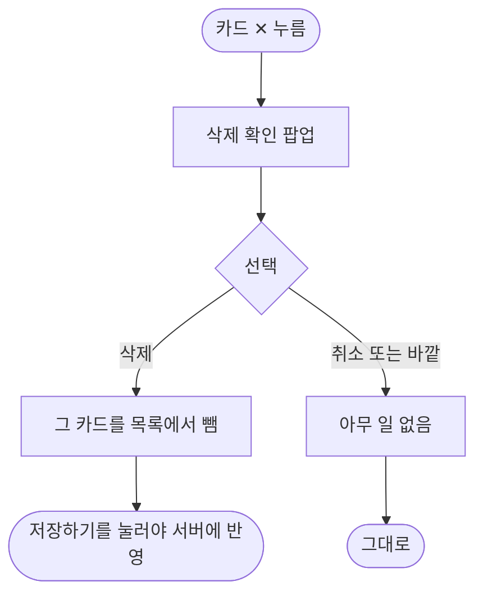

# 카드 확인에서 카드 지우기 X를 누르면 묻지 않고 바로 지워진다

## 개요

카드 확인 화면의 카드 오른쪽 위 `✕`가 확인 없이 곧바로 카드를 뺐다. 카드 그림은 AI가 만든 것이라 다시 받으려면 크레딧이 든다. 이제 먼저 `카드를 삭제하실건가요?` 팝업을 띄우고 `삭제`를 눌렀을 때만 뺀다.

## 기능 흐름

## 변경 사항

- `client/lib/features/guardian/presentation/card_review_screen.dart`: `_confirmRemove`를 추가하고 `✕`를 거기에 연결. 일과 삭제 팝업과 같은 `ElumDialog`(휴지통 아이콘, 취소/삭제)
- `client/test/card_review_delete_confirm_test.dart`: 팝업이 먼저 뜸, 삭제 시 빠짐, 취소 시 유지, 바깥 눌러도 유지, 한 장이면 `✕` 없음 (5건)

## 주요 구현 내용

- 바깥을 눌러 닫으면 팝업 결과가 null이라 취소로 다룬다. 팝업이 떠 있는 사이 화면이 닫혔으면(`mounted`) 카드를 건드리지 않는다.
- 마지막 한 장은 원래 `✕`가 없어(#69) 그대로다. 순서 변경 모드의 `✕`는 지우기가 아니라 되돌리기라 팝업이 없다.
- 팝업을 걷어내면 새 테스트 4건이 실패하는 것을 확인했다.

## 주의사항

- 팝업 문구·모양은 시안이 없어 일과 삭제 팝업을 빌렸다. 디자이너 확인은 #498에 남겼다.

## 검증

- 앱 전체 테스트 2109건 통과, `flutter analyze` 0건 (통합 브랜치 `39c83a2d` 기준, 다른 세션 커밋 병합 후 재실행)
- 원격 develop에 푸시했고 배포 PR #504(v2.10.2)가 머지돼 main에 포함됐다. 릴리스 PR 머지까지만 확인했고 **실기기에서 밟아 보지는 못했다** (스토어 제출은 따로 요청할 때만 한다)
