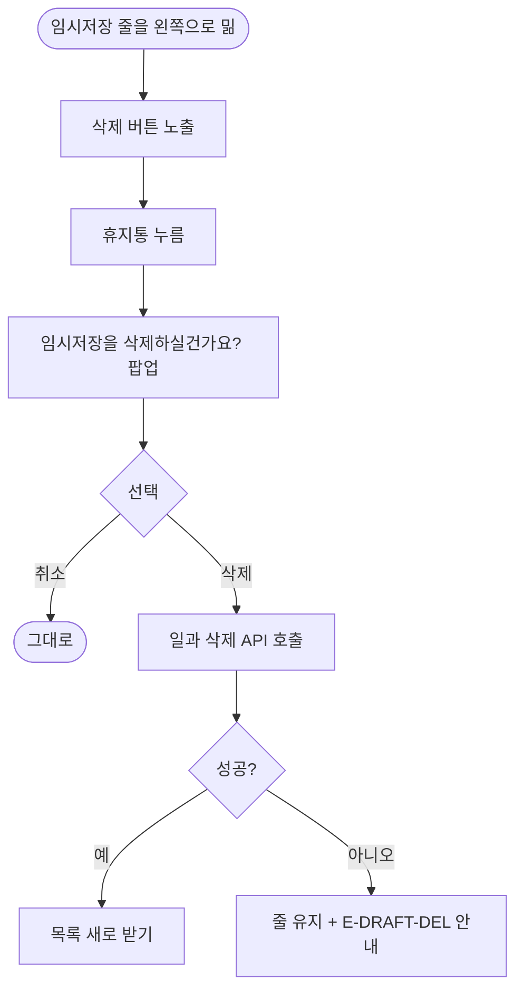

# 임시저장을 밀어서 지우고 지우기 전에 한 번 묻는다

## 개요

설정의 임시저장에는 지우는 방법이 없었다. 시안(1045:4910, 1274:9262)대로 화면을 다시 그리고, 줄을 왼쪽으로 밀면 삭제 버튼이 나오며, 누르면 확인 팝업을 거쳐 지운다.

## 기능 흐름

## 변경 사항

- `client/lib/features/guardian/presentation/draft_routines_screen.dart`: 줄을 361×68 시안 모양(제목, `완료 시` 보상 줄, 흰 `이어서` 알약)으로 재작성. 밀어서 삭제, 확인 팝업, 실패 처리, 지우는 중 잠금
- `client/lib/features/guardian/presentation/widgets/routine_swipe_actions.dart`: 수정 없이 삭제만 나오는 형태와 끝 여백(`endInset`), 삭제 버튼 접근성 이름(`deleteLabel`)을 받게 일반화. 홈 동작은 그대로
- `client/test/draft_routines_test.dart`: 묻고 지움, 취소, 실패 유지, 열린 줄 누르면 닫힘, 보상 미설정 표시 (총 9건)
- `client/test/settings_conformance_test.dart`와 골든 2장: 시안 1045:4910, 1274:9262 기준으로 교체

## 주요 구현 내용

- 서버 임시저장 삭제는 일과 삭제 API(#150)로 지운다. 이어 만들던 일과를 지웠으면 만들기 흐름도 비운다.
- 첫 줄 윗변을 시안 y=131, 줄 사이를 8로 맞췄다. 시안 export와 `figma_diff.py`로 맞대 글줄이 두 장 모두 어긋남 없이 맞는다.
- 확인 단계를 건너뛰게 바꾸면 테스트가 실패하는 것을 확인했다.

## 주의사항

- 팝업 문구는 시안에 없어 일과 삭제 팝업을 빌렸다(#498에 확인 요청).

## 검증

- 앱 전체 테스트 2109건 통과, `flutter analyze` 0건 (통합 브랜치 `39c83a2d` 기준, 다른 세션 커밋 병합 후 재실행)
- 원격 develop에 푸시했고 배포 PR #504(v2.10.2)가 머지돼 main에 포함됐다. 릴리스 PR 머지까지만 확인했고 **실기기에서 밟아 보지는 못했다** (스토어 제출은 따로 요청할 때만 한다)
