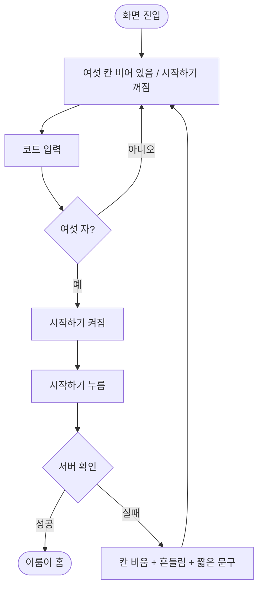

# 이룸이 휴대폰 연결 코드 입력 화면을 새 시안으로 바꾼다

## 개요

시안 `코드연결` 1274:7909와 `코드연결_입력` 1274:7988대로 연결 코드 입력 화면을 다시 맞췄다. 시안이 `시작하기` 버튼을 그려서, 여섯 자를 채우면 바로 보내던 동작을 버튼으로 옮겼다.

## 기능 흐름

## 변경 사항

- `client/lib/features/link/presentation/link_enter_screen.dart`: 제목 `보호자에게서 받은 코드를 입력해주세요`, 두 줄 안내(밑줄), 옛 안내 카드 제거, 시작하기 버튼 연결, 자동 전송 제거, 머리 글 영역 220 고정
- `client/lib/features/link/presentation/widgets/code_boxes.dart`: `CodeBoxes.figma` 추가 (48×64, 모서리 8, 3칸 묶음 간격 16, 글자 40/w800). 초대 코드 입력은 옛 모양 유지
- `client/lib/core/widgets/elum_header.dart`: 설명 일부 밑줄(`underlinedInDescription`)
- 테스트: `link_enter_screen_test`, `elumi_link_loss_test` 갱신, `link_enter_conformance_test`와 골든 2장 추가

## 주요 구현 내용

- 틀린 암호는 빨간 테두리 없이 흔들림과 문구로만 알리는 기존 원칙(#427)을 유지했다.
- 시안 export와 맞대 글줄 일곱이 모두 어긋남 없이 맞는다.

## 주의사항

- **동작 변경**: 자동 전송이 사라지고 버튼을 눌러야 한다. 디자이너가 의도한 흐름인지 확인이 필요하다(이슈 확인 사항).

## 검증

- 앱 전체 테스트 2109건 통과, `flutter analyze` 0건 (통합 브랜치 `39c83a2d` 기준, 다른 세션 커밋 병합 후 재실행)
- 원격 develop에 푸시했고 배포 PR #504(v2.10.2)가 머지돼 main에 포함됐다. 릴리스 PR 머지까지만 확인했고 **실기기에서 밟아 보지는 못했다** (스토어 제출은 따로 요청할 때만 한다)
