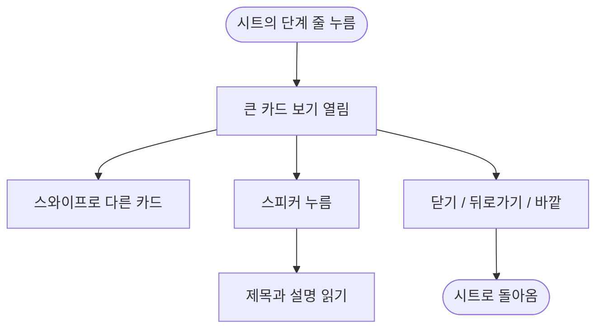

# 일과 시트에서 카드를 눌러 크게 본다

## 개요

일과 시트(오늘, 지난 일과)의 단계 줄 글 자리를 누르면 시안 1274:8864대로 카드를 크게 띄운다. 뒤는 검정 70%로 덮고 카드확인과 같은 카드를 세우며, 옆 카드가 걸쳐 보여 좌우로 넘겨 볼 수 있다.

## 기능 흐름

## 변경 사항

- `client/lib/features/guardian/presentation/widgets/step_card_viewer.dart` (신규): 카드 333×410 @ (30, 231), 옆 카드 x=373, 닫기 40×40 @ (328, 183, 흰 X)
- `client/lib/features/guardian/presentation/widgets/routine_detail_sheet.dart`: 단계 줄 글 자리에 누름 연결
- `client/test/step_card_viewer_test.dart`: 열림, 위치와 크기, 넘기기, 닫기, 보상 줄, 지난 일과, 읽기 (7건)

## 주요 구현 내용

- 손잡이와 체크는 누름 범위 밖이라 순서 끌기와 겹치지 않는다. 보상 줄은 열리지 않는다.
- 읽기만 하는 화면이라 카드에 삭제 X를 주지 않는다. 스피커와 `E-TTS` 실패 안내는 카드확인과 같다.

## 주의사항

- 바깥 눌러 닫기, 지난 일과 적용, 긴 설명 처리는 시안에 없어 이슈 확인 사항으로 남겼다.

## 검증

- 앱 전체 테스트 2109건 통과, `flutter analyze` 0건 (통합 브랜치 `39c83a2d` 기준, 다른 세션 커밋 병합 후 재실행)
- 원격 develop에 푸시했고 배포 PR #504(v2.10.2)가 머지돼 main에 포함됐다. 릴리스 PR 머지까지만 확인했고 **실기기에서 밟아 보지는 못했다** (스토어 제출은 따로 요청할 때만 한다)
