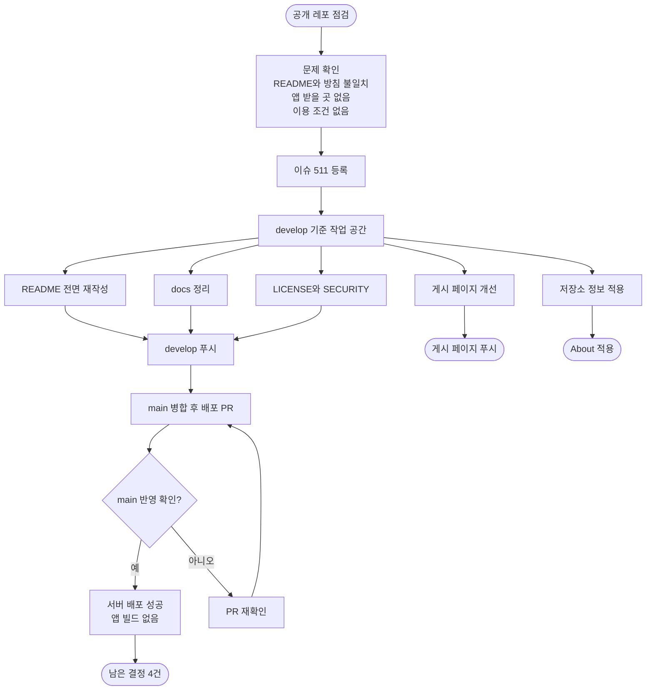

# 공개 레포를 이룸 앱 설치 허브로 정비

## 개요

공개 저장소의 첫 화면이 해커톤 제출용 문서로 남아 있고, 게시된 개인정보처리방침과 정반대의 내용(폐기한 AI DLP를 현재 기능처럼 소개)이 적혀 있어 정비했습니다. 읽는 사람을 보호자와 이룸이를 돕는 분들로 보고, 목표를 "무슨 앱인지 알고, 스토어로 가고, 믿을 수 있게"로 잡았습니다. 변경은 `develop`을 거쳐 배포 PR #512(v2.12.2), #513(v2.12.3)로 `main`에 반영했습니다.

## 기능 흐름

## 변경 사항

### README
- `README.md`: 267줄에서 74줄로 처음부터 다시 썼습니다. 앱 소개, App Store 링크 배지, Google Play "출시 준비 중" 배지, 게시 페이지 링크(도움말, 개인정보처리방침, 삭제 안내), 쓰는 법 3단계, 앱의 특징, 개발자 정보, 저작권을 담았습니다.
- 뺀 것: AI DLP, Ollama, 요청 암호화 서술, 낡은 테스트·워크플로 수치, 공개 Swagger 주소, 시스템 구성도, 안정성 표, 해커톤 데모 시나리오, 서비스 원칙 표, 기획 문서 목록. AI 업체는 게시된 방침 기준(Gemini, OpenAI, fal)으로 맞췄고 "아이·아동"은 "이룸이"로 바꿨습니다.

### docs
- `docs/README.md`: "지금 기준이 되는 문서"와 "초기 기획 기록"으로 나눠 다시 썼습니다.
- `docs/00`, `01`, `03`: 초안이라는 안내를 넣었습니다. `docs/02`, `04`~`07`: DLP를 쓰지 않는다는 안내 배너를 넣었습니다.
- `docs/00`~`07`: "아동·아이" 표기를 "이룸이"로 바꿨습니다(용어 규칙 문서 08은 금지 예시를 담고 있어 제외).
- 자문 문서: 자문위원 실명을 직함으로 바꾸고, 기관에 보낼 메시지 초안의 내부 의도 문구 3줄을 지웠습니다.

### 라이선스와 보안
- `LICENSE`: 팀 룸룸의 모든 권리 보유. GitHub 약관이 허용하는 열람과 포크만 예외로 뒀습니다.
- `SECURITY.md`: 공개 이슈가 아니라 메일로 신고하도록 안내하고, 지킬 수 없는 응답 시간 약속은 쓰지 않았습니다.

### 게시 페이지와 저장소 정보
- 게시 페이지 첫 화면을 도움말 문구에서 앱 소개로 바꿨습니다. App Store 받기 버튼과 비활성 "Google Play 출시 준비 중" 버튼을 넣었고, 도움말과 문의는 아래에 그대로 뒀습니다.
- 공유 미리보기 이미지(1200x630), 사이트 전용 404 페이지, `canonical`, `robots.txt`, `sitemap.xml`을 추가했습니다.
- 첫 화면 글자가 모바일에서 화면 왼쪽 끝에 붙고 데스크톱에서 아래 카드와 줄이 어긋나던 기존 여백 결함을 고쳤습니다.
- About 설명, 홈페이지(게시 페이지 주소), topics 6개를 적용했습니다.

## 주요 구현 내용

- **사실만 남겼습니다.** README의 모든 문장은 게시된 도움말·방침, 코드, 워크플로에서 확인된 것만 씁니다. 서버 실행처럼 확인하지 못한 부분은 "PostgreSQL과 로컬 설정이 필요해요"로만 적었습니다.
- **스토어 상태는 실제로 확인했습니다.** App Store 주소는 열려서 링크로 안내했고, Google Play 주소는 404라서 링크 없는 "출시 준비 중" 배지로 자리만 잡았습니다. 출시되면 배지 한 줄만 교체하면 됩니다.
- **게시 페이지는 방침과 어긋나지 않게 점검했습니다.** 저장소의 게시 페이지·서버 동의 문서 대조 도구가 "어긋난 곳 없음"으로 통과했습니다.
- **정직한 릴리스 노트.** 두 배포 모두 문서만 바뀌었다고 밝히고 "앱 동작에는 바뀐 점이 없어요"를 적었습니다.

## 검증

- 게시 페이지를 로컬 서버로 띄워 모바일 390폭과 데스크톱 1280폭으로 직접 캡처해 확인했고, 404 페이지도 모바일에서 확인했습니다.
- `main`에서 README가 74줄, 버전 v2.12.3, DLP·"아이·아동"·Swagger 언급 0건이고 LICENSE, SECURITY.md가 있는 것을 확인했습니다.
- `docs/README.md`의 링크가 전부 실제 파일을 가리킵니다.
- 서버 배포 워크플로(`elum-server-cicd`)가 성공했습니다. 서버 코드는 바뀌지 않았지만 `main` 푸시마다 재배포됩니다.
- iOS·Android 앱 빌드와 스토어 심사 제출은 실행되지 않았습니다(`client/` 변경 없음).
- 게시 페이지와 저장소 모두 200 응답입니다.

## 주의사항

- **정정:** 처음에 로컬 `develop`이 원격보다 183커밋 뒤처져 있어 낡은 파일을 보고 판단한 부분이 있었습니다. 이후 `origin/develop` 기준 작업 공간에서 다시 확인했고, docs 일부는 이미 폐기 표시가 있었습니다. 또 README 1차 정비는 DLP 서술만 걷어내고 옛 본문을 많이 남겨서, 이후 전면 재작성으로 바로잡았습니다.
- 커밋 이력 비밀 점검은 대표 패턴과 키 파일 이력을 확인한 결과 발견되지 않았지만, 패턴 기반이라 전수 보장은 아닙니다.
- 자문위원 실명은 현재 파일에서만 바꿨고 **커밋 이력에는 남아 있습니다.** 이력까지 지우려면 이력을 다시 써야 해서 하지 않았습니다.
- 루트의 `pr_body.md`, `build-output/`는 워크플로가 쓰는 의도된 파일이라 정리 대상이 아닙니다.
- Google Play 공개 전까지 초대 안내 페이지의 Google Play 링크는 열리지 않습니다.

## 남은 항목 (이 이슈에서 계속)

1. 초대 안내 페이지의 Google Play 링크 확인(Google Play 공개 후)
2. 지원, 삭제 요청, 보안 신고가 한 곳의 개인 메일에 몰려 있어 서비스용 연락처를 분리할지 결정
3. `docs/hackathon`의 상용화 전략, 수상 전략, 경쟁 서비스 비교 문서의 공개 여부 결정
4. 열린 이슈 55개의 공개 내용 확인
