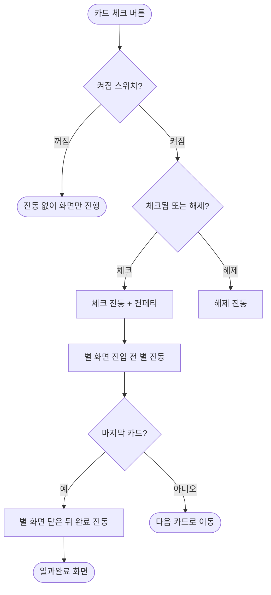

# 카드를 체크할 때 진동으로 알려준다

## 개요
이룸이가 카드를 하나 끝낼 때마다 손에 짧은 진동이 간다. 화면(컨페티, 별 화면)과 소리가 이미 알려주는 것을 손으로 한 번 더 느끼게 하는 **보조 신호**다. 진동 4종과 켜고 끄는 스위치를 넣었고, 보호자 설정과 이룸이 설정 두 곳에서 같은 값 하나를 바꾼다. 커밋 `98db1e09`, 릴리스 PR #516으로 `main`에 머지됐다.

**실기기에서 진동 세기를 아직 느껴 보지 못했다.** 위젯 테스트는 가짜 진동기만 검증하므로 Android와 iPhone 실기기 확인이 남아 있다.

## 기능 흐름

## 변경 사항

### 진동
- `client/lib/core/haptics/child_haptics.dart`: 진동 4종(`ChildHapticKind`)의 패턴과 세기, 진동기 경계(`HapticDriver`), 스위치 창구(`ChildHaptics`), 켜고 끄는 값(`childHapticOnProvider`)
- `client/lib/features/child/presentation/child_routine_detail_screen.dart`: 체크, 해제, 별 화면, 일과 완료 시점에 진동 호출

### 스위치와 저장
- `client/lib/core/widgets/settings_switch_tile.dart`: 켜고 끄는 설정 줄
- `client/lib/features/guardian/presentation/guardian_settings_screen.dart`, `client/lib/features/link/presentation/elumi_settings_screen.dart`: `카드 체크 진동` 줄 추가
- `client/lib/core/storage/local_storage.dart`: 저장 값 추가 (기본 켜짐)
- `client/pubspec.yaml`: `vibration` 패키지 추가

### 테스트
- `client/test/child_haptics_test.dart`: 패턴 규격, 켜짐/꺼짐, 진동기 실패, 체크·별·완료·해제 순서, 이룸이 설정 스위치
- `client/test/guardian_settings_test.dart`, `image_style_settings_test.dart`, `settings_conformance_test.dart`, `figma/settings_1022-4467.png`: 줄이 늘어난 것을 반영

## 주요 구현 내용
- **진동 구성**: 체크 20ms 한 번(중간), 별 약하게 두 번, 일과 완료 점점 세지는 세 번(강하게 끝남), 해제 10ms 한 번(가장 약함). 가장 긴 패턴도 0.3초 안에 끝난다.
- **기본은 약하고 짧게**: 소리와 진동에 예민한 이룸이가 있을 수 있어서다.
- **패턴을 못 쓰는 휴대폰**은 기본 진동(`HapticFeedback`)으로 대신하고, 진동 하드웨어가 없으면 아무 일도 하지 않는다.
- **실패해도 흐름은 계속 간다**: 호출이 실패하면 삼키지 않고 로그로 남기되 밖으로 던지지 않는다. 진동을 기다리느라 화면 전환이 늦어지지 않게 기다리지 않는다.
- **스위치 값은 휴대폰에 속한다**: 로그아웃(`clearAll`)이 지우지 않는다. 진동에 예민한 이룸이의 휴대폰이 로그아웃 한 번에 다시 울리면 안 된다. 저장된 적이 없거나 읽지 못하면 켜짐이다.
- **동작 줄이기와 별개**: 움직임과 진동은 다른 감각이라 동작 줄이기 설정을 진동 끄기 기준으로 쓰지 않는다.
- 스위치를 켤 때 체크 진동을 한 번 울려 어떤 느낌인지 알려준다.

## 검증
- 앱 테스트 2,166건 통과, 골든 태그 테스트 통과, analyze 0건
- 릴리스 PR #516 automerge 완료

## 주의사항
- **실기기 확인 전이다.** `vibration` 패키지의 iOS 동작은 이 레포에서 확인하지 못했다. Android는 8(API 26) 이상에서 세기가 적용된다. 값은 `ChildHapticKind` 한 곳에 모아 뒀으니 느껴 본 뒤 조정한다.
- **시안에 없는 줄이다.** 설정 시안(`1022:4467`) 골든을 "알려진 차이"로 주석과 함께 다시 찍었다. 켜고 끄는 줄 시안이 나오면 디자이너에게 요청하고 골든을 다시 찍는다.
- 위젯 테스트는 내가 만든 가짜 진동기만 검증한다. 실제 세기와 느낌은 테스트로 알 수 없다.
- iOS `Podfile.lock`은 커밋하지 않았다. 새 플러그인이라 iOS 빌드 때 `pod install`이 다시 돈다.
