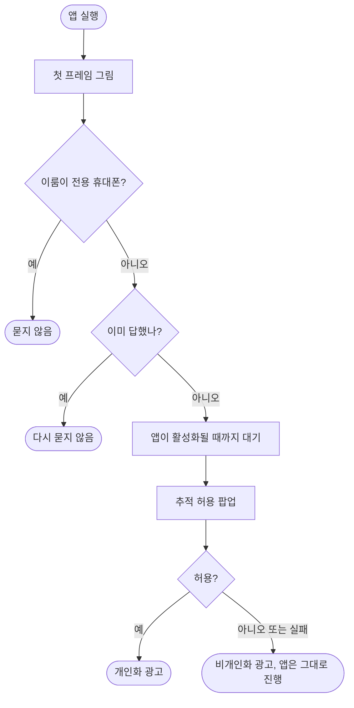

# iOS 심사 리젝 2.1: ATT 팝업이 심사 기기에서 안 보임

## 개요

iOS 2.12.1 심사가 **가이드라인 2.1 Information Needed** 로 리젝됐다(ATT 권한 요청을 심사 기기에서 찾을 수 없음). 팝업이 광고를 처음 불러올 때만 뜨는 구조여서 광고가 안 뜨는 경로로 쓰는 심사관은 한 번도 보지 못했다. 앱을 열자마자 묻도록 고쳤고, 같은 심사 건에 새 빌드(2.14.3, 빌드 238)를 붙여 **재제출했다. 현재 App Store Connect 상태는 `Waiting for Review`** 이다.

## 기능 흐름

## 변경 사항

### ATT 요청 시점
- `client/lib/app.dart`: 첫 프레임 직후 `AdConsent.requestOnLaunch()`를 부른다. 이룸이 전용 휴대폰은 광고를 보여 주지 않으므로 건너뛴다.
- `client/lib/core/ads/ad_consent.dart`: `requestOnLaunch`를 더했다. 앱이 활성화될 때까지 기다린 뒤 요청하고, 시작 요청과 광고 로더가 동시에 불러도 진행 중인 요청을 하나로 공유한다. 실패하면 앱은 그대로 진행하고 비개인화로 가며 다음 요청에서 다시 시도한다. 광고 로더의 호출은 이미 받은 답을 읽는 안전망으로 남겼다.

### 심사 메모
- `client/ios/fastlane/review_notes.txt`: ATT 설명을 "앱을 새로 설치하고 열자마자, 로그인 전 첫 화면에서 한 번 뜬다"로 고쳤다. ASC 심사 정보에 반영된 것을 API로 확인했다.

### 테스트
- `client/test/ads/ad_consent_test.dart`(신규 9건): 시작 시 한 번 요청, 이미 답했으면 미요청, Android 미요청, 동시 호출 시 한 번만, 거부 시 비개인화, 예외에도 앱 유지, 실패 후 재시도, 앱 코드가 호출하고 이룸이 폰을 건너뛰는지.
- `client/test/ads/ad_boundary_test.dart`: 광고 코드를 import할 수 있는 파일에 `lib/app.dart`를 이유와 함께 추가했다(광고를 그리지 않고 ATT 요청만 부른다).

## 주요 구현 내용

- **왜 시작 직후인가**: Apple은 추적 데이터가 수집되기 전에 팝업이 뜨는 것을 기대한다. 광고 요청에 묶으면 로그인 전·요금제 조회 중·광고 제거 요금제에서는 팝업이 영영 없다.
- **왜 활성화를 기다리나**: 앱이 완전히 활성화되기 전에 요청하면 iOS가 팝업을 조용히 무시한다.
- **검증**: 앱 테스트 2180건 통과, analyze 0건. iOS 시뮬레이터에서 앱을 지우고 새로 설치해 실행하자마자 **로그인 전 첫 화면(역할 선택)** 에서 팝업이 뜨는 것을 화면으로 확인했다.

## 심사 제출까지 있었던 일

| 단계 | 결과 |
| --- | --- |
| 커밋·푸시 | `develop`에 반영, 릴리스 PR #520 머지 |
| 1차 `store_submit` | 실패. iOS 빌드가 컴파일 오류로 깨짐(#523, 아래) |
| Xcode를 26.6으로 올림 | PR #524 머지, 버전 2.14.3(빌드 238) |
| 2차 `store_submit` | 빌드·TestFlight 업로드 성공, 제출 단계에서 `A review submission is already in progress` |
| 재제출 | 리젝됐던 심사 건의 거절 항목을 해결 처리하고 같은 건을 제출 → `Waiting for Review` |

## 주의사항

- **확인하지 못한 것**: 실기기 iOS 26에서의 팝업 동작, 운영 서버의 광고 제거 플래그 값(`FREE_ADS_REMOVED`/`PRO_ADS_REMOVED`). 이 플래그가 원인이었는지는 모른다. 이번 수정은 플래그와 무관하게 팝업이 뜨도록 했다.
- **Apple이 요구한 실기기 화면 녹화**는 만들지 못했다. 같은 사유로 다시 리젝되면 필요하다.
- **광고를 안 보여 주는 계정(Pro)에도 팝업이 뜬다.** 문구가 어색하면 별도로 검토한다.
- **`store_submit` dispatch는 같은 버전이 push로 이미 올라간 뒤에는 중복 빌드 번호로 실패한다.** 이번에는 push 실행을 취소하고 dispatch로 올렸고, 제출 단계에서 열린 심사 건과 충돌해 API로 재제출했다.
- 심사 결과는 보통 24~48시간 안에 나온다.
