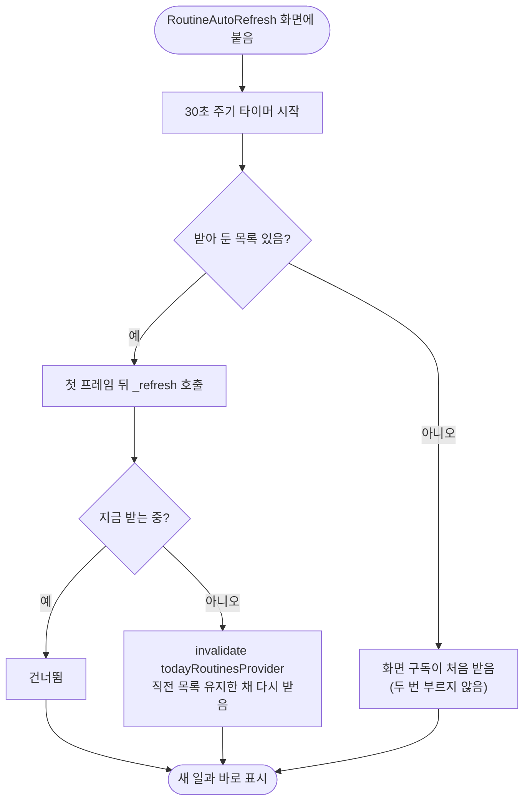

# 이룸이 화면으로 전환하면 오늘 일과를 바로 다시 받는다

## 개요

보호자 화면에서 일과를 만들고 이룸이 화면으로 넘어가면, 방금 만든 일과가 최대 30초 동안 보이지 않았다. #517의 자동 갱신(`RoutineAutoRefresh`)이 화면에 붙을 때 30초 타이머만 걸고 첫 갱신은 하지 않았기 때문이다. 오늘 일과 목록은 보호자 화면과 이룸이 화면이 **하나의 provider를 함께 쓰므로**, 이룸이 화면이 보호자 화면에서 받아 둔 옛 목록을 그대로 이어받고 있었다. 이번 수정으로 화면에 들어올 때 이미 받아 둔 목록이 있으면 곧바로 한 번 다시 받는다.

## 기능 흐름

## 변경 사항

### 자동 갱신
- `client/lib/features/child/application/routine_auto_refresh.dart`: `initState`에서 `todayRoutinesProvider`에 값이 이미 있으면 `addPostFrameCallback`으로 `_refresh()`를 한 번 부른다. 클래스 문서에 이유(#541)를 적었다.

### 테스트
- `client/test/routine_auto_refresh_test.dart`: "이미 받아 둔 목록이 있으면 들어오자마자 다시 받는다" 1건을 추가했다. 앞 화면이 목록을 받아 둔 상태에서 자동 갱신 위젯을 붙이고, 30초를 기다리지 않아도 요청이 한 번 더 가는지 본다.

## 주요 구현 내용

- **값이 있을 때만 즉시 갱신한다.** 앱을 처음 켤 때는 화면이 `ref.watch`로 구독하면서 목록을 받는다. 이때 무조건 갱신하면 요청이 두 번 간다. 기존 테스트("처음 켤 때 1번만 받는다")가 이를 지키고 있고, 그대로 통과한다.
- **첫 프레임 뒤에 부른다.** `initState` 안에서 provider를 무효화하면 build 도중 상태를 바꾸게 되므로 post-frame으로 미뤘다.
- **기존 보호 장치는 그대로다.** 받는 중이면 건너뛰기, `invalidate`로 직전 목록을 유지한 채 받기(깜빡임·빈 화면 없음), 백그라운드에서 멈추기.
- **보호자 홈에도 함께 적용된다.** 보호자 홈도 같은 위젯으로 감싸져 있어(#535), 이룸이 화면에서 돌아올 때 진행 상황이 바로 반영된다.

## 검증

| 항목 | 결과 |
| --- | --- |
| 자동 갱신 테스트 (`routine_auto_refresh_test.dart`) | 6건 통과 |
| 새 테스트가 수정을 잡는지 | 수정을 빼고 돌리면 `Expected 2 / Actual 1`로 실패 |
| `flutter analyze` | 0건 |
| 전체 `flutter test` | 2200건 중 3건 실패 (`dev_log_file_test` 2, `figma_conformance` 보호자 홈 1). **수정 전 코드에서도 같은 3건이 실패**해 이번 변경과 무관. 여러 세션이 동시에 테스트를 돌려 부하가 높던 때라 타이밍 탓일 수 있다 |
| 실기기 E2E | **보류 — 나중에 따로 진행** |

## 주의사항

- **실기기 E2E가 남아 있다.** 확인할 것: 보호자 화면에서 일과 저장 → 이룸이 화면 전환 직후(30초 전)에 목록에 보이는지, 이룸이 화면에서 카드 체크 → 보호자 화면 복귀 시 진행이 바로 반영되는지, 앱을 처음 켤 때 목록 요청이 한 번만 가는지(로그).
- 오늘 일과 목록은 보호자와 이룸이 화면이 같이 쓰는 keepAlive provider다. 화면 전환 시점의 신선도를 이 위젯이 책임지므로, 이 위젯을 빼거나 진입 갱신 조건(`hasValue`)을 바꾸면 이번 문제가 다시 생기거나 첫 실행에 요청이 두 번 간다.
- 아직 푸시하지 않았다.
