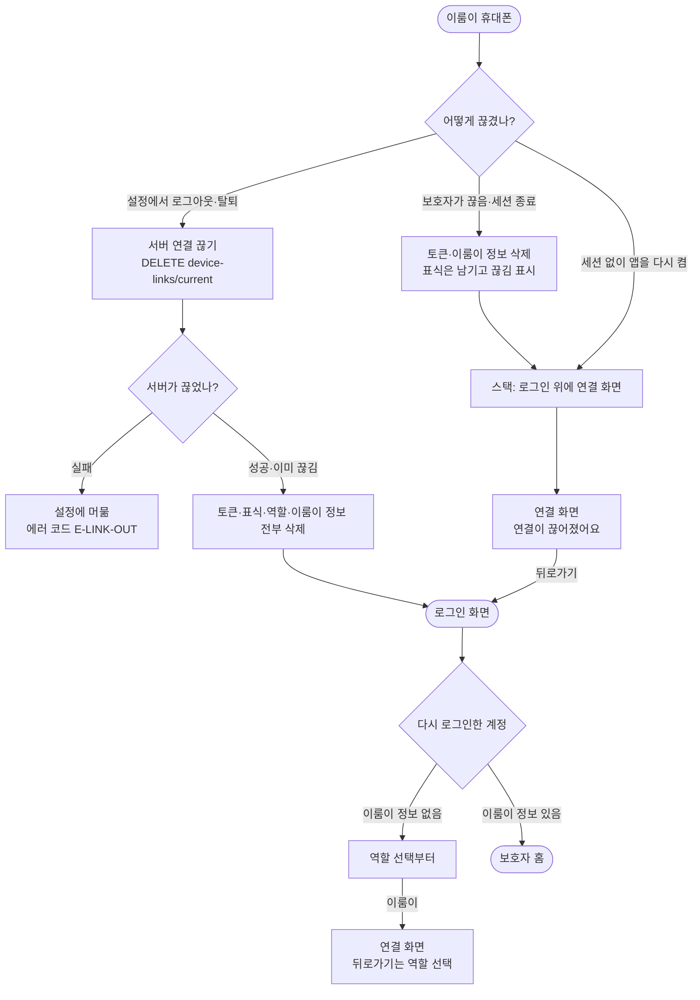

# 이룸이 휴대폰에서 로그아웃하면 연결 코드 화면에 갇혀 나올 수 없다

## 개요

이룸이 설정에서 로그아웃·회원탈퇴를 하면 연결 코드 화면으로 보냈는데, 그 아래 뒤로가기용으로 깔아 둔 역할 선택 화면이 라우터 가드에 걸려 다시 연결 코드 화면으로 바뀌었다. 스택이 `[연결, 연결]`이 되어 뒤로가기는 같은 화면만 다시 보여 주고, 이룸이 표식·역할이 남아 앱을 다시 켜도 그 화면에서 시작했다. 스스로 나가면 로그인 화면으로 보내고, 밖에서 끊긴 경우에는 연결 화면을 보여 주되 뒤로가기가 로그인 화면으로 가도록 바꿨다. 연결 화면은 어떤 길로 들어와도 막다른 화면이 되지 않는다. 함께 찾은 결함(다시 로그인하면 역할 선택을 건너뛰고 보호자 이름 입력으로 감)도 고쳤다.

커밋: `5068c515` (브랜치 `20261002_#542_…`, 아직 푸시 전)

## 기능 흐름

## 변경 사항

### 라우터

- `client/lib/core/router/app_router.dart`: 고정 상수 `linkEnterStack`(`[역할 선택, 연결]`)을 `linkEnterBackTarget(hasSession)`으로 바꿨다. 세션이 있으면 역할 선택, 없으면 로그인을 깐다. `goToLinkEnter`가 세션 여부를 받는다.
- `client/lib/features/onboarding/presentation/splash_screen.dart`: 앱 시작 시 연결 화면으로 보낼 때 세션 여부를 넘긴다.
- `client/lib/features/link/application/link_reset.dart`: 세션이 끝난 이룸이 휴대폰은 토큰을 방금 지웠으므로 로그인 화면을 깐다.

### 이룸이 설정의 로그아웃·회원탈퇴

- `client/lib/features/link/data/device_link_repository.dart`: `disconnectThisPhone`이 서버가 끊은 뒤 보호자 로그아웃처럼 `clearAll`로 전부 비운다(이룸이 표식·역할 포함). 카드 그림 캐시 삭제는 기다리지 않는다(`unawaited`, 세션 만료 때 `dio_client`와 같은 방식).
- `client/lib/features/link/presentation/elumi_settings_screen.dart`: 끊기면 연결 화면이 아니라 로그인 화면으로 간다.

### 연결 화면·로그인

- `client/lib/features/link/presentation/link_enter_screen.dart`: 뒤로가기가 돌아갈 곳이 없으면 `linkEnterBackTarget`과 같은 규칙으로 직접 옮긴다.
- `client/lib/features/auth/presentation/login_screen.dart`: 로그인 결과가 `onboarding`(약관은 마쳤지만 이룸이 정보가 없음)이면 이름 입력이 아니라 역할 선택으로 보낸다.

### 테스트

- `client/test/elumi_exit_no_dead_end_test.dart` (신규 9건): 실제 `createRouter`를 저장소·토큰과 묶어 띄운다. 로그아웃·탈퇴, 보호자가 끊음, 앱 재시작, 연결 화면 아래가 빈 경우, 역할 선택에서 이룸이를 고른 경우(#212 그대로)를 확인한다.
- `client/test/login_onboarding_asks_role_test.dart` (신규 1건): 이룸이 정보가 없는 계정은 역할 선택으로 간다.
- `child_elumi_settings_test` · `device_link_disconnect_test` · `elumi_link_loss_test` · `router_elumi_guard_test`: 옛 동작("표식을 남기고 연결 화면으로")을 고정하던 기대값을 새 동작에 맞췄다.

## 주요 구현 내용

**스스로 나간 것과 밖에서 끊긴 것을 나눴다.**

| | 스스로 로그아웃·탈퇴 | 보호자가 끊음·세션 종료 |
|---|---|---|
| 지우는 것 | 전부 (표식·역할 포함) | 토큰·이룸이 정보 (표식 남김) |
| 도착 화면 | 로그인 | 연결 화면 + `연결이 끊어졌어요` |
| 뒤로가기 | — | 로그인 |

#206은 "이룸이 휴대폰에는 로그인할 계정이 없으니 로그인 화면은 막다른 길"이라는 전제로 연결 화면에 보냈다. 지금 흐름은 이룸이 휴대폰도 소셜 로그인 → 약관 → 역할 선택 → 연결 순서로 들어오므로, 로그인 화면은 다시 들어오는 정상 입구다. 밖에서 끊긴 경우만 같은 이룸이에게 바로 다시 붙을 수 있게 연결 화면을 보여 준다.

**기존 테스트가 못 잡은 이유.** 모든 관련 테스트가 가드(redirect)가 없는 가짜 `GoRouter`를 썼다. 깔아 둔 역할 선택이 가드에 걸려 연결 화면으로 바뀌는 일이 가짜 라우터에서는 일어나지 않아, `canPop() == true`만 보고 통과했다. 새 테스트는 앱과 같은 `createRouter`를 쓴다. 고치기 전 코드(origin/develop)에서 새 테스트 9건 중 8건이 실패하는 것을 확인했다(통과한 1건은 원래 되던 #212 동작을 지키는 테스트).

## 검증

| 항목 | 결과 |
|---|---|
| `flutter analyze` | 0건 |
| 관련 테스트 6개 파일 | 75건 통과 |
| 앱 전체 테스트 | 2205 통과, 2 실패 (이번 변경과 무관, 아래) |
| 새 테스트를 고치기 전 코드에서 실행 | 9건 중 8건 실패 (결함 재현 확인) |

전체 테스트의 실패 2건

- `dev_log_file_test` "2MB를 넘으면 오래된 쪽부터 버린다": 단독 실행 시 통과. 여러 세션이 동시에 테스트를 돌려 부하가 높을 때 흔들린 것이다.
- `figma_conformance_test` "보호자 홈 — 일과를 민 뒤 (Figma 931:4179)": origin/develop에서도 같은 실패가 난다. 기존 결함이다.

## 남은 일

- **에뮬레이터 E2E는 하지 않았다.** 사용자 요청으로 나중에 따로 진행한다. 밟을 순서는 다음과 같다.
  1. 새 계정 로그인 → 이룸이 선택 → 보호자 코드로 연결 → 설정 → 로그아웃 → 로그인 화면 도착, 앱 재시작해도 로그인 화면
  2. 같은 계정으로 다시 로그인 → 역할 선택이 나오고 이룸이로 다시 연결 가능
  3. 회원탈퇴도 1과 같음
  4. 보호자 휴대폰에서 연결 끊기 → 이룸이 휴대폰이 연결 화면(`연결이 끊어졌어요`) → 뒤로가기로 로그인 화면, 앱 재시작해도 같음
  5. 오프라인에서 로그아웃 → 설정에 머물고 에러 코드 표시
- 푸시·배포 전이다.

## 주의사항

- **go_router 17에서 `currentConfiguration.uri`는 `push`로 쌓은 화면을 반영하지 않는다.** 맨 위 화면은 `currentConfiguration.last.matchedLocation`으로 본다. 작업 중 이것을 몰라 "go 직후 push가 경쟁한다"는 없는 원인을 만들어 대기 코드를 넣었다가 되돌렸다.
- **라우터 동작 테스트는 가드가 있는 `createRouter`로 한다.** 가짜 라우터로는 이번 결함 같은 가드 상호작용이 보이지 않는다. 실제 라우터는 시작 화면에서 출발해 스스로 이동하므로, 시험 시작점으로 옮기기 전에 그 이동이 끝나기를 기다려야 한다(테스트의 `pumpApp` 참고).
- `linkEnterBackTarget`의 "세션 없으면 로그인"은 가드가 로그인 화면을 막지 않는다는 전제에 기댄다. 로그인 화면에 가드를 붙이면 이 규칙도 함께 봐야 한다(`router_elumi_guard_test`가 이 전제를 검사한다).
- 이룸이로 연결할 때 처음 소셜 로그인한 계정의 리프레시 토큰은 연결 토큰으로 덮이기만 하고 서버에서 폐기되지 않는다. 사용자에게 보이는 결함은 아니라 이번 범위에서 고치지 않았다.
