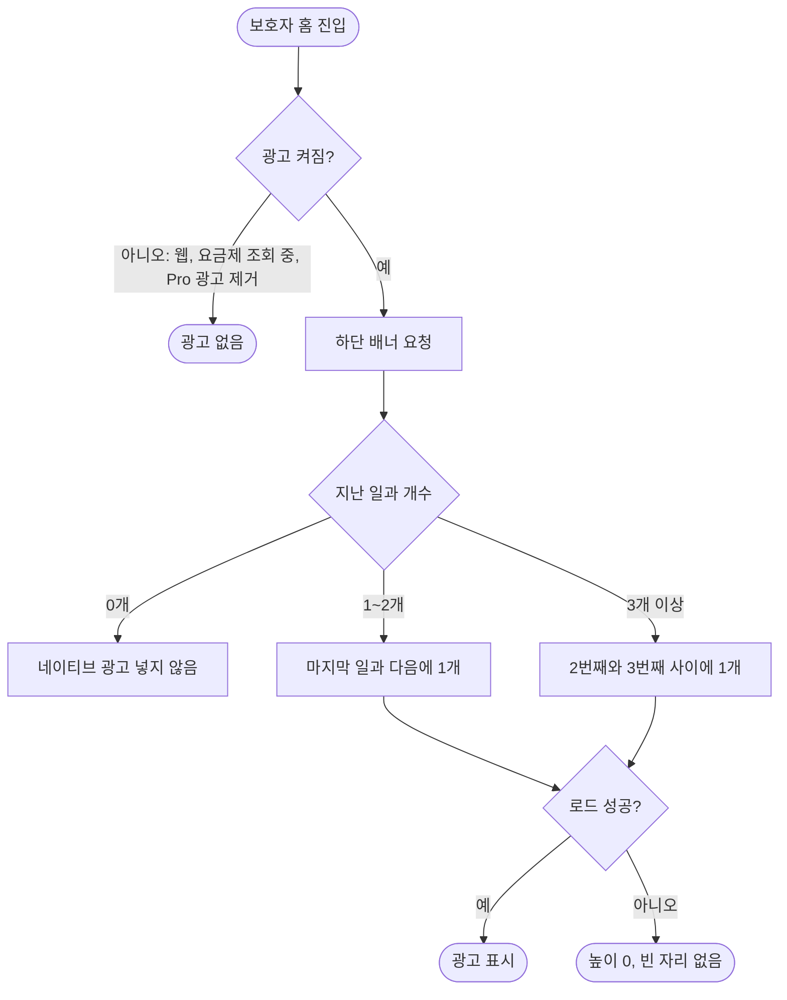

# 지난 일과가 1개 이상이면 네이티브 광고를 노출한다

## 개요

보호자 홈 지난 일과 목록의 네이티브 광고(#465)는 지난 일과가 3개 이상일 때만 두 번째와 세 번째 사이에 들어갔다. "사이"에 끼우려고 정한 기준이라 지난 일과가 1~2개인 보호자(앱을 쓴 지 얼마 안 된 보호자 대부분)는 네이티브 광고를 한 번도 보지 못했다. 이제 지난 일과가 1개 이상이면 광고를 하나 넣는다. 1~2개면 마지막 일과 다음, 3개 이상이면 지금처럼 두 번째와 세 번째 사이에 들어가고, 0개면 넣지 않는다.

## 기능 흐름

## 변경 사항

### 광고 위치
- `client/lib/features/guardian/presentation/widgets/today_routine_section.dart`: 지난 일과 개수 하한 상수(`_nativeAdMinItems = 3`)를 없애고, 광고를 넣는 위치를 `min(_nativeAdAfterIndex, 목록 길이 - 1)` 로 바꿨다. 목록이 짧으면 마지막 일과 다음이 된다. 오클릭을 막는 기존 여백(일과와 광고 사이 간격)은 그대로다.

### 테스트
- `client/test/ads/ad_native_home_test.dart`: "0·1·2건이면 넣지 않는다" 테스트를 둘로 나눴다.
  - 1건, 2건: 광고가 한 개 뜨고, 마지막 일과보다 아래에 있다.
  - 0건: 광고가 없고 요청도 하지 않는다.

## 주요 구현 내용

- **0개일 때 넣지 않는 이유**: 빈 상태 안내("아직 지난 일과가 없어요") 아래에 광고를 두면 하단 배너와 함께 내용 없는 화면에 광고 두 개가 위아래로 붙는다. AdMob은 콘텐츠보다 광고가 많은 화면을 정책 위반으로 보고, 계정이 정지되면 광고 수익이 전부 끊긴다. 그래서 가입 첫날(지난 일과 0개)만 비우고, 이때도 하단 배너는 나온다.
- **바꾸지 않은 것**
  - 하단 배너: Free 계정이면 원래 조건 없이 나온다.
  - 광고 게이트(`adsEnabledProvider`): 모바일이고, 회원 조회가 끝났고, 요금제가 광고를 없애지 않을 때만 켜진다. Pro 광고 제거는 결제로 산 약속이라 손대지 않았다. 조회 중에 광고를 먼저 요청하면 Pro 계정이 첫 화면에서 광고를 잠깐 보게 되므로 이 조건도 그대로 뒀다.
  - 오늘 일과 사이에는 광고를 넣지 않는다.

## 검증

| 항목 | 결과 |
|---|---|
| 광고 테스트 (`test/ads/`) | 99 통과 |
| `flutter analyze` | 0건 |
| 전체 `flutter test` | 2196 통과, 1 실패 |

- 실패 1건은 골든 `figma/routine_menu_931-4179.png`(보호자 홈, 일과를 민 뒤)로 7.60% 차이다. 변경 전 `origin/develop` 코드로 돌려도 같은 7.60%로 실패해 이번 변경과 무관하다. 원인은 따로 보지 않았다.
- 처음 전체 실행에서 `dev_log_file_test` 2건이 실패했지만, 여러 세션이 동시에 테스트를 돌려 맥 부하가 높았던 때였다. 순번 스크립트로 다시 돌리자 통과했다.

## 주의사항

- **실기기 E2E는 나중에 따로 한다.** 지난 일과가 1개, 2개인 계정에서 광고가 목록 끝에 붙는지와 여백을 실기기로 확인해야 한다. 지난 일과는 지난 날짜의 일과라 오늘 바로 만들 수 없어서, 일과가 쌓인 계정이 필요하다.
- **안드로이드 하단 배너가 안 보이는 문제는 이 이슈 밖이다.** 코드상 배너는 조건 없이 붙어 있다. 의심되는 원인은 두 가지다.
  - 릴리스 빌드의 `CLIENT_ENV_FILE` 에 `ELUM_ADMOB_ANDROID_*` 광고 단위가 비어 있을 수 있다. 비어 있으면 광고를 요청하지 않고 로그도 남지 않는다.
  - Play 비공개 테스트 앱이라 AdMob 노출이 제한됐을 수 있다.
  - 둘 다 아직 확인하지 못했다.
- 광고 위치 규칙을 다시 바꿀 때는 0개일 때 비우는 규칙을 유지한다(정책 위험).
