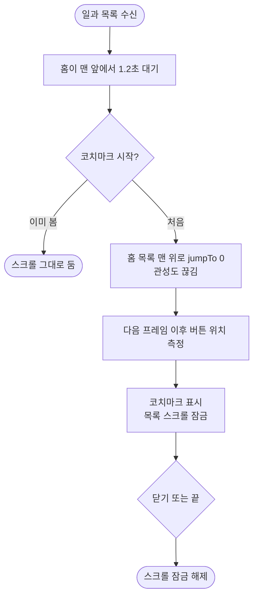

# 🚀[기능개선][클라][홈] 코치마크가 뜨기 직전 스크롤하면 구멍이 버튼과 어긋남

## 개요
보호자 홈 코치마크(#505)가 뜨기 직전에 화면을 스크롤하면 `새로운 일과 만들기` 구멍이 버튼과 어긋나던 문제를 고쳤다. 켜질 때 홈 목록을 맨 위로 되돌려 관성까지 끊고, 떠 있는 동안은 스크롤을 잠갔다.

## 기능 흐름

## 원인
- 구멍 위치는 코치마크가 켜질 때 **한 번만** 잰다(`coach_mark_overlay.dart` `_measure`).
- 시작 조건(`_maybeStartCoach`)은 화면 전환·맨 앞 여부·1.2초 대기만 보고 스크롤 상태는 보지 않는다.
- 대기 중 스크롤하거나 관성이 도는 중에 재면 위치가 틀어지고, 버튼이 화면 밖이면 1단계가 건너뛰어지기도 한다.

## 변경 사항

### 앱
- `client/lib/features/guardian/presentation/guardian_home_screen.dart`
  - 홈 스크롤에 `ScrollController`를 달았다.
  - 코치마크가 **실제로 켜질 때만** `jumpTo(0)` 한다. `jumpTo`는 진행 중인 관성도 끊는다.
  - 코치마크가 활성인 동안 `NeverScrollableScrollPhysics`로 잠그고, 끝나면 푼다.

### 테스트
- `client/test/home_coach_test.dart` (스크롤 3건 추가)
  - 시작 전에 스크롤해도 맨 위로 돌아오고 1단계가 유지된다.
  - 떠 있는 동안 잠기고 닫으면 풀린다.
  - 이미 본 사람의 스크롤은 건드리지 않는다.

## 주요 구현 내용
- 맨 위 이동은 `maybeStart`가 true를 돌려준 뒤에만 한다. 앞쪽에서 무조건 하면 코치마크를 이미 본 사람이 스크롤할 때마다 맨 위로 끌려간다.
- 구멍은 상태가 바뀐 다음 프레임 이후에 재므로, 같은 프레임에서 한 `jumpTo`가 먼저 반영된다.

## 검증
- 수정을 빼면 앞의 두 테스트가 실패하는 것을 확인했다(스크롤 위치 236 ≠ 0, 물리 null).
- 홈·코치마크 관련 테스트 통과, analyze 0건.
- 배포 PR #547 머지 완료.

## 주의사항
- 매 프레임 다시 재는 안전망은 범위에서 뺐다. 위 두 장치로 부족하면 얹는다.
- 확인 못 한 것: 실기기에서 관성 스크롤 도중 시작하는 장면. 위젯 테스트는 드래그 후 정지 상태만 만든다.
