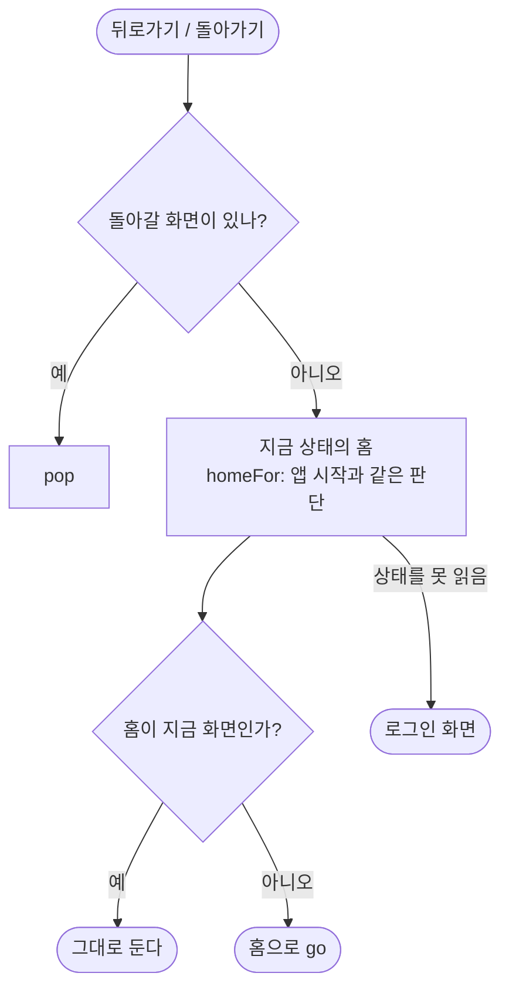
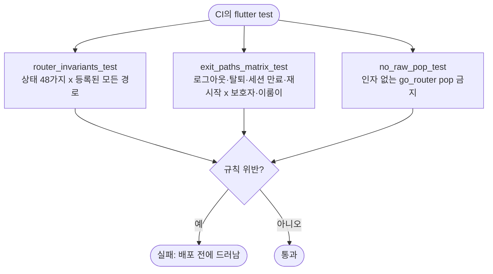

# 화면 이동 막다른 길이 다시 생기지 않게 뒤로가기 안전망과 상태 조합 검사를 넣는다

## 개요

#542(이룸이 로그아웃 뒤 연결 코드 화면에 갇힘) 같은 결함이 다시 생기지 않도록 구조를 바꾸고, 생기면 `flutter test`가 자동으로 잡게 했다. 핵심은 공통화다. "지금 상태의 홈", 뒤로가기, 로그아웃·탈퇴의 로컬 정리, 세션 만료 처리를 각각 한 곳으로 모았다. 그 위에 상태 조합 전수 검사와 나가는 경로 표 테스트를 얹었다.

새 검사가 **실제 결함 둘을 바로 찾아** 함께 고쳤다.

1. 연결 직후 이룸이 정보 조회가 실패한 이룸이 휴대폰이 **보호자 온보딩(이름 입력)** 으로 보내졌다. 이룸이가 보호자로 가입하는 길에 들어설 수 있었다.
2. 세션 없는 이룸이 휴대폰이 보호자 전용 경로를 열면 두 번 튕겼다.

커밋: `464055bb` (develop), 배포 PR #549

## 기능 흐름

## 변경 사항

### 공통화

- `client/lib/core/router/app_destination.dart`(신규): `resolveDestination`(시작 화면에서 옮김)과 `homeFor(container)`. 앱 시작과 뒤로가기가 같은 판단을 쓴다.
- `client/lib/core/router/pop_or_home.dart`(신규): `context.popOrHome()`. 돌아갈 화면이 있으면 pop하고, 없으면 지금 상태의 홈으로 간다. 이미 홈이면 아무것도 하지 않고, 상태를 못 읽으면 로그인 화면으로 간다.
- `client/lib/core/storage/account_wipe.dart`(신규): `wipeLocalAccount`. 보호자 로그아웃·탈퇴(`auth_repository.dart`)와 이룸이 로그아웃·탈퇴(`device_link_repository.dart`)가 같은 순서로 지운다. 순서는 토큰, 저장값 전부(이룸이 표식·역할 포함), 카드 그림 캐시이며, 캐시까지 지운 뒤에 돌아온다.
- `client/lib/features/link/application/link_reset.dart`: `handleSessionExpired`. `app.dart`의 세션 만료 listener에서 판단만 옮겼다. 동작은 같다.

### 뒤로가기 26곳

- 인자 없는 `context.pop()`을 쓰던 화면을 `context.popOrHome()`으로 바꿨다. 대상은 설정, 연결, 다중 보호자, 일과 만들기, 이룸이 화면, 온보딩이다.
- 결과를 돌려주는 `context.pop(값)`, 시트·다이얼로그의 `Navigator.pop`, 이미 대비가 있는 `leaveRoutineFlow`는 그대로 두었다.

### 가드 결함 수정 (`client/lib/core/router/app_router.dart`)

- 이룸이 휴대폰은 온보딩 완료 조건을 보지 않는다. 이룸이 정보는 보호자 계정에 있다.
- 보호자 전용 경로를 이룸이 휴대폰에서 열면 세션이 있을 때는 이룸이 홈, 없을 때는 연결 화면으로 한 번에 보낸다.

### 테스트

| 파일 | 내용 |
|---|---|
| `router_invariants_test.dart` | 로그인 여부 × 이룸이 휴대폰 여부 × 역할 3 × 온보딩 × 마지막 화면 = 48 상태와 라우터에 등록된 모든 경로를 확인한다. 보내는 곳이 실제 화면인지, 한 번에 멈추는지, 홈과 깔아 두는 화면이 막히지 않는지 본다. **새 경로는 자동으로 검사된다** |
| `exit_paths_matrix_test.dart` | 실제 `createRouter`로 보호자·이룸이의 로그아웃·탈퇴(4), 세션 만료(2), 끊긴 휴대폰 재시작, 설정을 go로 연 뒤 뒤로가기(2), 연결 화면 뒤로가기(3)를 확인한다. 도착 화면, 뒤로가기, 재시작, 남은 저장값까지 본다 |
| `no_raw_pop_test.dart` | `context.pop()`, `context.pop` 함수 참조, `GoRouter.of(context).pop()`, 줄바꿈된 호출을 막는다. 검사식 자체를 확인하는 테스트도 있다 |
| `pop_or_home_test.dart` · `account_wipe_test.dart` · `app_destination_test.dart` | 공용 함수 단위 테스트 |
| `helpers/real_router.dart` · `helpers/no_disk_cache.dart` | 실제 라우터를 띄우는 도우미, 디스크를 쓰지 않는 캐시 |

### 문서

- `client/CLAUDE.md`에 **화면 이동 규칙**을 추가했다. 뒤로가기는 `popOrHome`으로, 홈 판단·로컬 정리·세션 만료는 공용 함수로, 라우터 테스트는 실제 라우터로 한다. 경로를 추가하면 상태 조합 검사가 자동으로 돈다. 주석에는 이슈 번호와 과거 경위를 쓰지 않는다는 규칙도 함께 적었다.
- 설계: `docs/superpowers/specs/2026-10-02-router-dead-end-guard-design.md`, 계획: `docs/superpowers/plans/2026-10-02-router-dead-end-guard.md`

## 검증

| 항목 | 결과 |
|---|---|
| `flutter analyze` | 0건 |
| 앱 전체 테스트 | 2392 통과, 1 실패. 실패는 기존 `figma_conformance` "보호자 홈 일과를 민 뒤"로 develop에서도 실패한다 |
| 되돌림 확인 | 깔아 두는 화면을 역할 선택으로 고정하고 한 화면을 `context.pop()`으로 되돌리면 새 테스트 16건이 실패한다. 보호자 설정 뒤로가기를 `GoRouter.of(context).pop()`으로 바꾸면 표 테스트가 실패한다 |
| 리뷰 | 별도 리뷰어가 Critical 0, Important 3건을 냈고 모두 반영했다(검사식 확대, 실제 화면 홈 이동 행, 상태 축 추가) |

## 주의사항

- **새 화면을 추가할 때** 뒤로가기는 `context.popOrHome`을 쓴다. `context.pop()`을 쓰면 `no_raw_pop_test`가 실패한다. 정말 필요하면 그 테스트의 `allowed`에 사유와 함께 올린다.
- **가드 규칙을 바꾸면** `router_invariants_test`가 48 상태 전부를 다시 본다. 실패 메시지에 상태와 경로가 나오니 규칙을 고친다. 생길 수 없는 상태라고 제외하지 않는다. 저장값이 어긋난 채 앱이 켜질 수 있다.
- **계정 상태가 바뀌는 길**(새 로그인 수단, 새 탈퇴 경로 등)을 더하면 `exit_paths_matrix_test`에 행을 더한다.
- 로그아웃은 카드 그림 캐시 삭제가 끝난 뒤 화면을 옮긴다. 기존 개인정보 테스트(E22~E26)가 이를 약속한다. 위젯 테스트에서는 `noDiskCacheOverride()`를 끼워야 멈추지 않는다.
- go_router 17에서 `currentConfiguration.uri`는 push로 쌓은 화면을 반영하지 않는다. 맨 위 화면은 `.last.matchedLocation`으로 본다(`topOf`).
- 이룸이 휴대폰이 정보 조회에 실패한 채 이룸이 홈에 들어가면 이름은 서버 회원 정보로, 캐릭터는 기본값으로 그려진다. 보호자 온보딩으로 보내던 것보다 안전하다.

## 남은 일

- 실기기 E2E는 #542와 함께 나중에 따로 진행한다.
- 앱 전체 리팩터링(흩어진 공통 규칙 모으기)과 기존 주석의 이력 서술 정리는 별도 이슈로 진행한다.
- `#542` 때 만든 `elumi_exit_no_dead_end_test.dart`는 이번 표 테스트와 겹친다. 파일 삭제는 확인을 받은 뒤 한다.
