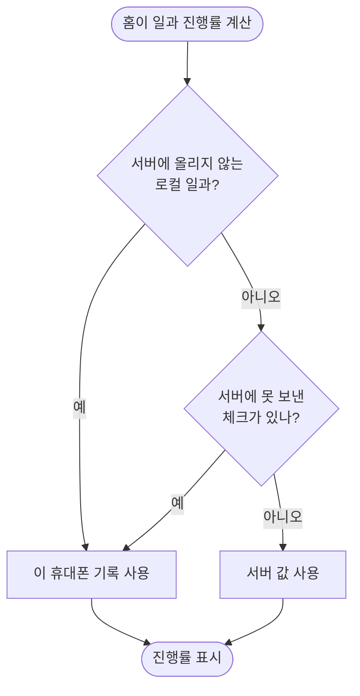

# 다른 휴대폰에서 끝낸 일과가 보호자 홈에 반영되지 않는다

## 개요

보호자 휴대폰에서 일과 카드를 일부 체크한 적이 있으면, 다른 이룸이 휴대폰이 그 일과를 끝내도 보호자 홈이 67%에 머물던 문제를 고쳤다. 홈 진행률이 "이 휴대폰에 체크 기록이 있는가"만 보고 서버 값을 무시한 것이 원인이었다. 이제 서버에 아직 못 보낸 체크가 있는 동안에만 이 휴대폰 기록을 따르고, 다 보낸 뒤에는 서버 값을 따른다.

배포: PR #554 (develop 8aa41d21)

## 기능 흐름

## 변경 사항

### 홈 진행률
- `client/lib/features/guardian/presentation/widgets/today_routine_section.dart`: `routineProgress`가 로컬 일과이거나 서버 전송 대기(`pending`) 중일 때만 기기 기록(`isChecked`)을 쓰고, 그 밖에는 서버가 준 카드 완료 값을 센다.

### 테스트
- `client/test/routine_progress_test.dart` (신규): 다 보낸 일과는 서버 값으로 100%, 대기 중이면 기기 기록 기준 2/3, 로컬 일과는 늘 기기 기록 기준, 3건.

## 주요 구현 내용

**왜 `isChecked`를 안 고쳤나.** 원인 줄은 `ChildRoutineState.isChecked`(기록이 있으면 서버 값 무시)지만 거기를 고치지 않았다. `isChecked`는 이룸이 상세 화면도 쓰는데, 상세 화면은 열 때 받은 **오래된 일과 스냅샷**을 들고 있다. 서버 값을 우선시키면 방금 체크한 카드가 스냅샷의 옛 값으로 되돌아가 체크가 풀려 보인다. 그래서 서버 목록을 새로 받아 오는 홈 계산만 바꿨다.

**왜 `pending`을 기준으로 삼았나.** 전송이 끝나면 대기열(`pending`)에서 빠지므로 "서버가 이 휴대폰 체크를 이미 알고 있다"는 신호로 쓸 수 있다. 오프라인에서 체크한 직후에는 대기 중이라 이 휴대폰 기록이 계속 보인다.

## 주의사항

- **실기기로는 확인하지 못했다.** 단위 테스트와 관련 테스트(`child_step_sync_test`, `child_mode_test`)만 통과했다. 같은 시나리오(보호자 폰이 카드 1, 2 체크 → 다른 폰이 3 체크)를 두 대로 다시 밟아야 한다.
- 전송이 끝난 직후 서버 목록을 다시 받는 사이(네트워크 시간)에는 옛 서버 값이 잠깐 보일 수 있다. 홈이 화면에 보이는 상태에서 체크가 끝나는 경우에만 해당한다.
- 이룸이 홈(`child_home_screen.dart`)도 같은 `routineProgress`를 쓰므로 같은 규칙을 따른다.
