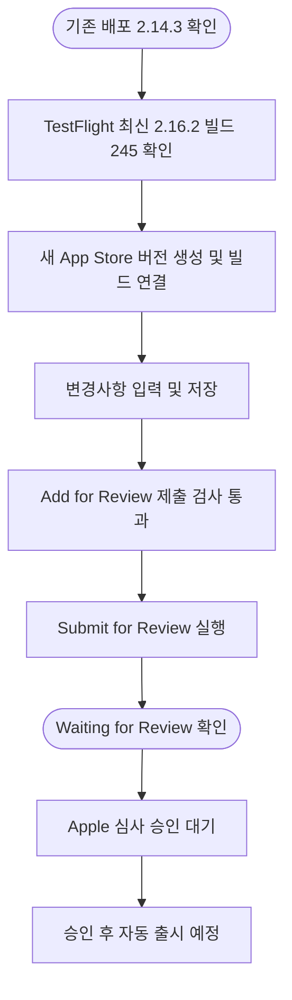

# iOS 2.16.2 심사 제출 및 기존 설정 확인

## 개요

기존 배포 버전 2.14.3 이후의 최신 업로드인 2.16.2(빌드 245)를 App Store Connect에서 심사 제출했다. 최종 제출 후 페이지를 새로고침해도 `Waiting for Review`가 유지되는 것을 확인했다. 승인 후 자동 출시 설정은 이전 버전과 같다.

관련 이슈: https://github.com/Twin-Fang/elum/issues/559

## 기능 흐름

## 변경 사항

| 항목 | 이전 | 이번 제출 |
| --- | --- | --- |
| App Store 버전 | 2.14.3 | 2.16.2 |
| 선택한 빌드 | 이번 작업에서 조회하지 않음 | 245 |
| 상태 | Ready for Distribution | Waiting for Review |
| 이번 버전 변경사항 | 이전 버전 문구 | 홈 진행률 반영, 보상 화면 중복 표시 수정, 뒤로가기 개선 |
| 출시 방식 | 승인 후 자동 출시 | 동일 |
| 평점 | 기존 평점 유지 | 동일 |

## 주요 작업 내용

### 최신 업로드 선택

TestFlight에 보이는 최상위 버전 2.16.2와 빌드 245를 확인했다. 로컬에 저장된 `origin/main`의 `version.yml`도 2.16.2/245로 일치했다. 새로 빌드하거나 업로드하지 않고 이미 업로드되어 선택 가능한 빌드를 사용했다.

### 기존 설정 계승과 직접 비교

새 버전 생성 시 기존 스크린샷과 메타데이터를 이어받았다. 제출 후 2.14.3과 2.16.2의 폼 값을 직접 대조했다.

- 설명, 키워드, 지원 URL, 마케팅 URL, 저작권, 심사 메모, 심사 연락처의 이름 2개·전화·이메일: 10개 항목 모두 동일.
- 로그인 필요 여부: 두 버전 모두 미선택.
- 승인 후 자동 출시: 두 버전 모두 선택.
- 기존 평점 유지: 두 버전 모두 선택.

개인 연락처나 로그인 정보 실제 값은 보고서에 포함하지 않는다. 스크린샷은 기존 3장이 계승된 것을 화면에서 확인했으나 이미지 파일 해시까지 대조하지는 않았다.

### 변경사항 문구

최근 릴리스에 포함된 #548, #550, #551의 변경을 바탕으로 다음 문구를 입력했다.

> • 다른 휴대폰에서 완료한 일과가 보호자 홈에 더 정확하게 반영되도록 개선했어요.
> • 이룸이의 보상 화면이 겹쳐 나타나는 문제를 수정했어요.
> • 뒤로가기와 화면 이동 동작을 개선했어요.

### 제출 검증

`Add for Review` 이후 `Ready for Review`와 `2.16.2 (245)`를 확인한 뒤 `Submit for Review`를 실행했다. 제출 후 `Waiting for Review`를 확인했고, 페이지를 다시 불러온 뒤에도 같은 상태가 유지됐다.

## 주의사항

- 심사 제출은 성공했지만 Apple 심사 승인과 App Store 출시 완료는 아직 아니다.
- 이번 작업은 제출 운영 검증이며 앱 실행, 실기기 E2E, 전체 기능 회귀 테스트는 수행하지 않았다. 따라서 앱의 모든 기능에 문제가 없다고 보장하지 않는다.
- 코드 수정, Git 커밋, 푸시, 새 빌드 업로드는 수행하지 않았다.
- 승인 후 자동 출시이므로 Apple 승인이 나면 출시로 이어진다.
- 로그인 입력란은 별도 iframe 안에 있어 일반 입력 셀렉터는 실패했고, 프레임을 지정한 pro-launch 입력으로 로그인했다. 비밀번호는 자격증명 저장소에 저장하지 않았다.
- 심사 상태 증거는 `docs/projectops/launch/20261004_001_iOS_심사_제출/screenshots/21_final_status.webp`에 남겼다. 계정명이 포함된 원본 화면은 GitHub에 첨부하지 않았다.
- 이슈는 열어 두고 심사 제출 작업의 완료 라벨만 반영한다. 심사 결과를 받으면 같은 이슈에 후속 기록을 남길 수 있다.
