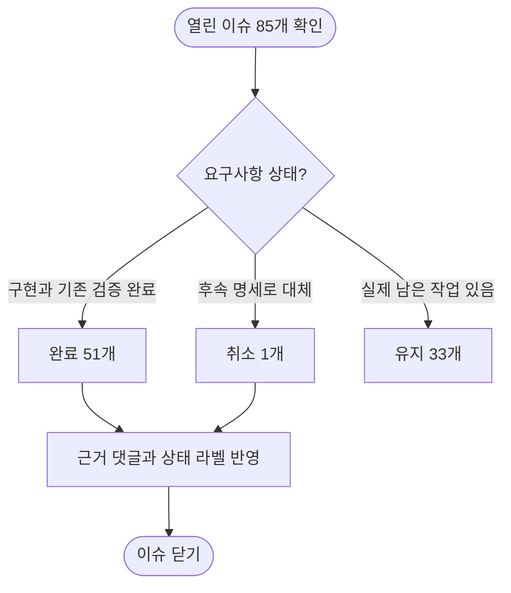

# 열린 이슈 전체 점검 및 완료·취소 정리

열린 이슈 85개를 본문·댓글과 최신 원격 코드 이력에 대조했다. 완료 51개와 이전 명세 취소 1개를 닫고, 미구현 요구사항·미해결 협의·운영 작업이 있는 33개를 유지한다.

## 처리 기준

## 완료 처리

| 이슈 | 제목 | 판단 근거 |
| --- | --- | --- |
| [#281](https://github.com/Twin-Fang/elum/issues/281) | ⚙️[기능추가][클라][광고] AdMob 배너를 붙인다 — 이룸이 화면은 제외 | 광고 SDK·ATT·배너 기반이 main에 반영됐고 기존 보고서에 플랫폼 테스트와 실제 보호자 화면 확인이 있다. 설정 배너와 홈 중간 배너의 옛 배치는 #487의 최종 배치로 대체됐다. 광고 인증과 디자인은 #467·#468에서 계속 추적한다. |
| [#342](https://github.com/Twin-Fang/elum/issues/342) | ❗[버그][클라][로그인] 글꼴을 가장 크게 하면 상단 두 문구가 겹친다 | 로그인 문구와 로고를 고정 좌표 대신 최소 간격을 유지하는 Column으로 배치하는 수정과 큰 글꼴 회귀 테스트가 main에 반영됐다. |
| [#355](https://github.com/Twin-Fang/elum/issues/355) | ❗[버그][클라][암호] 보호자 암호가 없는 휴대폰에서는 아무 숫자로 보호자 화면이 열린다 | 암호 없음이 보호자 화면 통과로 이어지던 경로를 막는 수정과 회귀 테스트가 main에 반영됐다. 암호 없는 보호자는 새 암호를 정하고 이룸이 휴대폰의 보호자 진입은 막는다. |
| [#361](https://github.com/Twin-Fang/elum/issues/361) | ⚙️[기능추가][서버][초대] 초대 코드로 보호자가 이룸이에 합류하고 나갈 수 있게 한다 | 보호자 초대·합류·목록·나가기 API와 테스트가 구현됐고 #480 배포 및 운영 V31·V32 반영 기록이 있다. |
| [#362](https://github.com/Twin-Fang/elum/issues/362) | ⚙️[기능추가][클라][초대] 초대 코드로 함께할 보호자를 부르고 이룸이를 바꿔 본다 | 함께하는 사람·초대 입력·이룸이 선택과 상태 정리 기능 및 테스트가 반영됐다. 디자인 협의는 #479에서 계속 추적한다. |
| [#363](https://github.com/Twin-Fang/elum/issues/363) | ⚙️[기능추가][클라][설정] 이룸이 휴대폰에 설정을 두고 보호자가 연결을 끊을 수 있게 한다 | 이룸이 설정과 보호자의 연결 끊기 기능이 구현·배포됐다. 임시 설정 시트는 #488의 설정 페이지로 대체됐으며 디자인은 #479에서 추적한다. |
| [#364](https://github.com/Twin-Fang/elum/issues/364) | 🚀[기능개선][서버][계정] V23 마이그레이션으로 옛 대표 보호자 컬럼을 지우고 필수 값을 건다 | 운영 배포 기록에서 profile.member_id 제거와 routine.created_by NOT NULL, V31·V32 성공을 확인했다. |
| [#365](https://github.com/Twin-Fang/elum/issues/365) | 🔧[기능요청][클라][초대] 초대 코드를 링크로 보내 누르면 합류하게 한다 | 초대 링크 처리 구현과 #480 배포 기록이 있으며 작업완료로 관리되고 있다. 운영 실기기의 링크 열기 확인 범위는 기존 배포 댓글에 남아 있다. |
| [#379](https://github.com/Twin-Fang/elum/issues/379) | 🔧[기능요청][클라][로그인] 네이버 로그인을 서비스 상태로 전환한다 | 기존 완료 댓글에서 사용자가 네이버 로그인이 잘 된다고 확인했고 작업완료로 관리되고 있다. 검수 요청·iOS 설정과 로그인 확인 기록을 근거로 처리 범위를 닫는다. 일반 계정과 콘솔 서비스 상태를 이번에 새로 확인하지 않았다는 한계는 보존한다. |
| [#393](https://github.com/Twin-Fang/elum/issues/393) | ❗[버그][클라][일과] 일과 만들기 E2E 에서 나온 범위 밖 작은 결함 모음 | S1~S7 수정이 develop·main에 반영됐고 기존 보고서에 앱 테스트 1032건 통과와 수정 전 실패 확인이 있다. 당시 실기기에서 못 밟은 항목은 기존 보고서에 보존한다. |
| [#401](https://github.com/Twin-Fang/elum/issues/401) | 🎨[디자인][클라][일과] 카드 확인 화면 카드 안 배치를 시안에 맞춘다 | 카드 안 여백·폭·스피커·제목·설명 정렬 수정과 시안 대조·회귀 테스트가 반영됐다. 기존 보고서의 시안 머리와 추가 간격 질문은 이번 카드 내부 배치 완료와 구분한다. |
| [#405](https://github.com/Twin-Fang/elum/issues/405) | ❗[버그][클라][일과] 저장한 일과를 편집해 저장하면 ROUTINE_INVALID_STATUS 가 뜨고 뺀 카드가 서버에 반영되지 않는다 | 일과 저장 시 제거한 카드를 먼저 서버에서 삭제하고 임시저장일 때만 확정하는 수정이 main에 반영됐으며 회귀 테스트 11건·앱 테스트 1026건 통과 기록이 있다. 기존에 남겨 둔 운영 편집·저장 E2E 재확인은 이번에 실행하지 않았다. |
| [#438](https://github.com/Twin-Fang/elum/issues/438) | 🎨[디자인][클라][설정] 비밀암호 변경 화면 시안 요청 | 요청했던 비밀암호 변경 시안 1027:4683·1274:9466·1274:9564·1274:9661이 제공됐고 #498의 79bfff68에서 반영됐다. 현재 코드와 시안 대조 골든에도 해당 프레임이 있다. |
| [#449](https://github.com/Twin-Fang/elum/issues/449) | 🚀[기능개선][클라][배포] iOS 심사 제출이 이미 올라간 빌드를 재사용하지 못하고 중복 업로드로 실패한다 | 이미 업로드된 빌드를 중복 업로드 오류 때 재사용하는 수정이 main에 반영됐고 v2.1.2 심사 제출 통과 보고서가 있다. 빌드 처리 대기와 스토어 설치본 검증은 기존 후속 기록을 보존한다. |
| [#451](https://github.com/Twin-Fang/elum/issues/451) | 🚀[기능개선][클라][카드확인] 카드 순서 변경에서 잡힌 카드를 알아보게 하고 색이 튀지 않게 한다 | 옛 일과 시트 변경은 사용자 요청에 따라 되돌려졌고 최종 대상인 카드확인 순서 변경의 확대·그림자·진동·스냅·색 전환이 반영됐다. Android 실화면 검증과 회귀 테스트 기록이 있으며 iOS 업로드 문제는 #452로 분리됐다. |
| [#452](https://github.com/Twin-Fang/elum/issues/452) | 🚀[기능개선][클라][배포] iOS 테스트 빌드가 출시된 버전이면 시작 직후 사유와 함께 멈춘다 | 출시 버전 사전 점검과 실패 사유·실제 빌드 SHA 표시 수정이 main에 포함돼 있다. 기존 댓글의 main 미반영 안내는 현재 브랜치 이력과 달라졌다. 댓글 트리거에서 사전 차단되는 실제 상황은 재실행하지 않았다. |
| [#456](https://github.com/Twin-Fang/elum/issues/456) | ⚙️[기능추가][클라][카드] 카드 그림을 카메라, 갤러리 사진으로 바꾼다 | 카메라·갤러리 사진 교체, 업로드 실패·재시도·권한 안내와 카드 비율 미리보기가 main에 반영됐고 통합 E2E·운영 QA 및 회귀 테스트 기록이 있다. 추가로 제안된 사진 자르기·확대 보정과 정식 시안은 #459의 후속 범위로 남긴다. 이번에 E2E를 새로 실행하지 않았다. |
| [#458](https://github.com/Twin-Fang/elum/issues/458) | ⚙️[기능추가][클라][설정] 온보딩과 설정에서 그림 방식을 고르고 그림 없는 카드를 기본 카드로 보여준다 | 그림 방식 선택·서버 저장·실패 롤백이 구현·배포됐고 운영 QA 기록이 있다. 정식 선택 시안도 #494로 반영됐다. 온보딩 실기기·TalkBack의 미확인 범위는 기존 댓글에 보존한다. |
| [#462](https://github.com/Twin-Fang/elum/issues/462) | ❗[버그][클라][카드] 카드 그림이 기기에 저장되지 않아 다시 들어가거나 오프라인이면 보이지 않는다 | 디스크 캐시·로그아웃 정리·동시 다운로드 보호가 반영됐고 실제 파일시스템 테스트 26건과 시뮬레이터 재시작·오프라인 E2E 기록이 있다. 후속 재시도 문제는 #500에서 계속 추적한다. |
| [#464](https://github.com/Twin-Fang/elum/issues/464) | ⚙️[기능추가][클라][광고] 크레딧이 없을 때 광고 보고 더 만들기를 제안한다 | 크레딧 소진 시 광고 제안·시청·서버 GRANTED 확인 후 잔액 갱신 흐름과 실패 경로 테스트가 main에 반영됐다. 운영 SSV 활성화는 #463, 최종 디자인은 #468에서 계속 추적한다. |
| [#465](https://github.com/Twin-Fang/elum/issues/465) | ⚙️[기능추가][클라][광고] 홈 지난 일과 목록 사이에 네이티브 광고를 넣는다 | 지난 일과 구역의 네이티브 광고 슬롯과 실패 시 높이 0·금지 구역 검사·0건 미노출 테스트가 반영됐다. 1~2건 목록의 후속 배치와 실측은 #540에서 추적하고 디자인은 #468에서 추적한다. |
| [#466](https://github.com/Twin-Fang/elum/issues/466) | 🔧[기능요청][클라][광고] 광고 도입에 맞춰 스토어 신고·약관·개인정보처리방침을 갱신한다 | 신고·약관·개인정보처리방침 갱신이 끝났다는 기존 완료 기록과 iOS 2.4.1 판매 상태 확인이 있다. 인증 등 별도 후속은 #467에서 관리한다. |
| [#481](https://github.com/Twin-Fang/elum/issues/481) | ⚙️[기능추가][서버][시크릿] 시놀로지 elum 폴더에 GitHub Secret 전체 백업 | 시크릿 백업 워크플로 수정과 기존 보고서의 역할별 업로드 성공 기록이 있다. 자격증명 값은 이 정리 기록에 포함하지 않는다. |
| [#482](https://github.com/Twin-Fang/elum/issues/482) | ❗[버그][클라][로그인] 계정을 바꿔 로그인하면 이전 계정의 일과가 남아 보인다 | 로그인 때 이전 계정의 일과 메모리를 비우는 수정이 배포됐고 수정 켬·끔 시뮬레이터 E2E와 회귀 테스트 기록이 있다. |
| [#484](https://github.com/Twin-Fang/elum/issues/484) | ❗[버그][클라][테스트] develop CI 코드 분석이 안 쓰는 import 경고로 계속 실패한다 | 미사용 import 제거가 main에 포함됐고 기존 검증에서 analyze 0건·해당 테스트 2건·앱 전체 2054건 통과를 확인했다. |
| [#485](https://github.com/Twin-Fang/elum/issues/485) | 🎨[디자인][클라][홈] 보호자 휴대폰과 이룸이 휴대폰의 홈 상단 줄을 시안대로 나눈다 | 보호자 휴대폰의 캐릭터 배지와 이룸이 휴대폰의 설정 톱니를 구분하는 시안 반영이 main에 포함됐고 작업완료로 관리되고 있다. |
| [#487](https://github.com/Twin-Fang/elum/issues/487) | 🚀[기능개선][클라][홈] Pro 요금제는 광고를 숨기고 홈 중간 배너를 뺀다 | Pro 광고 게이트와 홈 중간 배너 제거가 구현·배포됐다. 기존 보고서에 단위 테스트와 프로브 검증이 있고 실제 Pro 계정 검증의 한계도 명시돼 있다. |
| [#488](https://github.com/Twin-Fang/elum/issues/488) | 🚀[기능개선][클라][설정] 이룸이 휴대폰 설정을 시트가 아니라 설정 페이지로 연다 | 이룸이 설정이 시트에서 설정 페이지로 바뀐 구현과 앱 테스트 2057건·analyze 0건 기록이 있다. 해당 커밋은 현재 main에도 포함돼 있다. |
| [#490](https://github.com/Twin-Fang/elum/issues/490) | ⚙️[기능추가][클라][홈] 이룸이가 일과를 다 끝내면 일과완료 화면을 보여준다 | 마지막 카드의 별 화면 뒤 일과완료 화면이 구현·배포됐고 #539의 두 시뮬레이터 E2E에서 완료 화면→오예→홈을 확인했다. #525 E2E에도 일과완료 정상 기록이 있다. 별 화면 보상 칩 디자인 협의는 기존 댓글에 보존한다. |
| [#500](https://github.com/Twin-Fang/elum/issues/500) | ❗[버그][클라][카드] 서버가 재배포되는 중에 카드 그림 조회가 실패하면 기본 그림에 갇힌다 | 일시적인 카드 그림 조회 실패를 3·10·30·60·90초 간격으로 최대 다섯 번 다시 받는 수정이 main에 반영됐다. 일시 오류와 재시도 상한 회귀 테스트·앱 테스트 2075건 통과 기록이 있다. 재배포 중 실제 휴대폰 E2E는 이번에 실행하지 않았다. |
| [#503](https://github.com/Twin-Fang/elum/issues/503) | ❗[버그][클라][로그인] 기존 계정으로 로그인하면 이전 계정의 이룸이 설정이 남는다 | 계정 전환 때 onboardingProvider를 비우는 수정이 배포됐고 수정 전 실패·수정 후 통과 회귀 테스트 기록이 있다. 물리적 실기기 계정 전환은 기존 보고서에서 미확인으로 명시돼 있다. |
| [#506](https://github.com/Twin-Fang/elum/issues/506) | 🚀[기능개선][클라][초대] 함께하는 사람 화면이 무엇을 하는 곳인지 알 수 있게 문구와 안내를 바꾼다 | 함께하는 사람·초대 코드 안내 문구 수정이 main에 반영됐고 앱 전체 2114건과 시안 대조 95건 통과 기록이 있다. 화면 구조 디자인 협의는 #479에서 관리한다. |
| [#515](https://github.com/Twin-Fang/elum/issues/515) | ⚙️[기능추가][클라][이룸이] 카드를 체크할 때 진동으로 알려준다 | 체크·해제·별·완료 진동과 두 설정 화면의 공통 스위치가 구현·배포됐다. 앱 테스트 2166건과 가짜 진동기 검증 기록이 있으며 실제 Android·iPhone의 진동 세기는 측정하지 못한 한계로 보존한다. |
| [#517](https://github.com/Twin-Fang/elum/issues/517) | 🚀[기능개선][클라][홈] 이룸이 홈 일과 목록 30초 자동 갱신 | 30초 갱신과 앱 복귀 갱신이 반영됐고 E2E에서 발견한 카드 순서 변경 결함도 #522로 수정·배포됐다. |
| [#519](https://github.com/Twin-Fang/elum/issues/519) | ❗[버그][클라][광고] iOS 심사 리젝 2.1: ATT 팝업이 심사 기기에서 안 보임 | ATT를 로그인 전 첫 화면에서 요청하는 수정과 재설치 시 팝업 확인, 2180건 테스트 통과 및 심사 재제출 기록이 있다. 최신 버전의 심사 제출 상태는 #559 기록을 참고한다. |
| [#523](https://github.com/Twin-Fang/elum/issues/523) | ❗[버그][클라][빌드] iOS CI 빌드가 Xcode 26.0에서 컴파일 실패 | Xcode 26.6으로 올린 뒤 스토어 워크플로의 iOS 빌드가 성공하고 빌드 238이 TestFlight VALID가 된 기록이 있다. |
| [#525](https://github.com/Twin-Fang/elum/issues/525) | ⚙️[기능추가][클라][다국어] i18n 기반 도입과 문구 추출 | 클라이언트 번역 기반과 문구 추출이 #556으로 develop에 머지됐다. 기존 보고서에 analyze 0건·한글 리터럴 0줄·감사기 523건·테스트 2925건 및 한국어 E2E 기록이 있다. 알려진 골든 1건은 #553에서 관리하며 해외 번역·출시는 #521 하위 후속 이슈에서 계속 추적한다. main 배포 완료를 의미하지 않는다. |
| [#526](https://github.com/Twin-Fang/elum/issues/526) | ⚙️[기능추가][서버][다국어] Accept-Language 처리와 에러 문구 번역 | 서버 언어 기반이 #557로 develop에 머지됐다. 기존 보고서에 서버 테스트 1538건·V33 로컬 DB 리허설·헤더 패리티 72/72 기록이 있다. 운영 배포 전 점검과 ko 외 언어 활성화 조건은 기존 보고서와 #521에 보존한다. 운영 배포 완료를 의미하지 않는다. |
| [#532](https://github.com/Twin-Fang/elum/issues/532) | ❗[버그][클라][온보딩] 이룸이 화면으로 전환해도 앱을 다시 켜면 보호자 화면으로 돌아간다 | 마지막 이룸이 화면을 기억하는 수정과 테스트가 반영됐고 #539 E2E에서 종료→재실행 시 이룸이 화면 진입을 확인했다. |
| [#533](https://github.com/Twin-Fang/elum/issues/533) | ❗[버그][클라][일과] 일정 삭제 버튼을 누르면 에러 메시지만 뜬다 | 시작 전 일과 삭제와 시작한 일과 삭제 차단이 반영됐고 서버 테스트 및 #539 E2E의 삭제·E-DEL-STARTED 안내 확인 기록이 있다. |
| [#534](https://github.com/Twin-Fang/elum/issues/534) | ❗[버그][클라][일과] 완료된 일과가 보호자 화면에서 편집된다 | 완료 일과의 편집·삭제·순서 변경을 화면에서 막는 수정이 반영됐고 #539 E2E에서 비활성 동작을 확인했다. 시안 골든 불일치는 #553에서 계속 추적한다. |
| [#535](https://github.com/Twin-Fang/elum/issues/535) | ❗[버그][클라][일과] 완료된 일과의 완료율이 100%로 표시되는지 확인한다 | 보호자 홈 30초 갱신은 main에 반영됐다. #539 E2E에서 드러난 로컬 기록 우선 계산 문제도 후속 #550에서 수정·배포됐다. 구현 범위를 완료로 정리하며 수정 후 두 휴대폰 E2E 재확인은 이번에 실행하지 않았다. |
| [#539](https://github.com/Twin-Fang/elum/issues/539) | 🔍[시험요청][클라][일과] main v2.14.4 정적 수정분(#532~#535) 실기기 E2E 확인 | E2E 시험 실행과 결과 기록은 끝났고 발견한 결함·협의는 #550·#551·#552·#553으로 분리됐다. 결함이 모두 해결됐다는 뜻으로 닫는 것은 아니다. |
| [#540](https://github.com/Twin-Fang/elum/issues/540) | 🚀[기능개선][클라][홈] 지난 일과가 1개 이상이면 네이티브 광고를 노출한다 | 지난 일과 1건부터 네이티브 광고를 표시하고 2건은 사이에, 1건은 하단 배너와 떨어지게 놓는 수정이 main에 반영됐다. 광고 테스트 99건과 0·1·2·3건 화면 렌더 기록이 있다. 실제 광고 간격 E2E는 이번에 실행하지 않았다. |
| [#541](https://github.com/Twin-Fang/elum/issues/541) | 🚀[기능개선][클라][홈] 이룸이 화면으로 전환하면 오늘 일과를 바로 다시 받는다 | 화면 진입 직후 기존 목록을 즉시 재조회하는 수정이 main에 포함됐고 작업완료로 관리되고 있다. 실제 화면 전환 실측의 한계는 기존 리뷰에 보존한다. |
| [#542](https://github.com/Twin-Fang/elum/issues/542) | 🔥[긴급]❗[버그][클라][로그인] 이룸이 휴대폰에서 로그아웃하면 연결 코드 화면에 갇혀 나올 수 없다 | 로그아웃·탈퇴 때 역할과 이룸이 표식을 비우고 로그인으로 보내는 수정, 연결 화면 뒤로가기 안전망이 main에 반영됐다. 실제 createRouter 기반 회귀 테스트에서 수정 전 8건 실패·수정 후 통과 기록이 있다. 실기기 로그아웃→로그인→재연결 E2E는 이번에 실행하지 않았다. |
| [#543](https://github.com/Twin-Fang/elum/issues/543) | 🚀[기능개선][클라][공통] 스낵바가 기본 모양이라 앱과 어울리지 않아 임시 테마로 정리 | 공통 스낵바 임시 테마와 긴 문구·큰 글꼴 골든 검증이 반영됐다. 최종 시안과 배너 겹침 협의는 #422에서 계속 추적한다. |
| [#546](https://github.com/Twin-Fang/elum/issues/546) | 🚀[기능개선][클라][홈] 코치마크가 뜨기 직전 스크롤하면 구멍이 버튼과 어긋남 | 코치마크 시작 전 맨 위 복귀와 진행 중 스크롤 잠금 수정이 배포됐고 회귀 테스트·수정 전 실패 확인 기록이 있다. |
| [#548](https://github.com/Twin-Fang/elum/issues/548) | 🚀[기능개선][클라][라우터] 화면 이동 막다른 길이 다시 생기지 않게 뒤로가기 안전망과 상태 조합 검사를 넣는다 | 뒤로가기 안전망과 라우터 상태 조합·나가는 경로 검사 및 관련 결함 수정이 반영됐다. 구조 개선 범위는 완료됐고 실기기 로그아웃 경로 검증은 #542에서 계속 추적한다. |
| [#550](https://github.com/Twin-Fang/elum/issues/550) | ❗[버그][클라][홈] 다른 휴대폰에서 끝낸 일과가 보호자 홈에 반영되지 않는다 | 서버에 아직 못 보낸 체크가 있을 때만 휴대폰 기록을 따르고 전송이 끝나면 서버 진행률을 따르는 수정이 main에 반영됐다. 단위 테스트 3건 및 관련 테스트 통과 보고서가 있다. 같은 시나리오의 두 휴대폰 E2E 재확인은 이번에 실행하지 않았다. |
| [#559](https://github.com/Twin-Fang/elum/issues/559) | 🔍[시험요청][클라][배포] iOS 2.16.2 심사 제출 및 기존 설정 확인 | 이 이슈의 범위인 iOS 2.16.2(245) 심사 제출과 기존 설정 비교가 끝났고 새로고침 후 Waiting for Review 확인 보고서가 있다. Apple 승인·실제 출시 완료를 뜻하지 않는다. |

## 이전 명세 취소

| 이슈 | 제목 | 판단 근거 |
| --- | --- | --- |
| [#423](https://github.com/Twin-Fang/elum/issues/423) | 🎨[디자인][클라][연결] 이룸이 휴대폰 연결 암호 넣기 화면 시안 요청 | 옛 연결 암호 입력 시안 요청은 #493의 새 코드연결 시안 1274:7909·1274:7988과 구현으로 대체됐다. 현재 main의 LinkEnterScreen과 CodeBoxes.figma가 새 시안을 사용하므로 이 요청은 취소한다. 남은 연결 성공 후 표시 협의는 #552에서 추적한다. |

## 유지할 이슈

| 이슈 | 제목 | 판단 근거 |
| --- | --- | --- |
| [#163](https://github.com/Twin-Fang/elum/issues/163) | 🚀[기능개선][서버][배포] 무중단 배포 적용 — 컨테이너를 먼저 지워 서비스가 끊기고, 부팅 실패 시 롤백이 없다 | Blue/Green 코드는 반영됐지만 배포 중 무중단 응답과 실패 시 기존 컨테이너 유지 실측 완료 근거가 없다. |
| [#354](https://github.com/Twin-Fang/elum/issues/354) | ⚙️[기능추가][클라][설정] 보호자 암호를 바꾸고 · 너무 많이 틀리면 잠그고 · 잊었으면 푼다 | 암호 변경은 #437·#498로 구현됐지만 5회 실패 잠금과 소셜 로그인 재설정은 현재 코드에 없다. |
| [#373](https://github.com/Twin-Fang/elum/issues/373) | 🚀[기능개선][서버][AI] 카드 그림 제공자 시험 결과 FLUX는 영어 프롬프트가 필요하고 카드 비율에 맞춘 작은 그림으로 비용을 줄인다 | FLUX 영어 프롬프트는 구현됐으나 행동 그림 품질 문제로 운영 전환이 보류돼 있다. |
| [#385](https://github.com/Twin-Fang/elum/issues/385) | ❗[버그][클라][공지] 공지 운영 실측에서 나온 미리보기 차이·로그 없음·접근성 영역 | A·C·D·E는 해결됐지만 B의 release 빌드 페이드 재측정과 운영 확인이 남아 있다. |
| [#415](https://github.com/Twin-Fang/elum/issues/415) | 🎨[디자인][클라][업데이트] 강제 업데이트, 권장 업데이트, 점검 화면 시안 요청 | 강제·권장 업데이트·점검의 정식 시안 요청이 남아 있다. |
| [#419](https://github.com/Twin-Fang/elum/issues/419) | 🎨[디자인][클라][설정] 앱 정보 줄, 로그인 화면 앱 버전 표시 시안 요청 | 설정 일부는 후속 시안이 있지만 로그인 버전 표시까지 전체 시안 합의 완료 근거가 없다. |
| [#420](https://github.com/Twin-Fang/elum/issues/420) | 🎨[디자인][클라][설정] AI 크레딧 표시 여섯 곳 시안 요청: 설정 카드, 안내 팝업, 만들기 흐름, 실패 화면 | 저잔액 경고 항목은 취소됐지만 크레딧 표시·안내 나머지 시안 요청은 남아 있다. |
| [#422](https://github.com/Twin-Fang/elum/issues/422) | 🎨[디자인][클라][공통] 실패 화면, 빈 상태, 토스트 시안 요청: 곳마다 모양이 다르다 | 실패 팝업은 #433, 임시 스낵바는 #543으로 반영됐지만 빈 상태와 최종 토스트 디자인 협의가 남아 있다. |
| [#424](https://github.com/Twin-Fang/elum/issues/424) | 🎨[디자인][클라][보상] 보상을 글자 없이 전하는 방법, 보상 안내 팝업, 루루 보상 문구 시안 요청 | 보상을 글자 없이 전달하는 방법과 보상 안내 시안 결정이 남아 있다. |
| [#425](https://github.com/Twin-Fang/elum/issues/425) | 🎨[디자인][클라][카드] 카드 고치기 시트 시안 요청: 키보드가 올라온 상태 포함 | 키보드 상태와 바깥 누름 시 수정 유실 등 카드 수정 시트 디자인 요청이 남아 있다. |
| [#426](https://github.com/Twin-Fang/elum/issues/426) | 🎨[디자인][클라][공통] 시안에 없이 개발이 넣은 작은 요소 확인 요청 | 개발이 임시로 둔 작은 요소 네 항목에 대한 디자인 확인이 남아 있다. |
| [#427](https://github.com/Twin-Fang/elum/issues/427) | ❗[버그][클라][공통] 연결 암호 칸이 빨갛게 바뀌고, 카드 0장 화면에 다시 만들 방법이 없고, 토스트가 저장 버튼을 가린다 | ①②④는 해결됐지만 카드 0장 재생성과 보상 30자 입력 방식이 기존 기록에 남아 있다. |
| [#440](https://github.com/Twin-Fang/elum/issues/440) | 🎨[디자인][클라][일과만들기] 로딩 진행률 문구를 진행됐어요로 시안 수정 요청 | 앱은 진행됐어요를 사용하지만 이 요청의 대상인 Figma 원본 수정 완료 근거가 없다. |
| [#459](https://github.com/Twin-Fang/elum/issues/459) | 🎨[디자인][클라][설정] 그림 방식 선택, 사진으로 바꾸기, 그림 없는 카드 시안 요청 | 그림 방식 선택은 #494로 반영됐지만 사진 교체와 기본 카드·보정 페이지 디자인 요청이 남아 있다. |
| [#463](https://github.com/Twin-Fang/elum/issues/463) | ⚙️[기능추가][서버][광고] 보상형 광고 시청을 서버가 검증하고 AI 생성 크레딧으로 지급한다 | SSV 서버 코드는 반영됐지만 콘솔 콜백 시험과 실제 광고 시청→서버 지급 활성화 검증이 남아 있다. |
| [#467](https://github.com/Twin-Fang/elum/issues/467) | ⚙️[기능추가][서버][광고] app-ads.txt를 개발자 사이트 루트에 게시한다 | 게시 완료 기록은 있지만 AdMob 인증 확인과 Android 스토어 연결이 남아 있다. |
| [#468](https://github.com/Twin-Fang/elum/issues/468) | 🎨[디자인][클라][광고] 광고 배너·네이티브·보상형 화면 시안을 요청한다 | 광고 구현이 있어도 정식 배너·네이티브·보상형 시안이 완료된 근거가 없다. |
| [#474](https://github.com/Twin-Fang/elum/issues/474) | 🎨[디자인][클라][카드] 픽토그램 그림 자리와 그림 출처 화면 시안을 요청한다 | 픽토그램 그림 자리·사진 칩 가림·출처 화면의 정식 디자인 요청이 남아 있다. |
| [#475](https://github.com/Twin-Fang/elum/issues/475) | ❗[버그][클라][설정] 약관 상세에서 번호 항목이 조항 제목처럼 보이고 소제목이 다음 문단에 붙는다 | 파서와 공백 수정 커밋은 있지만 운영 DB 원문 공백 반영과 요구한 큰 글꼴 실측 완료 근거가 없다. |
| [#479](https://github.com/Twin-Fang/elum/issues/479) | 🎨[디자인][클라][초대] 초대 코드, 함께하는 사람, 이룸이 휴대폰 설정 시안 요청 | 초대·함께하는 사람·연결 상태의 전체 정식 시안 협의가 남아 있다. |
| [#498](https://github.com/Twin-Fang/elum/issues/498) | 🎨[디자인][클라][설정] 설정 시안 변경분을 코드와 대조한다: 문의하기, 약관, 지난 일과 | 비밀암호 프레임 반영은 끝났지만 약관 원문·요약, 옛 문의 프레임과 다른 시안 정리가 남아 있다. |
| [#508](https://github.com/Twin-Fang/elum/issues/508) | 🚀[기능개선][클라][서비스] 이룸 기능 소개와 시연 버전 이후 추가·개선 내용 정리 | 기능 소개와 시연 이후 개선 내용 정리 요청의 완료 산출물 근거가 없다. |
| [#511](https://github.com/Twin-Fang/elum/issues/511) | 🚀[기능개선][저장소][README] 공개 레포를 이룸 앱 설치 허브로 정비 | README 개편은 반영됐지만 Play 링크·연락처·문서 공개 범위 후속이 남아 있다. 열린 이슈 점검은 이번 작업으로 처리한다. |
| [#521](https://github.com/Twin-Fang/elum/issues/521) | ⚙️[기능추가][클라][다국어] 5개 언어 지원 구조 설계 및 적용 | #525·#526 기반만 머지됐고 #527~#531 및 법무·번역·해외 출시가 남아 있다. 상위 추적 이슈를 유지한다. |
| [#527](https://github.com/Twin-Fang/elum/issues/527) | ⚙️[기능추가][클라][다국어] 네이티브와 스토어 언어 설정 | 네이티브·스토어 언어 설정 구현 근거가 없다. |
| [#528](https://github.com/Twin-Fang/elum/issues/528) | ⚙️[기능추가][서버][다국어] 법무 검토와 언어별 출시 게이트 | 법무 검토와 언어별 출시 게이트 완료 근거가 없다. |
| [#529](https://github.com/Twin-Fang/elum/issues/529) | ⚙️[기능추가][서버][다국어] AI 프롬프트 다국어와 음성 언어 | AI 출력 언어와 음성 다국어 후속 구현이 남아 있다. |
| [#530](https://github.com/Twin-Fang/elum/issues/530) | ⚙️[기능추가][클라][다국어] 번역 검사 CI와 넘침 검사 | 최종 번역 CI·넘침 검사는 한국어 문구 추출과 별도 후속이다. |
| [#531](https://github.com/Twin-Fang/elum/issues/531) | ⚙️[기능추가][서버][다국어] 약관과 공지의 언어별 저장 | 약관·공지 언어별 저장·관리자 화면·동의 언어 기록 구현이 남아 있다. |
| [#536](https://github.com/Twin-Fang/elum/issues/536) | ⚙️[기능추가][클라][일과] 지난 일과를 복사해서 새 일과를 만든다 | 기존 일과 다시하기는 있지만 생성 화면 진입·복사 후 검토 동작 요구에 대한 결정이 남아 있다. |
| [#537](https://github.com/Twin-Fang/elum/issues/537) | 🚀[기능개선][클라][홈] 일과 구분을 날짜 기준에서 완료 여부 기준으로 바꿀지 정한다 | 날짜 기준과 완료 기준 중 어느 방식을 쓸지 제품 결정이 남아 있다. |
| [#552](https://github.com/Twin-Fang/elum/issues/552) | 🎨[디자인][클라][연결] 연결 성공 뒤 쓴 코드 표시와 삭제 확인 문구 띄어쓰기 협의 | 연결 성공 뒤 코드 표시와 삭제 문구의 디자인 답변이 없다. |
| [#553](https://github.com/Twin-Fang/elum/issues/553) | 🎨[디자인][클라][홈] 다 끝낸 일과를 민 장면 시안 협의 | 완료된 일과 스와이프 시안과 코드 충돌을 해결할 디자인 결정이 없어 골든 실패가 남아 있다. |

## 검증과 한계

- 코드 기준: develop `5436b376b7cc558d538996cb39f2cd7e50df3d8e`, main `2e764872bfaca7e2106f73ed8a1d4a2950e21d96`.
- 단일 목록의 50개 제한을 발견해 생성 시각 순 검색을 끝까지 이어 85개를 수집했다.
- 코드 그래프가 초기화되지 않아 원격 커밋과 해당 파일의 읽기 전용 확인으로 대조했다.
- 기존 완료 보고서와 테스트 기록을 활용했고 새 E2E·빌드·테스트·배포는 실행하지 않았다.
- E2E 재확인만 남은 구현은 사용자 지시에 따라 그 한계를 댓글에 보존하고 닫는다. 실제 미구현과 운영 작업은 유지한다.
- 취소는 projectops CLI가 지원하는 취소 라벨과 닫힘 상태로 표현한다. GitHub의 별도 state_reason은 이 CLI로 지정하지 못한다.
- 다국어 #525·#526은 develop 머지 완료다. main 배포와 해외 출시가 완료된 것은 아니며 상위 #521을 유지한다.
- #559는 심사 제출 완료이며 Apple 승인·출시 완료가 아니다.
