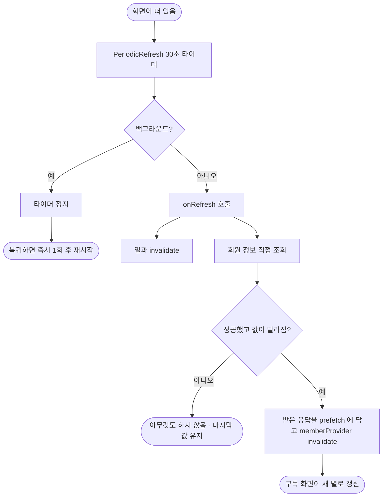

# 공동 보호자 별(#563)과 함께하는 사람 이름(#564)을 주기로 다시 받는다

## 개요
같은 이룸이를 보는 보호자 두 명이 서로 다른 값을 보던 문제를 한 번에 고쳤다. 푸시·소켓이 없어 다른 휴대폰의 변경을 알 길이 없는데, 홈은 일과만 30초마다 다시 받고 회원 정보(누적 별)는 처음 받은 값에 머물렀고, 함께하는 사람 화면은 열 때 한 번만 받았다. 두 화면이 같은 규칙(화면이 떠 있는 동안 30초, 백그라운드 정지, 복귀 즉시 갱신)으로 다시 받게 했고, 오프라인에서 마지막 값이 사라지지 않게 막았다.

## 기능 흐름

## 변경 사항

### 공용 갱신 위젯
- `client/lib/core/widgets/periodic_refresh.dart`(신규): 타이머, 백그라운드 정지, 복귀 즉시 갱신, 진입 즉시 갱신 옵션을 한 곳으로 모았다. 어떤 값을 다시 받을지는 `onRefresh` 가 정한다.
- `client/lib/features/child/application/routine_auto_refresh.dart`: 위 위젯을 쓰도록 바꾸고, 일과와 함께 회원 정보도 조용히 받는다. 회원 정보 요청이 겹치지 않게 막는다.

### 회원 정보 조용한 갱신
- `client/lib/features/guardian/data/routine_repository.dart`: `memberFetcherProvider`, `MemberPrefetch`, `refreshMemberQuietly` 추가. `memberProvider` 는 미리 받아 둔 응답이 있으면 한 번 꺼내 쓴다.
- `client/lib/features/guardian/data/member_repository.dart`: `Member.sameAs` — 화면에 쓰이는 값이 모두 같은지 비교.

### 화면
- `client/lib/features/child/presentation/child_home_screen.dart`, `child_stars_screen.dart`: 별을 `memberProvider.value?.totalStars ?? 0` 로 읽는다. 값이 없을 때만 0이고, 재조회 중이나 갱신 실패에는 마지막 정상 값을 쓴다.
- `client/lib/features/profile/presentation/guardians_screen.dart`: 30초 주기 갱신을 붙였다. 이미 받은 목록이 있으면 갱신 실패를 오류 화면으로 바꾸지 않고, 나가기·저장 중에는 갱신을 건너뛴다.

### 테스트
- `client/test/routine_auto_refresh_test.dart`: 별 반영, 오프라인에서 별 유지, 같은 값이면 재빌드 안 함, 요청 겹침 방지 4건 추가.
- `client/test/guardians_screen_test.dart`: 30초 뒤 이름 반영, 갱신 실패에도 목록 유지, 화면을 벗어나면 중단 3건 추가.

## 주요 구현 내용
- **그냥 `invalidate` 하면 안 되는 이유**: `MemberRepository.getMyInfo()` 는 실패하면 예외 대신 `null` 을 돌려준다(홈이 죽지 않게 한 의도). 30초마다 `memberProvider` 를 `invalidate` 하면 오프라인일 때 마지막 정상 값이 `null` 로 덮여 별이 0개로, 이름이 로컬 값으로 돌아간다. 그래서 먼저 직접 받아 성공했을 때만 반영한다.
- **요청이 두 번 나가지 않게**: 성공한 응답을 `MemberPrefetch` 에 담고 `invalidate` 하면 `memberProvider` 가 그것을 꺼내 써서 한 번 더 요청하지 않는다.
- **구독자를 괜히 다시 돌리지 않게**: `memberProvider` 는 광고 게이트, 프로필 세션(선택 이룸이 맞춤) 등 여러 곳이 구독한다. 값이 같으면 `invalidate` 하지 않는다.
- **오류 표시 기준**: 보여줄 값이 이미 있으면 갱신 실패는 조용히 넘기고, 처음부터 값이 없을 때만 기존 오류 화면과 재시도를 쓴다. 오프라인이라고 오류로 띄우지 않는다.

## 검증
- 앱 테스트 2949 통과, `flutter analyze` 0건. `figma_conformance_test` 의 `보호자 홈 — 일과를 민 뒤` 1건은 `develop` 에서도 같은 수치로 실패하는 기존 문제(#570 에서 원인 분석).
- **실기기**(iOS 시뮬레이터 두 대, 보호자 A·B 가 같은 이룸이): #564 B 가 이름을 바꾸면 A 목록이 나가지 않은 채 30초 안에 반영, #563 A 가 카드를 체크하면 B 별이 15초 안에 12→13. 서버 로그로 `PATCH …/guardians/me`, `PUT …/progress` 와 폰마다 `member/me`·`guardians` 약 30초 간격 요청을 확인했다. 자세한 근거는 QA 댓글에 있다.
  - #564: https://github.com/Twin-Fang/elum/issues/564#issuecomment-6016112316
  - #563: https://github.com/Twin-Fang/elum/issues/563#issuecomment-6016112592

## 주의사항
- **단위 테스트가 못 잡은 이유**: 위젯 테스트는 가짜 저장소로 "다시 요청한다"만 증명한다. 두 계정이 같은 이룸이를 공유하고 서버가 별·이름을 돌려주는 흐름은 실기기 두 대로만 보였다. 이후 이 흐름을 고치면 실기기 두 대로 다시 밟는다.
- **오프라인은 위젯 테스트로만 확인**했다(시뮬레이터에서 네트워크를 끊으면 다른 세션에 영향).
- 갱신 간격은 최대 30초 늦다. 진입·복귀에는 바로 받는다.
- `getMyInfo` 의 "실패하면 null" 규약을 바꾸면 `refreshMemberQuietly` 의 가정이 깨진다.
- #565(마스킹 이메일로 보호자 구분)는 이 변경과 별개로 남아 있다.
