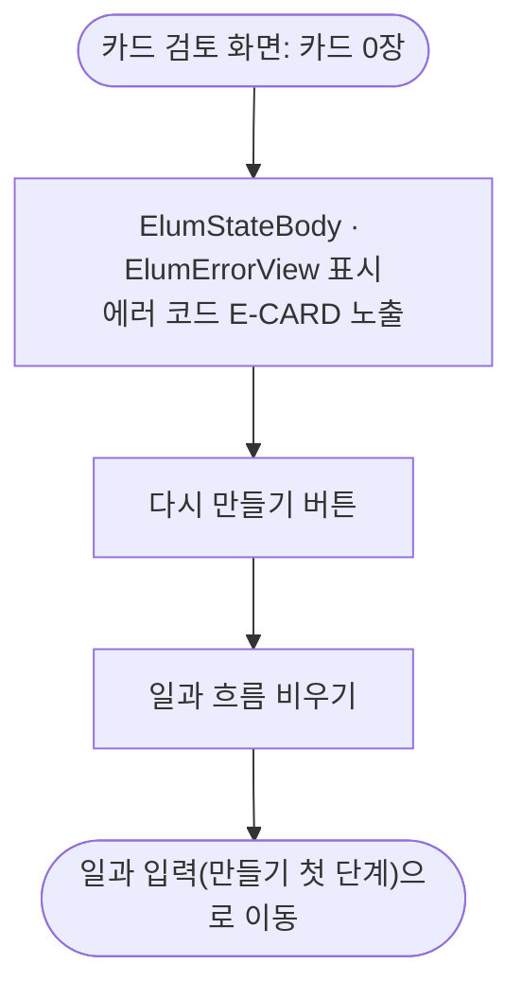

# 카드 0장 화면에 다시 만들 방법이 없음 (#427 항목 3)

## 개요
#427 의 세 항목 중 ③ "카드 0장 화면에 다시 만들 방법이 없다"를 고쳤다. 카드 0장 빈 상태를 공통 위젯으로 바꾸고 "다시 만들기" 버튼을 더했다. ⑤(보상 30자 입력)는 디자인 #424 를 기다린다. 커밋 `cc780666`.

## 기능 흐름

## 변경 사항
- `client/lib/features/guardian/presentation/card_review_screen.dart`: 빈 상태에서 다시 만들기 동작 연결.
- `client/lib/features/guardian/presentation/widgets/card_review_parts.dart`: 빈 상태를 공통 `ElumStateBody`·`ElumErrorView` 로 교체. 에러 코드 `E-CARD` 를 화면에 따로 노출한다.
- `client/lib/l10n/app_ko.arb` 외 다국어 파일: 안내 문구에서 코드를 빼고 버튼 문구 키 `cardReviewEmptyAction` 추가.
- `client/test/card_review_empty_test.dart`: 신규. 수정 전에는 버튼이 없어 실패하는 구조다.
- `client/test/l10n/guardian_widgets_wiring_test.dart`: 문구 변경 반영.

## 주요 구현 내용
다시 만들기 버튼은 생성을 다시 호출하지 않는다(생성은 호출마다 비용이 든다). 일과 흐름을 비운 뒤 일과 입력으로 돌아가므로 보호자가 내용을 확인하고 다시 시작한다. 에러 코드는 안내 문구가 아니라 화면에 따로 노출해 제보 때 추적할 수 있다.

## 주의사항
- ⑤ 보상 30자 입력은 디자인 #424 가 나와야 진행한다.

## 남은 일
- [ ] ⑤ 보상 30자 입력 — 디자인 #424 대기
- [ ] 실기기에서 카드 0장 상태 진입과 다시 만들기 흐름 확인

## 검증
- 관련 3개 파일 98개 통과(수정 직후), 통합본에서 `flutter test` 전체 1회: 2994 통과, 3 skip, 실패 0.
- `./gradlew test` 전체 통과.
- `flutter analyze` 0건.
- 실기기 확인은 하지 않았다.
