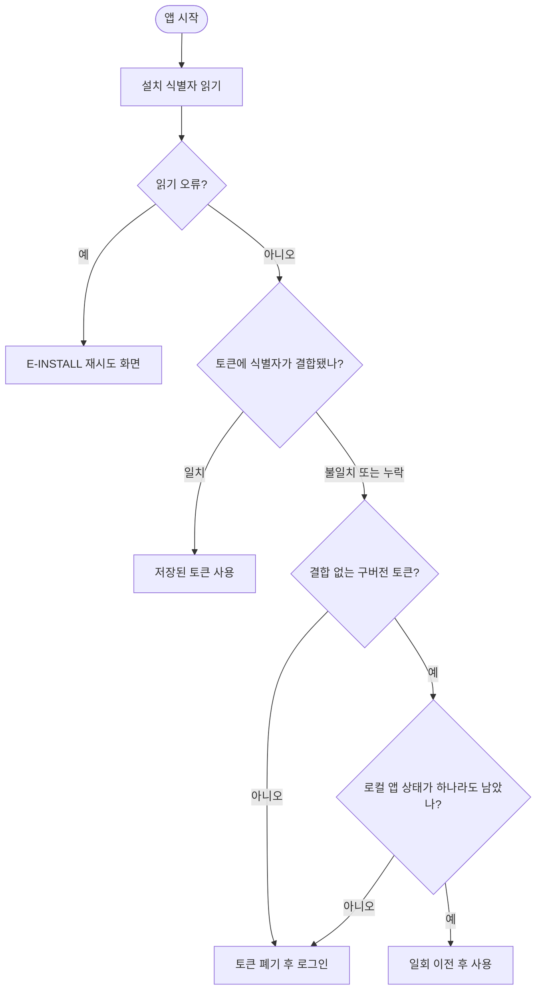

# 앱 재설치 후 로그인을 건너뛰고 역할 선택으로 진입 (#560)

## 개요
앱을 삭제하고 다시 설치해도 iOS Keychain 에 토큰이 남아, 로그인 없이 역할 선택으로 들어갔다. 백업에서 제외되는 설치 식별자를 토큰에 묶어, 식별자가 다르거나 없으면 남은 토큰을 쓰지 않게 했다. 이후 업데이트한 기존 사용자가 로그아웃되는 문제를 막도록 구버전 토큰 이전 조건을 완화했다. 커밋 `f26ccb31`(명세), `a726158a`, `99e79f58`, `16fa8980`(테스트 가짜).

## 기능 흐름

## 변경 사항

### 네이티브
- `client/ios/Runner/AppDelegate.swift`: 설치 식별자 채널. iOS Application Support 에 저장. `99e79f58` 에서 `rootViewController` 형변환 대신 플러그인 registrar 로 등록한다.
- `client/android/app/src/main/kotlin/kr/twinfang/elum/MainActivity.kt`: Android `noBackupFilesDir` 에 저장.

### 토큰·인증
- `client/lib/core/storage/installation_store.dart`, `token_store.dart`, `local_storage.dart`: 토큰에 설치 식별자를 결합. 구버전 토큰 이전 조건은 "온보딩 완료·이룸이 휴대폰·고른 역할 중 하나라도 남았으면"으로 완화(`99e79f58`).
- `client/lib/core/network/auth_interceptor.dart`: 토큰 갱신은 임시 실패에 세션을 지우지 않고 확정 401 에서만 종료한다.
- `client/lib/features/auth/data/auth_repository.dart`, `login_screen.dart`: 로그인이 회원 조회 응답을 검증해 기존 프로필·역할을 복원한다. 조회 실패는 가입 미완료가 아니라 실패로 처리한다.
- `client/lib/main.dart`: 시작 시 식별자 읽기 오류를 `E-INSTALL` 재시도 화면으로 막는다.

### 보호자 비밀암호
- `client/lib/core/storage/guardian_lock_store.dart`: PBKDF2 verifier 를 휴대폰 secure storage 에 둔다. 5회 오답 5분 제한을 영속한다.
- `client/lib/core/router/app_router.dart`, `pin_change_screen.dart`: 암호가 없으면 방금 로그인한 보호자의 일회 허가로만 만들 수 있고, 라우터가 만들기 전 보호자 화면을 막는다.

### 테스트
- `installation_session_test.dart` 신규, `router_redirect_test.dart`, `auth_test.dart` 등 갱신.
- `16fa8980`: 로그인 테스트 4개 파일의 가짜 저장소에 보호자 잠금을 넣었다(앱 동작 회귀 아님, 새 계약 반영).

### 문서
- `docs/superpowers/specs/2026-10-05-session-restoration-design.md` 및 plans: 재설치 인증과 오프라인 휴대폰 잠금 명세.

## 주요 구현 내용
재설치 때는 앱 로컬 상태(온보딩 완료·이룸이 휴대폰·고른 역할)도 함께 지워진다. 반대로 업데이트는 이 상태가 남는다. 이 차이를 구버전 토큰 이전의 판별 기준으로 썼다. 처음에는 온보딩 완료·프로필 ID·이름·역할을 모두 요구해, 프로필 ID나 이름이 비어 있던 휴대폰(연결 직후 조회에 실패한 이룸이 휴대폰 등)이 업데이트만으로 로그아웃되고 연결 암호를 다시 받아야 했다.

## 주의사항
- 네이티브 코드(Swift·Kotlin)는 CI 빌드로만 검증했다. 로컬에서 실행하지 않았다.
- 구버전 토큰이 남은 채 로컬 상태만 지워진 드문 경우(예: 앱 데이터만 삭제)는 토큰을 폐기해 다시 로그인한다.

## 남은 일
- [ ] 실기기에서 앱 삭제 후 재설치 시 로그인 화면이 나오는지 확인(iOS·Android)
- [ ] 구버전에서 새 버전으로 업데이트해도 로그인이 유지되는지 확인(보호자·이룸이 휴대폰 각각)
- [ ] 프로필 ID나 이름이 비어 있는 휴대폰(이룸이 휴대폰)의 업데이트 유지 확인

## 검증
- 통합본에서 `flutter test` 전체 1회: 2994 통과, 3 skip, 실패 0.
- `./gradlew test` 전체 통과.
- `flutter analyze` 0건.
- 실기기 확인은 하지 않았다(삭제·재설치, 업데이트 모두).
