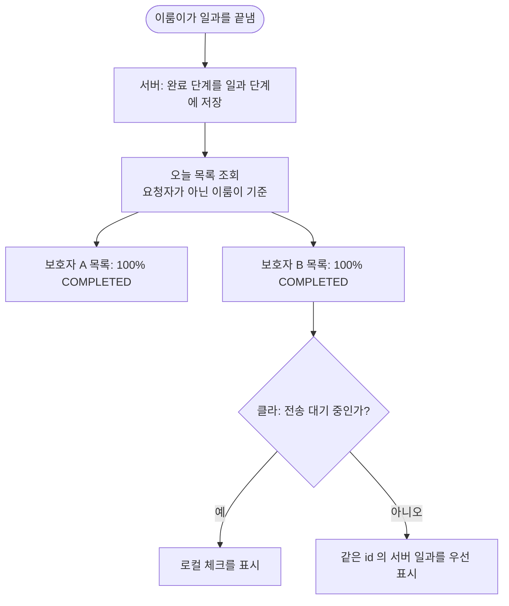

# 공동 보호자별 일과 완료 상태가 다르게 표시됨 (#561)

## 개요
보호자 A가 만든 일과를 이룸이가 끝냈을 때 보호자 B 화면의 완료 상태가 다르게 보인다는 제보를 조사했다. 서버와 클라이언트 모두 남은 원인을 찾지 못했고, 클라이언트의 `0efde0cb` 로 이미 해결됐다고 판단한다. 코드 변경 없이 서버 회귀 테스트만 더했다. 커밋 `b39fdcf8`.

## 기능 흐름

## 변경 사항
- `RoutineServiceTest`: `getTodayRoutines_completedByElumi_is100PercentForOtherGuardian` 추가. 보호자 A가 만든 일과를 이룸이가 끝내면 보호자 B 목록에서도 100% COMPLETED 임을 지킨다.
- 앱 코드 변경 없음.

## 주요 구현 내용
- 서버는 완료 단계를 일과 단계에 저장하고 오늘 목록을 요청자가 아니라 이룸이 기준으로 조회한다. 생성자와 무관하다.
- 클라이언트는 `0efde0cb` 로 같은 id 의 서버 일과를 우선 표시하고, 전송 대기 중일 때만 로컬 체크를 쓴다.

## 판정과 한계
- 서버·클라 코드에서 남은 원인은 찾지 못했다. 다만 실기기에서 공동 보호자 두 대로 재현·해소를 확인하지 않았다. 제보가 재현되면 증상과 시점을 받아 다시 본다.

## 남은 일
- [ ] 실기기 두 대(공동 보호자 A·B)로 이룸이가 일과를 끝낸 뒤 양쪽 완료 상태가 같은지 확인

## 검증
- 통합본에서 `flutter test` 전체 1회: 2994 통과, 3 skip, 실패 0.
- `./gradlew test` 전체 통과(위 서버 회귀 테스트 포함).
- `flutter analyze` 0건.
- 실기기 확인은 하지 않았다.
