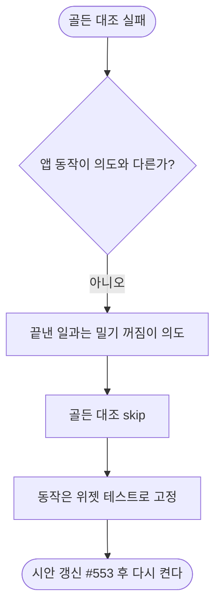

# 보호자 홈 일과 민 상태 골든 대조가 실패한다 (#570)

## 개요
보호자 홈 "일과 민 상태" 시안 대조(931:4179)가 실패했다. 시안은 끝낸 일과를 밀면 버튼이 나오게 그렸지만 앱은 끝낸 일과의 밀기를 꺼 둔다(의도된 동작). 앱 동작은 맞고 시안이 어긋난 것이므로, 사용자 결정에 따라 이 골든 대조를 skip 하고 시안 갱신은 디자인 이슈 #553 을 기다린다. 커밋 `a1433d2b`, `b2dab71a`.

## 기능 흐름

## 변경 사항
- `client/test/figma_conformance_test.dart`: 해당 시안 대조를 skip 하고 이유를 남겼다.
- `client/test/guardian_home_screen_test.dart`: "다 끝낸 일과는 밀리지 않는다" 위젯 테스트 추가. 처음 테스트가 틀려서(`b2dab71a`) 바로잡았다.

## 주요 구현 내용
처음 테스트는 진행률 `percent 100` 만으로 끝난 일과로 봤다. 그러나 앱은 `isFinished`(status `COMPLETED` 또는 모든 단계 완료)로 판단하므로 밀기가 켜져 있었다. 또 동작 버튼은 늘 카드 뒤에 깔려 있어 `findsNothing` 으로는 닫힘을 볼 수 없다. 그래서 status `COMPLETED` 일과로 바꾸고, 다른 밀기 테스트처럼 `revealOf` 가 0 인지로 단언했다. 앱 코드는 바꾸지 않았다.

## 주의사항 · 남은 일
- skip 한 시안 대조는 #553 에서 시안이 갱신된 뒤 다시 켠다. 켜는 걸 잊으면 이 화면의 시안 대조가 영구히 빠진다.

## 검증
- 통합본에서 `flutter test` 전체 1회: 2994 통과, 3 skip, 실패 0.
- `./gradlew test` 전체 통과.
- `flutter analyze` 0건.
- 실기기 확인은 하지 않았다.
