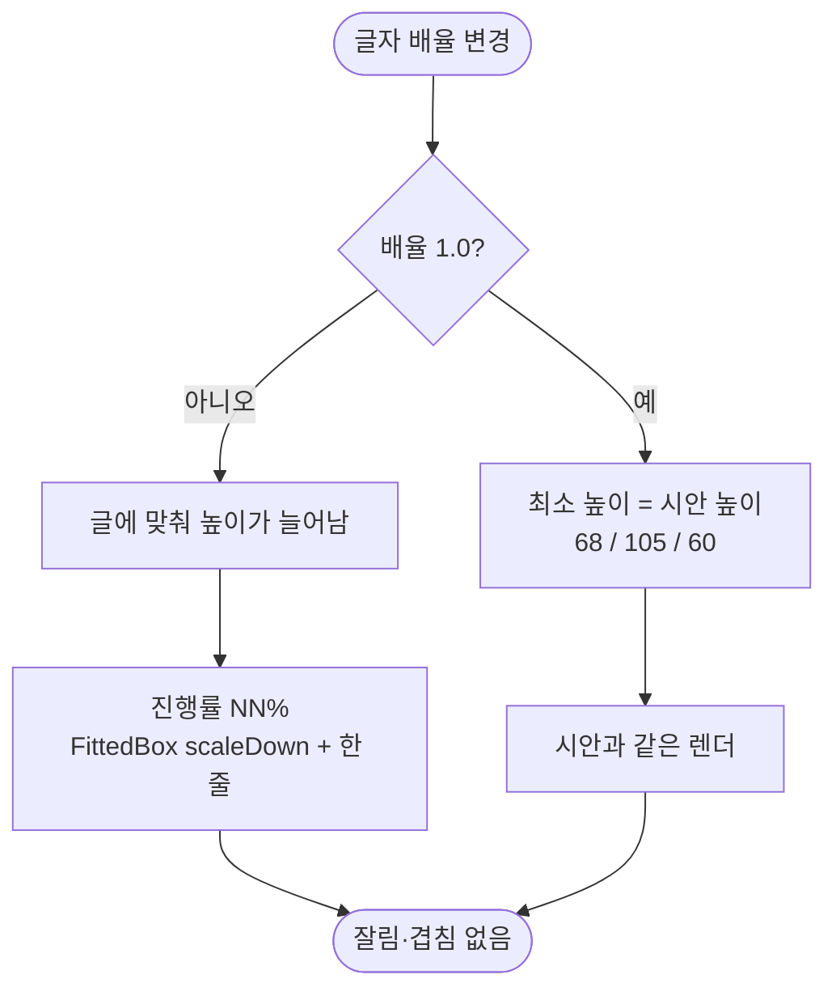

# 글자 크기를 키우면 일과 타일이 잘리고 진행률 글자가 깨진다 (#572)

## 개요
일과 타일·새 일과 버튼·설정 줄이 고정 높이라 글자가 커지면 잘리고 겹쳤다. 시안 높이를 최소 높이로 바꿔 기본 배율에서는 시안과 같게 두고, 커지면 늘어나게 했다. 진행률 글자는 한 줄로 묶어 쪼개지지 않게 했다. 커밋 `58f24a4b`, `0811f9bf`, `70115bf2`.

## 기능 흐름

## 변경 사항

### 위젯
- `client/lib/core/widgets/routine_progress_ring.dart`: 진행률 `NN%` 를 `FittedBox(scaleDown)` + 한 줄로 묶었다.
- `client/lib/core/widgets/settings_tile.dart`, `settings_switch_tile.dart`: 고정 높이를 `minHeight`(60)로 바꿨다. 설정 줄 값에 폭 상한을 뒀다.
- `client/lib/features/guardian/presentation/widgets/routine_summary_tile.dart`: 일과 타일 최소 높이 68.
- `client/lib/features/guardian/presentation/widgets/create_routine_button.dart`: 최소 높이 105, 문구 줄바꿈 허용.
- `client/lib/features/guardian/presentation/guardian_home_screen.dart`: 이미 큰 인사말만 2배 초과에서 2배로 멈춘다(앱 전체 배율은 묶지 않음).
- `docs/08-design-principles.md`: §7-2 서술 갱신.

### 1.0배 골든 보정 (`0811f9bf`)
- 설정 줄·스위치 줄의 최소 높이를 `Container(alignment)` 대신 `Row` 에 직접 건 `ConstrainedBox` 로 바꿔 옛 고정 높이와 같은 세로 가운데를 맞췄다.
- 설정 줄 값의 `textAlign.end` 와 새 일과 버튼 문구의 `textAlign.center` 는 한 줄에서 글자를 반 픽셀 밀어 골든을 깨므로 지웠다(폭 상한·줄바꿈은 유지).
- `client/test/l10n/overflow_pilot_test.dart`: `SettingsTile` 이 글에 맞춰 자라 줄 높이가 잣대가 못 되므로 음성 대조는 시안 높이(60)를 잣대로 삼았다. 줄이 자라 해결된 2.0배 건너뛰기를 풀었다.

### 테스트
- `client/test/font_scale_home_settings_test.dart`: 홈·설정 1.0/1.3/2.0/3.1배 overflow, 타일 높이, 진행률 한 줄.
- `70115bf2`: #581 로 바뀐 `updateStep` 시그니처에 이 테스트의 가짜 저장소를 맞췄다.

## 주의사항 · 못 고친 곳
- 일과가 없을 때의 회색 칸(`_GreyTileShell`), 로딩·빈·실패 상태는 큰 글자에 대응하지 않았다. 큰 글자에서 여기는 여전히 잘릴 수 있다.
- 반 픽셀 어긋남은 정렬 방식을 바꿔서 해결했다. 이 줄들의 `textAlign` 을 되살리면 골든이 다시 깨진다.
- 이룸이 홈 빈 상태 골든 2건은 #578 문구 결정에 따라 새로 만들었다.

## 검증
- 통합본에서 `flutter test` 전체 1회: 2994 통과, 3 skip, 실패 0.
- `./gradlew test` 전체 통과.
- `flutter analyze` 0건.
- 실기기 확인은 하지 않았다.
