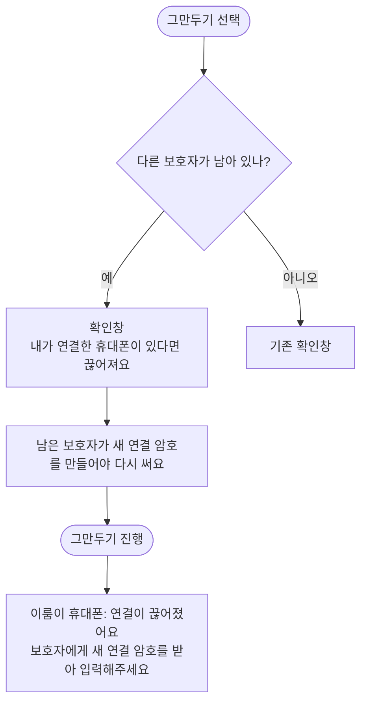

# 함께 돌보기 그만두기 확인창이 이룸이 휴대폰 연결 끊김을 알리지 않음 (#577)

## 개요
다른 보호자가 남은 채 내가 함께 돌보기를 그만두면, 내가 연결한 이룸이 휴대폰의 연결이 끊어진다. 확인창이 이를 알리지 않았다. 확인창이 일과 안내보다 먼저 연결 끊김을 말하게 하고, 이룸이 휴대폰의 "연결이 끊어졌어요" 설명에는 다음 행동을 이어 붙였다. 커밋 `02bcb2f0`.

## 기능 흐름

## 변경 사항

### 문구
- `client/lib/l10n/app_ko.arb` 외 다국어 `app_localizations*.dart`: 확인창 문구와 이룸이 휴대폰 연결 끊김 설명에 다음 행동 안내를 이어 붙였다. 기존 텍스트 자리만 사용했다.

### 테스트
- `guardians_screen_test`, `l10n/profile_messages_ko_test`, `l10n/link_messages_ko_test`, `elumi_link_loss_test` 추가·갱신.
- `elumi_exit_no_dead_end_test`, `exit_paths_matrix_test`: 연결 끊김 문구 일치 검사를 `textContaining` 으로 완화했다.

## 주요 구현 내용
서버 동작은 그대로다. 문구만 바꿨다.

## 주의사항 · 남은 의문
- 클라이언트가 "내가 연결한 이룸이 휴대폰이 있는지"를 모른다. 그래서 "있다면" 조건 표현으로 항상 표시한다. 연결한 휴대폰이 없는 보호자에게도 같은 문구가 보인다. 정확히 가르려면 서버가 그 정보를 내려줘야 한다.
- 연결 끊김 문구 검사를 `textContaining` 으로 완화했으므로 문구 앞부분이 바뀌어도 테스트가 잡지 못한다.

## 검증
- 통합본에서 `flutter test` 전체 1회: 2994 통과, 3 skip, 실패 0.
- `./gradlew test` 전체 통과.
- `flutter analyze` 0건.
- 실기기 확인은 하지 않았다.
