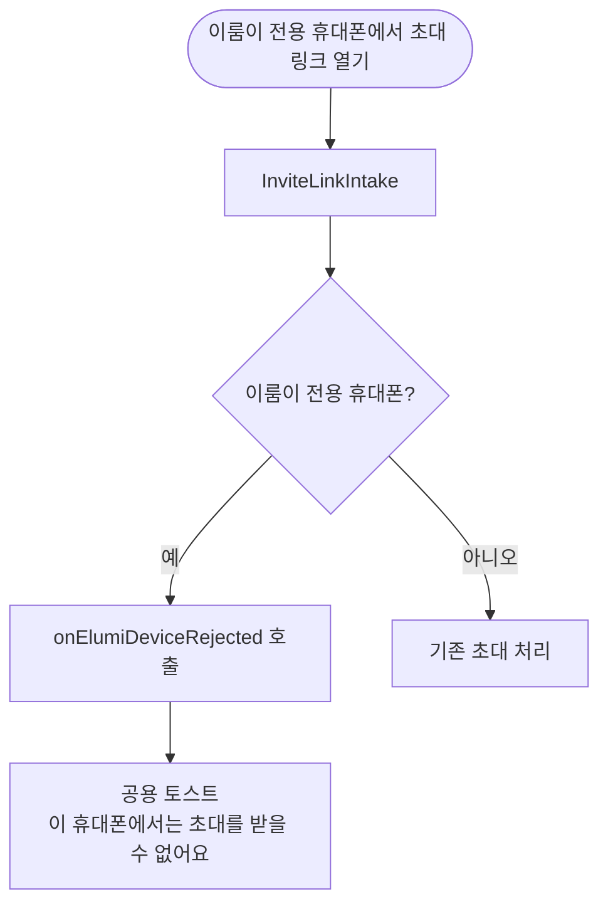

# 이룸이 전용 휴대폰 안내가 그 휴대폰에서 못 하는 일을 가리킴 (#578)

## 개요
이룸이 전용 휴대폰의 빈 일과 안내가 그 휴대폰에서는 할 수 없는 일(일과 만들기)을 가리키고 있었다. 문구를 "보호자 휴대폰에서 일과를 만들 수 있어요"로 바꾸고, 회원탈퇴 확인창에 연결 암호 안내를 더했으며, 이룸이 전용 휴대폰에서 초대 링크를 열 때 조용히 무시하던 것을 토스트로 알리게 했다. 커밋 `49000d30`, 골든 갱신 `e7c047cc`.

## 기능 흐름

## 변경 사항

### 문구
- `client/lib/l10n/app_ko.arb` 외 다국어 `app_localizations*.dart`: 이룸이 전용 휴대폰 빈 일과 안내, 회원탈퇴 확인창 안내, 초대 거절 토스트 문구 추가·변경. 보호자 휴대폰의 이룸이 화면 문구는 그대로다.

### 동작
- `client/lib/features/profile/application/invite_link_intake.dart`: 이룸이 전용 휴대폰이면 `onElumiDeviceRejected` 로 알린다.
- `client/lib/app.dart`: `MaterialApp` 에 `scaffoldMessengerKey` 를 달아 화면 밖에서도 공용 토스트를 띄운다.

### 테스트
- `invite_link_intake_test`, `child_mode_test`, `child_wiring_test`, `child_elumi_settings_test`, `link_messages_ko_test`, `child_messages_ko_test` 추가·갱신.
- `client/test/figma/child_home_empty_1197-6846.png`, `childhome_empty_1197-6869.png`: 새 문구로 골든 두 장을 다시 만들었다(사용자 승인).

## 주요 구현 내용
- 회원탈퇴·로그아웃 메뉴는 사용자 결정으로 이룸이 전용 휴대폰에서도 유지하고 문구만 맞췄다. 다시 쓰려면 보호자에게 연결 암호를 받아야 한다고 확인창이 알린다.
- 시안 문구는 이 변경과 다르다. 시안 수정은 디자인 이슈 #584 로 예람(yeramyyi)에게 요청했다.

## 주의사항
- 골든 두 장은 시안이 아니라 새 문구 기준이다. #584 에서 시안이 바뀌면 다시 대조한다.
- 토스트가 화면 밖에서도 뜨므로 `scaffoldMessengerKey` 를 다른 곳에서 중복으로 달지 않는다.

## 검증
- 통합본에서 `flutter test` 전체 1회: 2994 통과, 3 skip, 실패 0.
- `./gradlew test` 전체 통과.
- `flutter analyze` 0건.
- 실기기 확인은 하지 않았다.
