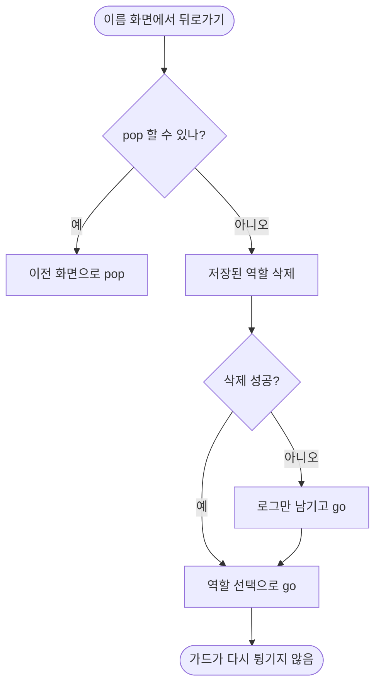

# 보호자를 고른 뒤 앱을 다시 열면 역할 선택으로 돌아갈 길이 없음 (#580)

## 개요
이름 화면의 뒤로가기가 `canPop` 일 때만 그려졌다. 앱 재시작이나 함께 돌보기 그만두기 뒤처럼 `go` 로 들어오면 뒤로가기 버튼이 없고, 저장된 역할 때문에 가드가 역할 선택으로 보내 주지도 않아 화면에 갇혔다. 뒤로가기를 항상 두고, 돌아갈 스택이 없으면 저장된 역할을 지운 뒤 역할 선택으로 이동하도록 고쳤다. 커밋 `01c717f5`.

## 기능 흐름

## 변경 사항

### 클라이언트
- `client/lib/features/onboarding/presentation/name_screen.dart`: `_goBack` 추가(pop 가능하면 pop, 아니면 `clearSelectedRole` 후 `Routes.roleSelect` 로 go). 헤더 뒤로가기를 항상 표시. `PopScope` 로 안드로이드 시스템 뒤로가기·스와이프도 같은 동작을 타게 했다.

### 테스트
- `client/test/name_screen_back_test.dart`: 실제 `createRouter` 를 쓰는 회귀 테스트 3건. 수정 전에는 2건이 실패했다.

## 주요 구현 내용
저장된 역할이 남아 있으면 시작 화면·가드가 다시 이름 화면으로 되돌린다. 그래서 단순히 `go(roleSelect)` 만 하면 도돌이표가 된다. 역할을 먼저 지우는 것이 핵심이다. 지우기에 실패해도 이동은 하며(다음 시작 때 이 화면으로 돌아올 뿐), 실패는 삼키지 않고 로그를 남긴다.

## 주의사항
- 이름 화면에서 뒤로가면 선택한 역할이 지워진다. 다른 화면에서 같은 갇힘이 있는지는 이번에 보지 않았다.

## 검증
- 관련 테스트 32건 통과(수정 직후), 통합본에서 `flutter test` 전체 1회: 2994 통과, 3 skip, 실패 0.
- `./gradlew test` 전체 통과.
- `flutter analyze` 0건.
- 실기기 확인은 하지 않았다.
