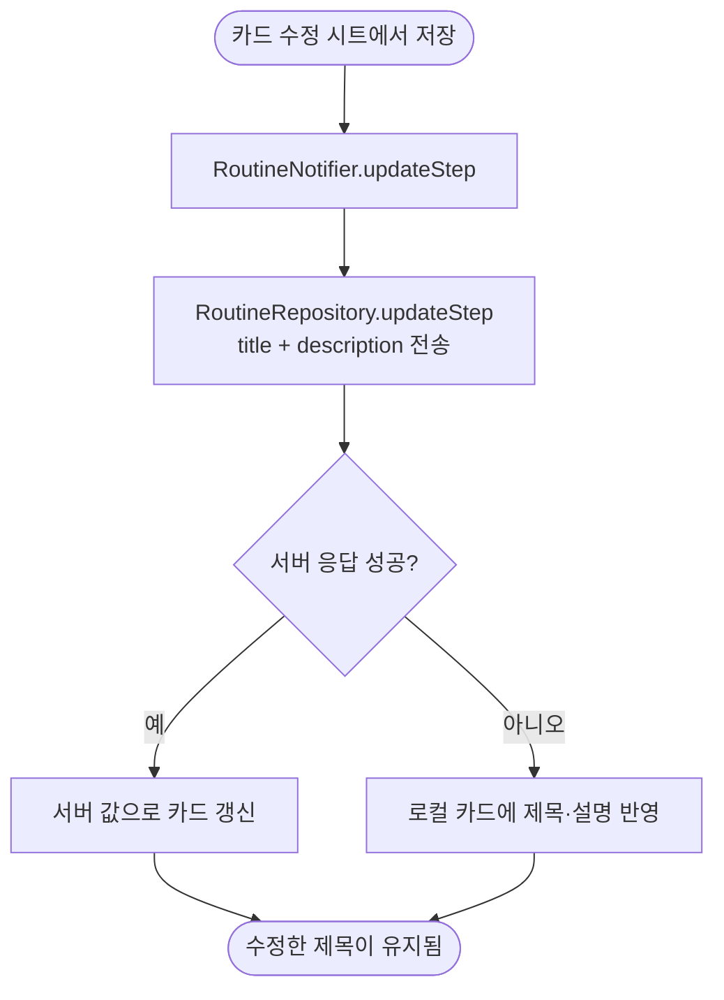

# 카드 제목을 고쳐도 저장하면 원래 제목으로 돌아옴 (#581)

## 개요
카드 수정 저장 때 클라이언트가 PATCH 로 `description` 만 보내, 서버에는 옛 제목이 그대로 남았다. 서버는 `title` 컬럼과 반영 로직을 이미 갖고 있었으므로 클라이언트가 제목도 함께 보내도록 고쳤다. 커밋 `b9fe85f1`.

## 기능 흐름

## 변경 사항

### 클라이언트
- `client/lib/features/guardian/data/routine_repository.dart`: `updateStep` 이 `title` 을 본문에 함께 보낸다. 서버 실패 시 로컬 카드에도 제목을 반영한다.
- `client/lib/features/guardian/application/routine_notifier.dart`: 바뀐 시그니처(이름 인자)에 맞춰 호출부를 고쳤다.

### 테스트
- `client/test/card_step_repository_test.dart`: `updateStep` 요청 본문에 제목이 실리는지, 서버 실패 시 로컬 카드에 제목이 반영되는지 추가.
- 가짜 저장소를 쓰는 기존 테스트 13개 파일: 바뀐 `updateStep` 시그니처에 맞춰 갱신(동작 단언은 그대로).

## 주요 구현 내용
원인은 서버가 아니라 클라이언트의 전송 누락이다. 서버 코드는 건드리지 않았다. 서버가 실패해도 화면에서는 방금 고친 제목이 보여야 하므로 로컬 반영을 같은 변경에 넣었다.

## 주의사항
- `updateStep` 시그니처가 바뀌었다. 이 함수를 구현하는 가짜 저장소를 새로 만들 때 같은 시그니처를 맞춘다(#572 의 테스트 가짜도 이 때문에 `70115bf2` 로 맞췄다).
- 서버 실패 시 로컬만 바뀐 상태가 된다. 다음 동기화에서 서버 값이 우선 표시될 수 있다.

## 검증
- 통합본에서 `flutter test` 전체 1회: 2994 통과, 3 skip, 실패 0.
- `./gradlew test` 전체 통과.
- `flutter analyze` 0건.
- 실기기 확인은 하지 않았다.
