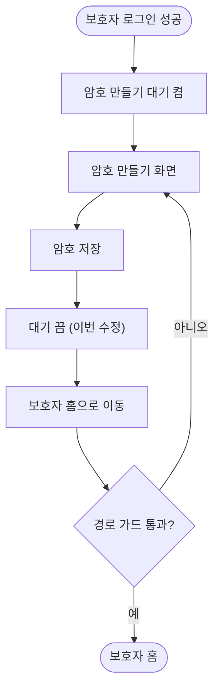

# 첫 로그인 뒤 암호 만들기에서 저장하기가 안 넘어감

## 개요
새 휴대폰이나 재설치 뒤 보호자로 처음 로그인하면 비밀암호를 만드는 화면으로 간다. 암호를 저장해도 화면이 넘어가지 않고 확인 화면에 머물렀다. 저장은 끝나 있어서 앱을 껐다 켜면 보호자 홈이 열렸다. 저장이 끝나면 "암호 만들기 대기"를 끄도록 고쳤고, 배포 PR #587로 main에 나갔다.

## 기능 흐름

수정 전에는 E 단계가 없어서 G 가 항상 "아니오"였고, 가드가 다시 암호 만들기 화면으로 돌려보냈다.

## 변경 사항

### 화면
- `client/lib/features/guardian/presentation/pin_change_screen.dart`: 로그인 직후 암호를 만든 경우(`createOnly`) 저장이 성공하면 `finishGuardianPinSetup()`을 불러 대기를 끈 뒤 보호자 홈으로 보낸다.

### 테스트
- `client/test/pin_create_finish_setup_test.dart`: 앱의 실제 경로 가드(`resolveRedirect`)를 거치게 만들어, 저장 뒤 보호자 홈에 도착하고 대기가 꺼지는지 확인한다. 수정 전 코드에서는 실패했다.

## 주요 구현 내용
- 원인: `guardianPinSetupPending` 은 로그인 때 켜지는데 끄는 `finishGuardianPinSetup()` 은 로그아웃·회원탈퇴에서만 불렸다. 저장 뒤에도 켜진 채라 `resolveRedirect` 가 보호자 화면 진입을 암호 만들기로 되돌렸다.
- 왜 안 걸렸나: 기존 암호 화면 테스트는 가짜 인증(`pin_setup_auth.dart`)을 써서 이 값을 거치지 않았다. 새 테스트는 가드를 그대로 쓰되 값만 켠 가짜 인증을 쓴다.

## 검증
- 새 테스트 + 암호·경로·인증 관련 기존 테스트 60개 통과, `flutter analyze` 0건.
- iOS 시뮬레이터(수정 빌드)에서 재설치 → 카카오 로그인 → 암호 1234 저장 → 앱을 다시 켜지 않고 보호자 홈 진입 확인.
- 배포: PR #587 머지 완료.

## 주의사항
- 같은 이슈 본문에 적은 두 항목은 이번에 고치지 않았다: 글자 크기 최대에서 설정 줄이 붙어 보이는 문제, debug 빌드에서 틀린 암호 검증이 약 10초 걸리는 문제(릴리스 빌드 시간은 재지 않음).
- 암호 만들기 흐름을 더 고칠 때는 이 대기 값의 켜짐·꺼짐 짝(로그인 → 저장/로그아웃/탈퇴)이 맞는지 같이 본다.
