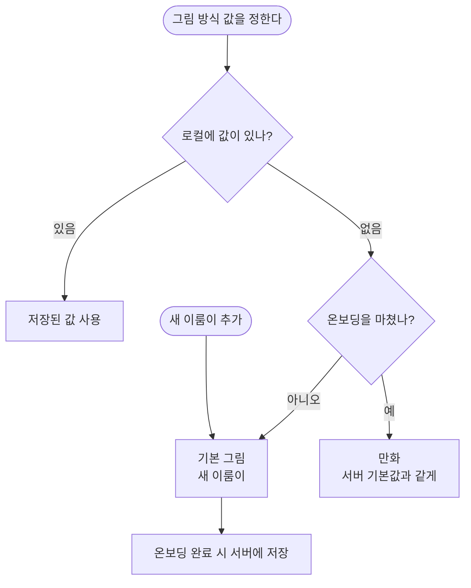

# 그림 방식 고르기의 기본 그림 표현과 비용 안내 자리

## 개요

**개발자 피드백으로 B안을 먼저 구현해 배포했어요.** 시안이 나오기 전에 개발 쪽에서 정한 것이에요.

- 그림 방식 화면의 세 번째 선택지 `직접 찍은 사진`을 **`기본 그림`** 으로 바꿨어요. 예시 그림도 오리 사진에서 실제 카드에 들어가는 픽토그램으로 바꿨어요.
- **기본 그림을 맨 위에 두고 새 이룸이의 기본값으로 했어요.** 순서는 기본 그림, 만화, 실사예요.
- 온보딩의 **`건너뛰기`를 없앴어요.** 처음부터 하나가 골라져 있어서 `다음`만 누르면 돼요.
- 온보딩에서는 크레딧(비용)을 말하지 않아요.

디자인은 처리됐어요. 설정 화면의 비용 안내(F1·F2안)와 크레딧 소진 팝업 안내(G안)는 이번 배포에 넣지 않았어요. 시안이 나오면 따라가요.

> 후 화면은 앱 렌더예요(만화 예시는 온보딩에서 고른 친구라 여우로 보여요). 휴대폰 실측은 TestFlight 빌드가 올라온 뒤 후속 댓글로 남겨요.

## 기능 흐름

## 변경 사항

### 그림 방식 값

- `client/lib/features/onboarding/domain/image_style.dart`: 순서를 기본 그림(`PHOTO_ONLY`) → 만화 → 실사로 바꿨어요. 새 이룸이의 기본값 `onboardingDefault`를 더했어요. 서버로 보내는 값은 그대로예요.
- `client/lib/features/onboarding/domain/onboarding_profile.dart`: 처음 값을 기본 그림으로 바꿨어요. 새 이룸이 추가(`resetProfile`)도 이 값으로 시작해요.
- `client/lib/features/onboarding/application/onboarding_notifier.dart`: 로컬 값이 없을 때 온보딩 중이면 기본 그림, 온보딩을 마친 기존 앱이면 만화로 읽어요.

### 화면

- `client/lib/features/onboarding/presentation/image_style_screen.dart`: 건너뛰기를 없앴어요.
- `client/lib/features/onboarding/presentation/widgets/image_style_option_card.dart`: 기본 그림 예시를 픽토그램 SVG로 그려요. 온보딩과 설정이 같은 카드를 써서 두 화면이 함께 바뀌어요.
- `client/lib/core/assets/app_assets.dart`: 예시 에셋을 `imageStyleBasic`(양치 픽토그램)으로 바꿨어요.
- `client/lib/l10n/app_ko.arb`: 이름 `기본 그림`, 설명 `간단한 그림 기호가 들어가요. 사진으로 바꿀 수 있어요`로 바꿨어요. 쓰지 않는 건너뛰기 문구 키는 지웠어요.

### 테스트

- 순서·기본값·건너뛰기 없음·새 이룸이 추가·기존 앱 폴백을 테스트로 고정했어요.
- 시안 대조 골든 두 장을 지금 화면으로 갱신했어요. 시안과 일부러 다르다는 표시를 테스트에 남겼어요.

## 주요 구현 내용

**기본값을 두 갈래로 나눈 이유.** 서버 DB의 기본값은 지금도 `CARTOON`이에요. 서버가 값을 주지 않는 경우와 로컬에 값이 없는 기존 설치 앱을 모두 기본 그림으로 읽으면 안 돼요. 화면은 기본 그림인데 서버는 만화로 카드를 그리는 어긋남이 생기기 때문이에요. 그래서 다음처럼 나눴어요.

| 상황 | 값 | 이유 |
|---|---|---|
| 온보딩 중, 새 이룸이 추가 | 기본 그림 | 이번에 정한 기본값 |
| 온보딩을 마친 앱에 로컬 값 없음 | 만화 | 서버 DB 기본값과 같게 |
| 서버가 값을 안 주거나 모르는 값 | 만화 | 같은 이유 |

새 이룸이는 온보딩을 마칠 때 고른 값(기본값이면 `PHOTO_ONLY`)을 서버에 저장해요. 그래서 서버 기본값은 바꾸지 않았어요.

**검증.** 앱 테스트 2,998건 통과, analyze 0건, 사용자 노출 한글 리터럴 0줄이에요. 실기기 E2E는 하지 않았어요.

## 주의사항

- **새로 가입한 보호자의 첫 일과는 픽토그램 카드로 나와요.** AI 그림을 기대한 사람은 설정에서 만화나 실사로 바꿔야 해요. 첫인상에 영향이 있는지 지켜봐야 해요.
- 온보딩을 마칠 때 그림 방식 저장이 실패하면 서버는 `CARTOON`으로 남고 로컬은 기본 그림이에요. 이 실패는 지금도 E-STYLE로 알리고 있어요.
- `image_style_photo.png`(오리 사진) 에셋 파일은 지우지 않고 남겨 두었어요. 지금은 쓰지 않아요.
- 남은 디자인 질문: 설정 비용 안내(F1·F2), 크레딧 소진 팝업 안내(G), Figma 시안 갱신.
