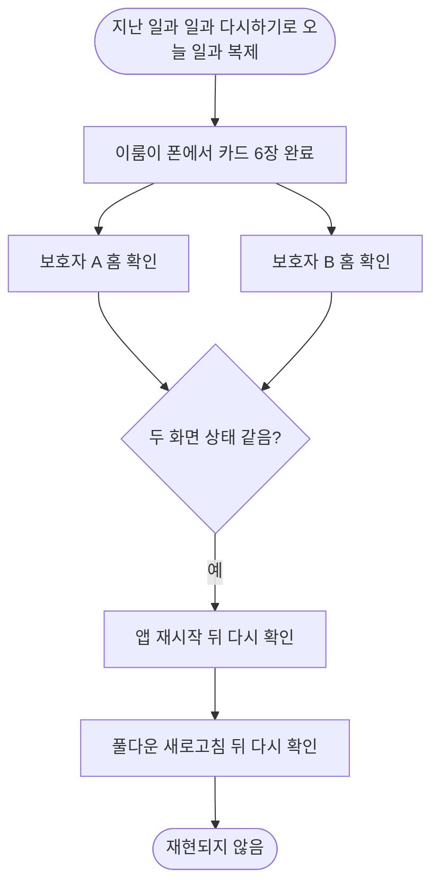

# 공동 보호자별 일과 완료 상태가 다르게 표시됨 (#561) — iOS 시뮬레이터 실측

## 개요
이룸이 폰에서 끝낸 일과가 공동 보호자 두 화면에서 같은 완료 상태로 보이는지 iOS 시뮬레이터 세 대로 밟았다. 완료 직후, 앱을 껐다 켠 뒤, 새로고침 뒤 모두 두 보호자 홈이 같았고 #561 증상은 재현되지 않았다. 코드 변경은 없다.

## 기능 흐름

## 검증 환경
- 보호자 A: QA563 Guardian A, 보호자 B: QA551, 이룸이 폰: QA563 Guardian B (세 대 모두 같은 이룸이 Haneul 을 돌보는 상태)
- 빌드: 세 기기에 설치돼 있던 debug 빌드 그대로(A 10/7 17:47, 이룸이 폰 10/7 19:45 설치). 수정 `0efde0cb`(10/5) 이후 설치로 보이나 빌드가 정확히 어느 커밋인지는 확인하지 못했다.
- AI 일과 생성 없이 지난 일과 `병원에서 진료를 받아요`를 `일과 다시하기`로 복제해 썼다. 만든 일과는 지우지 않았다.

## 시점별 결과

| 시점 | 보호자 A 홈 | 보호자 B 홈 |
| --- | --- | --- |
| 복제 직후 | 0% | 0% |
| 카드 4/6 완료 | 67% | 67% |
| 카드 6/6 완료 직후 | 완료 체크 | 완료 체크 |
| 앱 껐다 켠 뒤 | 완료 체크 | 완료 체크 |
| 풀다운 새로고침 뒤 | 완료 체크 | 완료 체크 |

이룸이 폰에서 끝낸 값이 두 보호자 홈에 새로고침 없이 거의 즉시 반영됐다. 완료 직후와 재시작 직후 캡처에는 공지·광고 팝업이 위에 떠 있어 팝업을 닫고 다시 찍은 화면을 근거로 썼다.

복제 직후 (A / B)

카드 4/6 완료 (A / B)

앱 재시작 뒤 팝업을 닫은 화면 (A / B)

풀다운 새로고침 뒤 (A / B)

## 주의사항 (밟지 못한 것)
- 전송 대기 중인 로컬 체크 경로(오프라인·전송 지연)는 만들지 않았다.
- 보호자 B 가 만든 일과를 이룸이가 끝내는 역방향은 밟지 않았다.
- 이룸이 폰 홈의 최종 완료 표시는 마지막 카드 직후 보상 화면까지만 찍었다.
- 두 보호자의 로그인 계정이 서로 다른지는 확인하지 못했다.
- 재현이 되면 증상과 시점을 받아 다시 본다.
