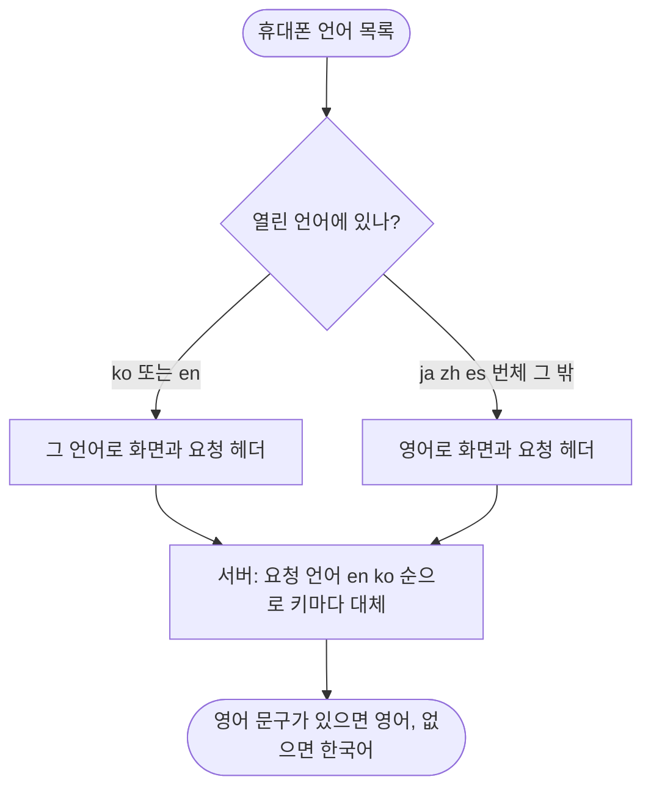

# 5개 언어 지원 구조 설계 및 적용 (#521) — 한국어·영어 두 언어 먼저 열기

## 개요
5개 언어(ko·en·ja·zh·es)를 받는 구조는 #525(클라이언트)·#526(서버)로 이미 main 에 있었다. 이번에는 ko 와 en 두 언어만 실제로 열었다. 클라이언트에 "열린 언어 목록"을 두고 영어 화면 문구 516개와 서버 에러·검증 문구 123개를 영어로 옮겼다. 언어를 더 열 때는 번역 파일과 목록 한 줄만 더하면 된다. 설계는 `docs/superpowers/specs/2026-10-08-ko-en-launch-design.md`, 계획은 `docs/superpowers/plans/2026-10-08-ko-en-launch.md`.

## 기능 흐름

## 변경 사항

### 클라이언트
- `client/lib/core/l10n/app_locales.dart`: `openedAppLocales = [ko, en]` 추가. ARB 가 있는 5개(`supportedAppLocales`)와 별개로 실제로 여는 언어만 담는다.
- `client/lib/core/l10n/app_l10n.dart`, `effective_locale.dart`: 휴대폰 언어 판정을 열린 언어 목록에서 고르게 했다. 개발자 도구가 강제한 언어는 QA 에서 5개 모두 볼 수 있게 예외를 뒀다.
- `client/lib/l10n/app_en.arb`: 516키를 영어로 옮겼다. ICU 복수형은 단수·복수를 따로 쓰고, 한국어 조사 선택(`batchim`)은 영어에서 뺐다.
- `docs/i18n/glossary.md`: 번역 용어집(이룸이 = Elumi, 보호자 = guardian 등).

### 서버
- `server/src/main/resources/i18n/messages_en.properties`: 에러·검증 문구 123개를 영어로 옮겼다. 서버는 이미 요청 언어 → en → ko 순으로 키마다 대체하므로 ja·zh·es 요청도 영어를 받는다. 화면 언어용 열린 목록은 서버에 새로 두지 않았다.

### 테스트
- `locale_policy_test`, `app_l10n_wiring_test`, `dev_locale_override_test`, `accept_language_dio_wiring_test`: 열린 언어 규칙(ja·es·zh·번체 → en)에 맞췄다.
- `arb_parity_test`: 영어를 열린 언어로 올려 키·자리표시자가 한국어와 같은지 검사하고, 앱의 열린 언어 목록과 검사 대상이 같은지도 묶었다.
- `EnglishMessagesCompletenessTest`(서버): 한국어 원본의 모든 키에 영어가 있고, 한글이 섞이지 않고, 원본에 없는 키가 없음을 고정했다.

## 주요 구현 내용
- 열린 언어 목록은 ARB 가 있는 5개와 분리했다. ARB 를 비워 둔 언어가 열려 한국어 문구로 채워지는(gen-l10n 이 빠진 키를 한국어로 채운다) 일을 막기 위해서다.
- MaterialApp 은 강제 언어도 같은 판정 콜백을 다시 거친다. 열린 목록만 보면 개발자 도구의 일본어 강제가 영어가 되므로, 강제가 켜진 경우에만 5개를 모두 허용한다.
- AI 콘텐츠 언어(`ENABLED_CONTENT_LOCALES`, 운영 값 `ko`)는 건드리지 않았다. 영어 화면에서 만든 일과의 카드 글은 아직 한국어다.

## 검증
- 서버 `./gradlew test` 전체 통과.
- 클라이언트 `flutter analyze` 이상 없음. `flutter test` 전체에서 2995건 통과, 5건 실패였고 그중 2건은 이번 변경으로 깨진 요청 헤더 테스트라 고쳐서 통과를 확인했다. 나머지 3건은 이번 변경과 무관하다 — `ad_boundary_test` 2건은 다른 작업이 남긴 untracked 파일 `lib/_probe_ad_main.dart` 를 읽어서, `card_image_retry_test` 1건은 단독 실행에서는 통과하는 불안정한 테스트다.
- 영어 화면 실기기 확인은 하지 않았다.

## 주의사항
- **영어 휴대폰은 아직 가입을 열면 안 된다.** 약관·개인정보처리방침 영어본이 없어 영어 휴대폰에서도 약관이 한국어로 보인다(계획 4).
- 영어 휴대폰에서 일과를 만들면 카드 글은 한국어다. 영어 AI 생성(계획 3)이 필요하다. 영어 폴백 질문·추천(`routine-phrases_en`)도 그때 함께 채운다.
- 영어 문구가 한국어보다 길어 좁은 자리에서 잘리는지 시뮬레이터로 보지 못했다. 영어 휴대폰으로 보호자 홈·일과 만들기·설정 화면을 한 번 훑어야 한다.
- 번역 문구는 초안이다. 어색한 문장은 사용자 검토가 필요하다.
- 남은 계획: 3(영어 AI 생성), 4(영어 약관·공지), 5(번역 품질), 6(네이티브·스토어 문구), 7(법무 검토). 그래서 이 이슈는 `작업중`으로 둔다.
