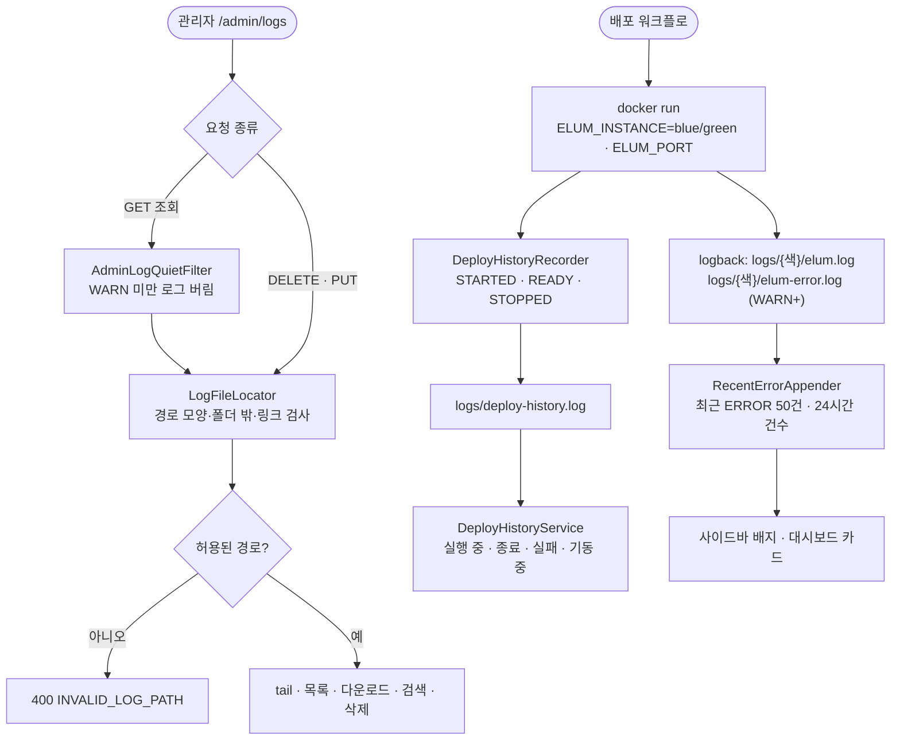

# 서버 로그 관리 개편 (blue/green 분리, 다운로드, 검색, 레벨, 배포 이력)

## 개요

운영에서 문제가 났을 때 로그를 바로 볼 수 없던 문제를 고쳤다. 관리자 "서버 로그" 화면은 현재 파일의 끝 1000줄만 보여줬고, 롤링된 `.gz`는 볼 수도 받을 수도 없었다. 더 근본적으로는 Blue/Green 배포에서 **두 컨테이너가 같은 NAS 폴더의 같은 `logs/elum-server.log`에 쓰고 있었다.** 배포 중 1~2분 동안 서로 다른 JVM이 한 파일을 각자 롤링해 줄이 섞이거나 사라질 수 있었다. 또 PID가 늘 `1`이라 어느 색 로그인지 구분할 수 없었다. 헬스체크에 실패한 컨테이너는 `docker rm`과 함께 로그도 사라졌다.

이번 작업으로 로그를 색깔별 폴더로 나눴다. 배포 이력도 파일로 남겨, 관리자 화면 하나에서 보기·찾기·받기·지우기·레벨 변경·배포 상태 확인을 할 수 있다.

> 참고: 이 서버는 log4j가 아니라 Spring Boot 기본 **logback**(`logback-spring.xml`)을 쓴다.

## 기능 흐름

## 변경 사항

### 로그 구조 · 배포
- `server/src/main/resources/logback-spring.xml`: 폴더를 `logs/{ELUM_INSTANCE}/`로 나누고 줄마다 `[blue]`/`[green]`을 넣었다. 오류 전용 `elum-error.log`(WARN 이상, 30일·200MB)를 추가했다. 최근 오류 집계 appender와 조회 소음 차단 TurboFilter를 걸었다.
- `.github/workflows/PROJECT-SPRING-CICD.yaml`: `docker run`에 `ELUM_INSTANCE`(컨테이너 이름의 색)와 `ELUM_PORT`를 넘긴다.
- `server/build.gradle`: `springBoot { buildInfo() }`로 화면에 버전을 보여준다.
- `server/.gitignore`: 실행 중 생기는 `logs/`를 제외했다. 지금까지는 추적되지 않은 채 커밋 후보로 떠 있었다.

### 공통 로깅 (`common/infrastructure/logging`)
- `LogInstance`: `blue`/`green`만 인정하고, 나머지는 `local`로 본다(폴더 이름이 되므로).
- `InstanceInfo`: 색·포트·버전·JVM 시작 시각.
- `DeployHistoryRecorder`: 생명주기 이벤트마다 `{시각} {색} {버전} {포트} {이벤트}` 한 줄을 남긴다. 1000줄을 넘으면 정리한다. 기록에 실패해도 기동은 막지 않는다.
- `RecentErrorStore` · `RecentErrorAppender`: logback이 Spring보다 먼저 뜨므로 정적 저장소에 둔다.
- `QuietLogTurboFilter`: MDC 표시가 걸린 요청 안에서는 WARN 미만을 버린다.

### 관리자 API (`/admin/logs/api/**`)
- `LogFileLocator`: 경로 검증과 파일 목록. 지금 쓰고 있는 파일은 지울 수 없게 막는다.
- `AdminLogService`: tail(파일 선택)·다운로드·삭제.
- `AdminLogSearchService`: `.gz`까지 레벨·키워드·시각으로 검색한다. 스택트레이스는 한 건으로 묶는다.
- `DeployHistoryService`: 배포 단위 판정.
- `AdminLogLevelService`: 런타임 로거 레벨 변경과 "원래대로".
- `AdminLogOverviewService`: 상단 카드·오류 집계.
- `AdminLogApiController`: `instance` · `tail` · `files`(GET/DELETE) · `download` · `search` · `deploys` · `levels`(GET/PUT) · `errors`
- `AdminLogQuietFilter`: 로그 조회 GET 요청에 MDC 표시를 건다.
- `ErrorCode` · `messages_{ko,en}.properties`: `INVALID_LOG_PATH`(E-LOG-002), `LOG_FILE_NOT_FOUND`(E-LOG-003), `LOG_FILE_IN_USE`(E-LOG-004), `LOG_FILE_DELETE_FAILED`(E-LOG-005), `INVALID_LOG_LEVEL`(E-LOG-006)

### 화면
- `templates/admin/logs.html`: 상단 카드(지금 응답 중인 색·버전·시작 시각, 직전 배포, 24시간 오류)와 탭 5개(실시간·파일·검색·배포 이력·레벨). 실패하면 토스트에 에러 코드를 함께 보여준다. 결과가 0건이면 빈 상태 화면을 따로 띄운다.
- `templates/admin/fragments/admin-layout.html`: 사이드바 "서버 로그" 옆에 오류 건수 배지를 붙였다.
- `templates/admin/dashboard.html` · `AdminViewController`: "최근 24시간 서버 오류" 카드를 추가했다.
- `static/admin/vendor/admin.css`: 새 클래스를 반영해 다시 빌드했다.

## 주요 구현 내용

**왜 색깔별 폴더인가.** 세 안을 비교했다. 한 파일에 logback `prudent` 모드를 쓰는 안은 크기 기준 롤링·압축과 함께 쓸 수 없다. 배포마다 새 폴더를 만드는 안은 logback 보관 정책이 폴더를 넘지 못해 정리 스케줄러가 따로 필요하다. 색깔별 폴더는 쓰는 파일 자체가 분리돼 섞임이 근본적으로 사라지고, 보관·용량은 logback이 그대로 관리한다.

**배포 판정.** 같은 색의 STARTED부터 다음 STARTED 전까지를 한 배포로 본다.
- READY 없이 STOPPED되거나, 같은 색이 다시 뜨거나, 3분이 지나도 READY가 없으면 **실패**다. 워크플로 헬스체크가 최대 120초를 기다린다.
- 옛 컨테이너가 `docker rm -f`로 지워지면 STOPPED를 남기지 못한다. 그래서 다른 배포가 READY가 되면 옛 배포를 종료로 본다.
- 지금 화면에 응답하는 배포는 판정과 무관하게 "실행 중"이다.

**경로 보안.** `path`는 정해진 모양만 받는다.
- `{blue|green|local}/elum(-error)[.날짜.번호].log[.gz]`
- 이전 형식 `elum-server…`
- `deploy-history.log`

그래서 `../`나 절대경로는 패턴에서 먼저 걸린다. 그 뒤 정규화한 경로가 폴더 밖인지, 심볼릭 링크인지 한 번 더 본다.

**다운로드 크기.** 기록 중인 파일은 받는 사이에도 자란다. 그래서 요청 시점 크기만큼만 보내 Content-Length와 실제 바이트가 어긋나지 않게 했다.

**조회가 로그를 덮지 않게.** 운영은 `DispatcherServlet: DEBUG`라 2초 폴링마다 두 줄이 쌓였다. 로그 조회 GET 요청 동안에만 WARN 미만을 버린다. 삭제·레벨 변경은 감사 기록으로 남는다. 실시간 탭이 안 보이거나 창이 뒤로 가면 폴링을 쉰다.

## 검증

- 서버 테스트 **1605건 통과**(27건은 로컬 DB가 필요한 기존 통합 테스트라 건너뜀). 새 테스트:
  - 경로 탐색 11가지 거부, 심볼릭 링크 거부
  - 기록 중 파일 삭제 409, `.gz` 검색, 스택트레이스 묶음
  - 배포 판정 6가지, 0초 시각 기록
  - 레벨 변경·복구, 조회 소음 필터
  - 템플릿 렌더(대시보드 오류 있음/없음)
- **로컬 서버 실측**(전용 Postgres, `ELUM_INSTANCE=green`):
  - 모든 API 응답 확인. 다운로드 헤더·크기 일치(31,122 B).
  - `../../etc/passwd`와 `green%2F..%2F..%2Fx.log`는 400 `INVALID_LOG_PATH`.
  - `green/elum.log` 삭제는 409 `LOG_FILE_IN_USE`, `.gz` 삭제는 204. CSRF가 없는 DELETE는 403.
  - `DispatcherServlet` INFO 변경 후 "원래대로" 누르면 DEBUG로 복구.
  - 비로그인 요청은 로그인 페이지로 302.
  - `deploy-history.log`에 STARTED·READY·STOPPED 기록 확인. 종료 시 graceful로 STOPPED가 남는다.
  - 로그 조회 GET 10회 → 로그 0줄 추가(필터 전에는 요청마다 2줄).
  - 화면 5탭 콘솔 오류 0.

## 주의사항

- **아직 배포 전이다.** develop(`bdc478e9`)까지 반영했다. 같은 릴리스에 다른 작업의 앱 변경이 함께 실려 있어 배포는 보류 중이다. 운영 실측(색 표시가 nginx 활성 포트와 맞는지, 배포 이력에 이번 배포가 찍히는지)은 배포 후 후속 댓글로 남긴다.
- **첫 배포 직후 반대 색 폴더는 비어 있다**(정상). 기존 `logs/elum-server*.log`는 자동으로 지우지 않는다. 파일 탭의 "이전 형식"에서 받거나 지운다.
- **워크플로 변경은 main에 머지돼야 적용된다.** 서버 코드가 먼저 뜨고 `ELUM_INSTANCE`가 없으면 `logs/local/`에 쓴다. 어느 순서로 반영돼도 서버는 정상으로 뜬다.
- **hibernate TRACE**: 운영 로그 1000줄 중 SQL 바인딩 줄은 0줄이었다. `org.hibernate.type.descriptor`는 Hibernate 6에서 쓰이지 않는 로거라 지금도 아무것도 찍지 않는다. 운영 yml은 GitHub Secret이라 건드리지 않았고, 바인딩을 보려면 레벨 탭에서 `org.hibernate.orm.jdbc.bind`를 바꾼다.
- **레벨 변경은 응답 중인 JVM 하나에만 적용되고, 재배포하면 원래대로 돌아간다.** DEBUG를 켰다면 확인 뒤 [원래대로]를 누른다.
- **오류 건수는 메모리 집계라 재시작하면 0부터 다시 센다.** 전체 기록은 `elum-error.log`에 있다.
- 로그 줄에는 요청 헤더(토큰 포함)가 그대로 찍힌다. 화면은 모든 로그 텍스트를 `textContent`로만 그려, 로그 내용이 HTML로 실행되지 않게 했다.
