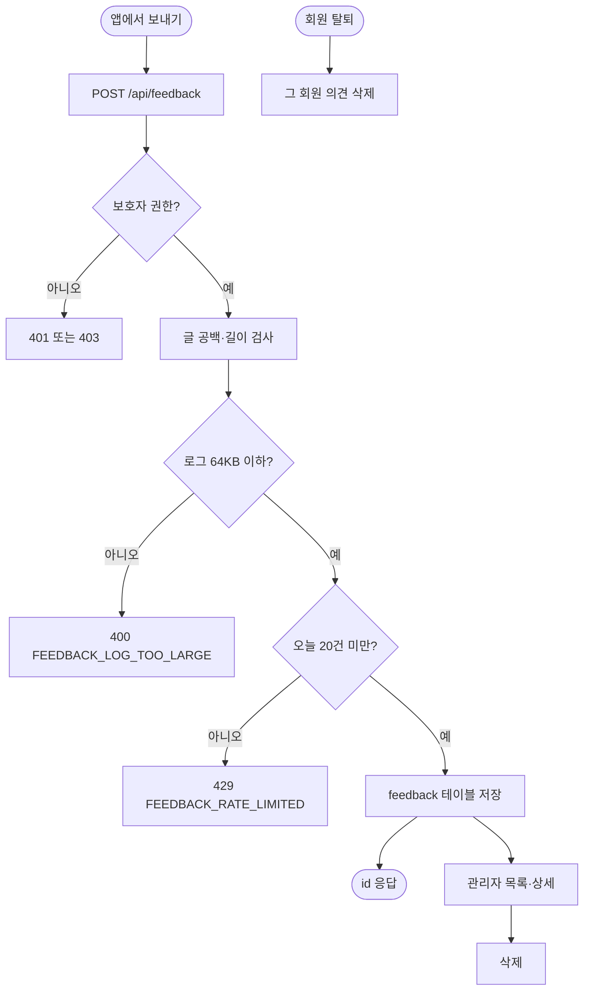

# 의견 보내기 저장과 관리자 조회 (서버)

## 개요

보호자가 앱에서 보낸 의견 글과 앱 상태 기록(최근 로그)을 받아 저장하는 `POST /api/feedback`을 만들었고, 관리자 화면에서 목록·상세·삭제를 볼 수 있다. PR #607로 운영에 나갔고 운영 서버에서 V34 적용·기동·실제 전송·관리자 조회·삭제까지 확인했다. 설계는 `docs/superpowers/specs/2026-10-08-의견-보내기-design.md`이다.

## 기능 흐름

## 변경 사항

### API와 저장
- `feedback/application/controller/FeedbackController(Docs).java`: 보호자 권한 `POST /api/feedback`. 요청 파라미터 로그를 껐다(`logParameters=false`).
- `feedback/application/service/FeedbackService.java`: 글은 `strip()` 뒤 2000자, 로그는 UTF-8 바이트 64KB(65536)까지. 앱 버전·OS는 32자·64자를 넘으면 거절하지 않고 잘라 저장한다. 하루 20건 상한. 빈 로그는 `null`로 저장한다.
- `feedback/infrastructure/entity/Feedback.java`, `FeedbackRepository.java`: `BaseEntity` 상속, `member_id`에는 외래키를 걸지 않는다.
- `db/migration/V34__create_feedback.sql`: 테이블과 `(member_id, created_at)` 인덱스.
- `ErrorCode.java`와 `messages_{ko,en}.properties`: `FEEDBACK_MESSAGE_EMPTY`, `FEEDBACK_MESSAGE_TOO_LONG`, `FEEDBACK_LOG_TOO_LARGE`, `FEEDBACK_RATE_LIMITED`, `FEEDBACK_NOT_FOUND`.
- `GlobalExceptionHandler.java`: `feedback` 패키지를 처리 대상에 추가. 빠지면 400·429가 500으로 나간다.

### 관리자
- `admin/application/controller/AdminFeedbackController.java`, `templates/admin/feedback.html`, `feedback-detail.html`: 최신순 목록, 상세(앱 버전·OS, 로그는 접어서 표시), 삭제. 사이드바에 "의견 관리" 추가. 의견은 사용자 입력이라 `th:text`로만 출력한다.
- `AdminViewExceptionHandler.java`: 새 컨트롤러 등록.

### 탈퇴 정리
- `FeedbackService.deleteAllOf`를 `MemberService.withdraw`와 `WithdrawnMemberService.purge`에서 부른다. 서비스를 거치게 한 이유는 `ArchitectureRulesTest`가 다른 도메인의 저장소 직접 사용을 동결(54건)해 두었기 때문이다.

## 주요 구현 내용

- 길이·공백 검사를 DTO 어노테이션이 아니라 서비스에서 한다(`server/CLAUDE.md`가 요청 DTO의 validation 어노테이션을 금지한다).
- 의견·앱 버전 같은 값은 길면 거절보다 잘라 저장하는 쪽이 낫다고 보았다. 글과 로그만 거절한다.
- 자동 삭제는 만들지 않았다. 사용자가 보관 기간을 두지 않기로 했고, 관리자가 지울 때까지 남는다.

## 검증

- 서버 전체 테스트 1622건 통과(DB가 필요한 통합 27건은 DB 없이 건너뜀). 새 테스트는 서비스·보안·관리자 컨트롤러.
- V34 SQL을 일회용 PostgreSQL 17에서 두 번 적용(재적용 안전).
- 운영: 새 컨테이너 `elum-back-green` 기동 39초, Flyway "34 - create feedback" 적용, 에러 문구 115개 확인, ERROR 0건, `/api/app/status` 200.
- 운영 E2E: 앱에서 보낸 `POST /api/feedback` 200(230ms). 체크를 끄면 본문 `appLog`가 `null`. 관리자 화면에서 목록(상태 기록 있음/없음), 상세(앱 버전 2.20.0, OS, 접은 로그 147줄)를 확인하고 테스트 의견 2건을 삭제했다(삭제 뒤 0건).

## 주의사항

- **의견 원문과 앱 로그가 서버 로그에 그대로 찍힌다.** `@LogMonitoring(logParameters=false)`를 껐지만 외부 라이브러리 `com.chuseok22:logging`이 요청 본문을 따로 찍는다(`chuseok22.logging`의 `sensitive-keys` 기본값이 비어 있다). 사용자가 원문이 찍혀도 된다고 정했다. 마스킹하려면 `chuseok22.logging.sensitive-keys`에 `message`, `appLog`를 넣으면 된다.
- 탈퇴 정리 검사(`WithdrawCoversMemberReferencesTest`)가 회원을 참조하는 새 표를 반드시 지우거나 남길 이유를 적게 한다. 이번에 이 검사에 걸려 탈퇴 때 의견을 지우는 쪽으로 했다. 표를 더 만들면 같은 검사를 지난다.
- 서버 `ErrorCode`에 `LOG_*` 5개가 있는데 앱이 모른다(`server_error_sync_test` 2건이 develop에서 이미 실패). 이번 변경과 무관하다.
- `ja`·`es`·`zh` 메시지 파일은 기존 코드 문구도 비어 있어서(en → ko 대체) 이번에도 채우지 않았다.

## 남은 일

- [ ] 약관·개인정보처리방침에 의견·앱 상태 기록 수집 문구가 필요한지 확인(법적 문구라 임의 변경 금지)
- [ ] 디자인 시안(#604) 반영은 클라 쪽
