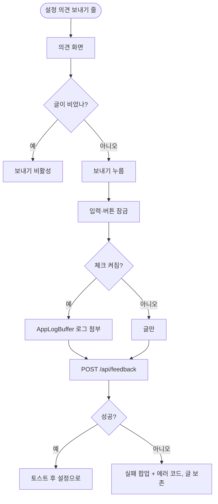

# 설정에서 의견 보내기와 앱 상태 기록 전송 (클라)

## 개요

보호자 설정의 `약관 및 개인정보처리방침`과 `앱 정보` 사이에 `의견 보내기` 줄을 두고, 새 화면에서 글을 적어 서버로 보낸다. "앱 상태 기록 보내기"(기본 켜짐)를 켜 두면 메모리에 쌓은 최근 로그를 함께 보낸다. 시안(#604)이 없어 입력창과 체크박스는 임시 모양이다. PR #607로 운영 빌드에 포함되었고 iOS 시뮬레이터에서 운영 서버와 직접 주고받아 확인했다. 설계는 `docs/superpowers/specs/2026-10-08-의견-보내기-design.md`이다.

## 기능 흐름

## 변경 사항

### 화면과 진입
- `features/feedback/presentation/feedback_screen.dart`, `widgets/feedback_text_box.dart`, `widgets/feedback_check_row.dart`: 여러 줄 입력(2000자), 체크박스, 보내기 버튼. `ElumScaffold`는 키보드가 올라와도 하단 버튼을 올려 주지 않아서 이 화면이 `viewInsets`로 직접 올린다.
- `core/router/routes.dart`, `routes_guardian.dart`: `/guardian/settings/feedback`. `/guardian` 접두라 이룸이 휴대폰은 기존 가드가 막는다.
- `guardian_settings_screen.dart`: `의견 보내기` 줄 추가.

### 전송과 로그
- `features/feedback/data/feedback_repository.dart`, `application/feedback_sender.dart`: `guarded`로 감싸고 실패 코드 `E-FEEDBACK`. 앱 버전과 OS를 함께 보낸다.
- `core/logger/app_log_buffer.dart`, `app_logger.dart`: 최근 200줄·50KB(UTF-8 바이트) 메모리 링버퍼. 디스크에 쓰지 않는다. `AppLogger`가 한 줄을 만들 때 항상 버퍼에도 추가한다.
- ARB(`app_ko.arb`, `app_en.arb`)와 `server_error_code.dart`: 문구와 서버 에러 코드 5개.

## 주요 구현 내용

- 기존 `DevLogBuffer`는 개발자 도구 빌드에서만 켜지고 "출시 전 제거 대상"이라고 적혀 있어 재사용하지 않고 `AppLogBuffer`를 새로 만들었다.
- 일반 빌드의 `AppLogger`는 값을 100자에서 자르고 목록은 개수만 남겨서, 로그에 들어가는 원문이 적다.
- 실패해도 글과 체크 상태를 남기고 다시 보낼 수 있다. 전송 중에는 입력·체크·뒤로가기를 잠가 중복 전송을 막는다.

## 검증

- 앱 전체 테스트 3043건 통과. 실패 3건: 서버 에러 코드 동기화 2건(서버 `LOG_*` 5개를 앱이 모르는 develop의 기존 문제)과 설정 시안 대조 1건(`의견 보내기` 줄이 시안에 없어 골든을 알려진 차이로 다시 찍음).
- 통합 develop(8cd107ed)에서 서버·클라 변경을 합쳐도 이번 코드의 동기화 항목은 통과.
- iOS 시뮬레이터(iPhone 16 Pro, 운영 서버)에서 확인: 설정 줄 위치, 빈 글에서 보내기 비활성, 키보드가 올라와도 버튼이 키보드 위, 보내기 200, 토스트 "의견을 보냈어요" 후 설정 복귀, 체크를 끄면 `appLog`가 `null`.

### 실기기 화면 (설정 줄 · 입력 화면 · 키보드 · 보낸 직후)

<table><tr>
<td></td>
<td></td>
<td></td>
<td></td>
</tr></table>

## 주의사항

- **설정 목록 아래쪽 줄이 스크롤 없이는 눌리지 않는 일이 있었다.** `의견 보내기` 줄(화면 높이의 약 92%)을 스크롤 전에 텍스트·좌표로 눌러도 반응이 없었고, 스크롤한 뒤에는 열렸다. 같은 조건의 `약관` 줄(약 85%)은 바로 눌렸다. 원인은 확정하지 못했다(시뮬레이터 자동 탭 한계일 수도 있다). 사람 손으로 한 번 눌러 확인이 필요하다.
- 키보드 상태는 시뮬레이터 실기기로 확인했지만 한글 입력, 글자 크기 200%, 오프라인 실패 시 글 보존은 위젯 테스트로만 확인했다.
- 입력창과 체크박스는 임시 모양이다. 앱에 체크박스 컴포넌트가 없어 새로 만들었고 시안(#604)이 나오면 모양만 바꾼다.
- 설정 시안 대조 골든(`test/figma/settings_1022-4467.png`)을 다시 찍었다. 의견 시안이 나오면 `settings_conformance_test.dart`의 "알려진 차이" 주석과 골든을 함께 바꾼다.
- 디버그 시뮬레이터 재설치 뒤에는 온보딩 비밀암호 화면이 먼저 떠서, 운영 계정에 값을 쓰지 않으려고 로컬 설정(plist)에 온보딩 완료를 넣어 밟았다.

## 남은 일

- [ ] 약관·개인정보처리방침에 의견·앱 상태 기록 수집 문구 확인(법적 문구라 임의 변경 금지)
- [ ] 디자이너 시안(#604) 반영
- [ ] 설정 하단 줄 탭 미반응을 실기기 손으로 확인
