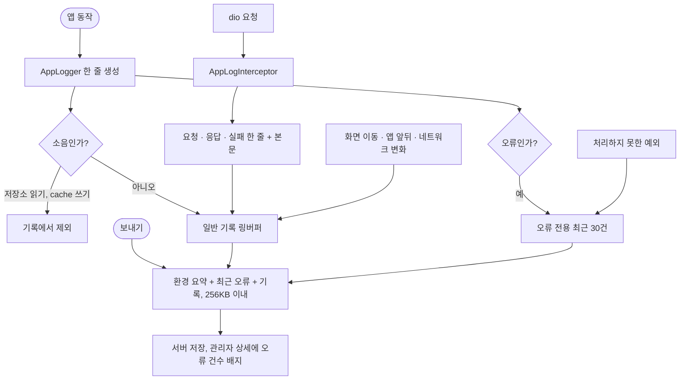

# 앱 상태 기록에 요청·응답·오류·화면 이동을 남겨 문제 추적에 쓴다

## 개요

의견 보내기(#606)로 서버에 올라온 앱 상태 기록이 문제를 찾는 데 쓸모가 없었다. 150줄 중 절반이 `SharedPreferences` 읽기 소음이었고, API 요청 주소·상태·본문, 처리하지 못한 예외, 화면 이동이 없었다. 이를 고쳐 이 기록만 보고 원인을 찾을 수 있게 했다. v2.24.0(PR #613)으로 배포했다.

## 기능 흐름

## 변경 사항

### 클라이언트
- `core/logger/app_log_buffer.dart`: 일반 기록(최대 1500줄)과 오류 전용 보관(최근 30건, 건당 6000자)으로 나눴다. `asText`가 `머리말 → 최근 오류 → 기록` 순으로 합치고 전체를 256KB(UTF-8) 안에서 일반 기록을 오래된 줄부터 잘라 맞춘다.
- `core/logger/app_logger.dart`: 저장소 읽기와 `cache.*` 쓰기는 기록에서 뺐다(콘솔 출력은 그대로). 오류는 스택 상위 12줄과 함께 오류 보관에도 넣는다.
- `core/network/app_log_interceptor.dart`(신규): 요청마다 `X-Request-Id`를 만들어 보내고 기록에 같은 id를 적는다. `→`, `←`, `✕` 한 줄에 상태 코드, 소요 시간, 서버 에러 코드, 본문(8000자 절단, 바이너리·이미지는 바이트 수만)을 담는다. `Authorization` 헤더와 의견 전송 본문은 적지 않고, `accessToken`·`refreshToken`·`idToken`·`token`·`password`·`pin`·`guardianPin`·`authorization`·`secret`·`code` 키의 값은 중첩 JSON까지 `****`로 가린다.
- `core/logger/app_diagnostics.dart` 외 3개(`app_log_route_observer`, `app_log_lifecycle_observer`, `app_log_connectivity`): 처리하지 못한 예외(`FlutterError.onError`, `PlatformDispatcher.onError`, 기존 핸들러 보존), 화면 이동, 앱 앞뒤, 네트워크 종류 변화를 남긴다.
- `core/logger/app_log_header.dart`, `feedback_sender.dart`: 보낼 때 앱 버전·빌드, OS, 언어, 글자 크기, 역할, 온보딩 완료 여부, 화면 크기를 머리말로 붙인다.

### 서버와 관리자
- `FeedbackService`: 기록 상한 64KB → 256KB. `Feedback.appLogErrorCount()`가 "최근 오류" 구역의 건수를 센다.
- 관리자 의견 목록·상세: 다른 관리자 화면과 같은 카드 모양(통계 카드, 의견 카드, 어두운 로그 창), 오류 건수 배지, 로그 복사 버튼, 상단 삭제·목록 버튼.

## 주요 구현 내용

- 용량 상한은 전체 256KB다. 보통 한 세션이 6KB 안팎이고 본문을 넣어도 60~100KB쯤이라, 본문 하나 8000자, 오류 30건을 합쳐 256KB로 잡았다.
- 오류를 따로 보관한 이유는 일반 기록 줄이 소음으로 가득 차도 오류가 밀려나지 않게 하려는 것이다.
- `X-Request-Id`는 서버 로깅 라이브러리가 그대로 받는 헤더라서, 앱 기록의 id로 서버 로그의 같은 요청을 찾을 수 있다.
- 사용자가 원문이 남아도 된다고 정했으므로 본문은 가리지 않았다. 다만 관리자 DB에 로그인 세션이 남지 않도록 토큰·암호·PIN만 가렸다.

## 검증

- 서버 테스트 1629건 통과. 새 관리자 템플릿 테스트(렌더, 이스케이프, 태그 짝, 오류 배지)를 추가했다.
- 앱 테스트 3055건 통과, 실패 3건 중 한글 리터럴 검사 1건과 테스트 하나는 고쳐서 통과, 서버 `LOG_*` 에러 코드 동기화 2건은 develop에 이미 있다.
- 배포(v2.24.0): `elum-back-blue` 18:36 기동 40초, ERROR 0건, 에러 문구 115개.
- 관리자 상세 화면을 직접 그려서 모양을 확인했다(오류 2건 배지, 환경 요약·오류·기록 순서의 로그 창).

## 주의사항

- **새 앱 빌드를 쓴 사용자의 기록부터 좋아진다.** 이미 올라온 의견의 기록은 옛 형식이다.
- 의견 전송 요청의 본문은 일부러 기록하지 않는다. 그렇지 않으면 전송 때마다 기록 안에 기록이 겹쳐 쌓인다.
- 토큰 갱신 때 첫 401 시도는 기록에 안 남고 재시도 결과만 새 id로 남는다. 최종 결과를 보려고 인터셉터를 맨 마지막에 붙인 대가다.
- 라우트 관찰자·연결 변화 기록은 단위 테스트가 없고 실기기로도 아직 확인하지 못했다.
- 서버 로그에는 의견 원문과 앱 기록이 그대로 찍힌다(외부 로깅 라이브러리). 사용자가 허용했다.
- 수집 항목이 늘었다. 약관·개인정보처리방침 문구 확인이 남아 있다(법적 문구라 임의 변경 금지).

## 남은 일

- [ ] 약관·개인정보처리방침에 수집 항목 확인
- [ ] 새 빌드로 실기기에서 의견을 보내 기록 내용(요청 id, 화면 이동, 오류 구역) 확인
- [ ] 쓰이지 않게 된 `SafeLogInterceptor` 정리(파일 삭제라 확인 후)
